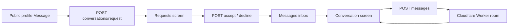

# Chat — Implementation Guide

**Audience:** humans and AI agents implementing this feature end-to-end.  
**Repos:** backend (`audio-social-backend`) + mobile app (`audio-social-app`) + Cloudflare Worker (realtime only).  
**Status:** implemented in code — run migrate, set env, deploy Worker (see task list).

**Schema:** Prisma models live in `prisma/schema.prisma` (`Conversation`, `Message`, enums). Do **not** paste or duplicate the full schema here — read the file. Run migrate + generate after schema is committed.

---

## 1. Goal

Wire the existing Messages / Requests / Conversation UI (today fixtures) to real APIs and live delivery:

1. User A sends a **message request** to User B (required even if they follow each other)
2. B sees it under **Requests** → Accept or Decline
3. Only after **Accept** both can exchange messages
4. v1 content: **text** and **voice-note audio** only
5. New messages appear live via **Cloudflare Workers** (no polling as the primary path)



---

## 2. Scope

### In scope

| # | Item |
|---|------|
| 1 | Prisma `Conversation` + `Message` (already in schema — migrate) |
| 2 | REST: request, accept/decline, inbox, requests list, history, send text |
| 3 | Voice notes: signed upload via **existing Supabase Storage**, then AUDIO message |
| 4 | Cloudflare Worker (+ Durable Object): fan-out after API write |
| 5 | Short-lived realtime join token from API |
| 6 | Mobile: replace fixtures with API + subscribe while thread is open |
| 7 | Design aligned with existing chat screens under `features/message` |

### Out of scope (do not build in this slice)

- Moving object storage to Cloudflare R2
- Supabase Realtime
- Custom Socket.io / long-lived WS on the Next.js server
- Groups, reactions, delete-for-everyone, edit message
- Sharing published library tracks as rich cards (fixture `shared-recording` stays unused or trimmed)
- Presence / typing indicators / read receipts (backend); UI stubs may remain inert
- Push notifications
- Block / mute / report
- Redesigning chat UI

---

## 3. Locked product decisions

1. **Every DM starts as a request** — mutual follow does **not** skip the gate.
2. **One conversation per user pair** — store participants as canonical `(userLowId, userHighId)` (lexicographically lower UUID first).
3. **Status lifecycle:** `PENDING` → `ACCEPTED` or `DECLINED`. Open chat only when `ACCEPTED`.
4. **Decline:** status → `DECLINED`. Sender may send a **new request** later (create/update back to `PENDING` with a new first message). At most **one PENDING** per pair.
5. **Request body:** initial **text** message created with the conversation. (Audio-on-request not required for v1.)
6. **While PENDING:** no back-and-forth messaging — only the request text is visible in the request UX.
7. **Audio = voice note** file in Supabase Storage (same signed-URL pattern as tracks), not “share a track from library.”
8. **Realtime:** Cloudflare Workers fan-out only. **Postgres via your API** is source of truth.
9. **Storage:** keep Supabase buckets for voice notes in this slice (R2 later, separate work).

---

## 4. Data model (reference only)

Source of truth: `prisma/schema.prisma`.

| Model / enum | Role |
|--------------|------|
| `ConversationStatus` | `PENDING` \| `ACCEPTED` \| `DECLINED` |
| `MessageType` | `TEXT` \| `AUDIO` |
| `Conversation` | Pair + status + `initiatedById` + `lastMessageAt` |
| `Message` | Belongs to conversation; `body` and/or `audioPath` + `durationMs` |

**Business rules (enforce in service):**

- Cannot message / request yourself → `400`
- Target user must exist → `404`
- Pair key: `userLowId = min(a,b)`, `userHighId = max(a,b)` (UUID string compare is fine if consistent)
- Accept / decline: only the **non-initiator**, and only when `PENDING`
- Send message: only if `ACCEPTED` and caller is `userLow` or `userHigh`
- `TEXT`: require non-empty `body`; `audioPath` null
- `AUDIO`: require `audioPath` (+ `durationMs`); `body` null
- On successful message insert: bump `conversation.lastMessageAt`
- After accept from `DECLINED`/`PENDING` flows: clear or keep history as product allows — **v1:** keep messages; new request after decline adds another message and sets `PENDING` again

---

## 5. Architecture

```text
Mobile
  │
  ├─ REST (app JWT) ──► Next.js API ──► Postgres
  │                         │
  │                         └─ notify Worker (service secret)
  │
  └─ WebSocket ─────────► Cloudflare Worker / Durable Object
                              room = conversation:{id}
```

- **Writes and authz:** always Next API + Prisma.
- **Realtime:** API broadcasts `message.created` (and optionally `conversation.accepted`) to the Worker; clients in that room receive events.
- **Reconnect:** REST history first, then WS for live appends.
- **Subscribe** only while the conversation screen is mounted (save free-tier connections).

---

## 6. Backend APIs

All routes require auth (`withAuth`), same envelope as tracks:

```json
{ "success": true, "message": "...", "data": { } }
```

Errors: existing `AppError` codes (`BAD_REQUEST`, `RESOURCE_NOT_FOUND`, `UNAUTHORIZED`, `FORBIDDEN`, …).

### 6.1 Create / renew message request

`POST /api/conversations/request`

```ts
// body
{ userId: string; body: string } // target user + request text
```

**Behavior:**

- Resolve pair; if no row → create `PENDING`, `initiatedById = viewer`, insert first `TEXT` message
- If `ACCEPTED` already → `400` (use send message instead) or return existing conversation id (prefer **400** with clear message)
- If `PENDING` and viewer is initiator → idempotent: return existing (optional: reject empty re-send)
- If `DECLINED` (or recipient previously declined) → set `PENDING`, set `initiatedById = viewer`, insert new `TEXT` message, update `lastMessageAt`

**Response `data`:** conversation summary + first/latest request message id.

### 6.2 Inbox (accepted)

`GET /api/conversations`

List conversations where viewer is a participant and `status = ACCEPTED`, newest `lastMessageAt` first.

Each item:

```ts
{
  id: string;
  status: "ACCEPTED";
  participant: {
    id: string;
    username: string;
    name: string | null;
  };
  previewKind: "text" | "voice-note";
  previewText: string;
  lastMessageAt: string | null;
  unread: boolean; // v1: may always be false until read-state exists
}
```

### 6.3 Incoming requests

`GET /api/conversations/requests`

`PENDING` conversations where **viewer is not** `initiatedById`.

```ts
{
  id: string; // conversation id
  participant: { id: string; username: string; name: string | null };
  message: string; // latest / request text
  requestedAt: string;
}
```

### 6.4 Accept / decline

`POST /api/conversations/:id/accept`  
`POST /api/conversations/:id/decline`

- Participant + non-initiator + `PENDING` only
- Accept → `ACCEPTED`; Decline → `DECLINED`
- Return updated conversation summary
- Optional: notify Worker so initiator’s UI can refresh if connected

### 6.5 Message history

`GET /api/conversations/:id/messages?cursor=&limit=`

- Participant only
- If `ACCEPTED`: full history (paginated, newest-first or oldest-first — pick one and stick; recommend **oldest-first page for chat UI** with `before` cursor)
- If `PENDING`: allow recipient/initiator to see request message(s) only as needed for Requests UI (or fold into requests list and skip this for PENDING)

Include signed **playback** URL for `AUDIO` rows when returning messages.

### 6.6 Send text

`POST /api/conversations/:id/messages`

```ts
{ type: "TEXT"; body: string }
```

- `ACCEPTED` + participant
- Insert message → update `lastMessageAt` → **broadcast** to Worker
- Return created message DTO

### 6.7 Voice note

`POST /api/conversations/:id/audio-upload-url`  
→ signed Supabase upload URL + storage `path` (prefix e.g. `chat/{userId}/{conversationId}/...`)

`POST /api/conversations/:id/messages/audio`

```ts
{ path: string; durationMs: number }
```

- Verify object exists (same pattern as track backup complete)
- Insert `AUDIO` message → broadcast

### 6.8 Realtime join token

`POST /api/conversations/:id/realtime-token`

- Participant + (`ACCEPTED`, or optionally `PENDING` if you want live request updates)
- Returns short-lived JWT/HMAC payload: `{ conversationId, userId, exp }` for Worker validation

### 6.9 Explicitly not in this slice

- Read receipts APIs
- Typing / presence APIs
- Delete message
- Attach published track by id

---

## 7. Cloudflare Worker

**Role:** fan-out only — never the source of truth.

1. Client connects with `realtime-token` from §6.8
2. Worker validates token, attaches socket to Durable Object `ConversationRoom:{conversationId}`
3. Backend calls Worker (shared secret): `POST` `{ type: "message.created", message }` (and similar events)
4. DO broadcasts to sockets in that room
5. Client disconnects on leaving the conversation screen

**Do not** accept arbitrary client “send message” over the Worker without going through the Next API.

**Env (Worker):** verify secret / public key for tokens; backend notify secret.  
**Env (Next):** Worker base URL + notify secret.

Free-tier habits: one room per open thread; no global “all chats” socket for v1.

---

## 8. Backend code map

Mirror tracks / follow modules:

| Area | Suggested path |
|------|----------------|
| Prisma | `prisma/schema.prisma` + migration |
| Conversation service | `src/server/modules/conversation/conversation.service.ts` |
| Message helpers | same module or `message.service.ts` |
| Validators | `conversation.validator.ts` |
| Storage paths | extend `storage-path.ts` / `storage.config.ts` for chat prefix |
| Realtime notify | `src/server/lib/realtime-notify.ts` (HTTP to Worker) |
| Routes | `src/app/api/conversations/...` |
| OpenAPI | `src/server/openapi/paths/conversations.paths.ts` + schemas |

**Patterns to copy:** `withAuth`, Zod validators, `AppError`, OpenAPI registration like tracks.

### Backend implement order

1. Migrate + generate (schema already drafted)
2. Conversation service: pair key, request, accept, decline, lists
3. Messages: text send + history
4. Audio upload URL + complete
5. Realtime token + notify stub (log no-op until Worker exists)
6. OpenAPI
7. Worker + wire notify
8. Smoke-test with HTTP client

---

## 9. Mobile app

### 9.1 Design

Do **not** invent a new look. Reuse `features/message` screens and components:

- `MessagesScreen`, `RequestsScreen`, `ConversationScreen`
- `ConversationRow`, `RequestCard`, `MessageBubble`, `ConversationComposer`, etc.

### 9.2 Data wiring

| Today | Change |
|-------|--------|
| `message.fixtures.ts` + Zustand store | API client + React Query (same style as users/follow) |
| Local `sendTextMessage` / `acceptRequest` | Call REST; invalidate lists |
| No sockets | On conversation mount: history query → open Worker WS → append → cleanup on unmount |

Keep Zustand only for ephemeral UI (search query, composer draft) if useful.

### 9.3 Entry points

- Chat tab → inbox / requests (already routed)
- Public profile **Message** button → `POST /conversations/request` flow (composer for first text, or dedicated sheet) then navigate appropriately
- After accept → open `/message/{conversationId}`

### 9.4 Audio UX

- Composer: text now; add voice-note capture → upload URL → complete message
- Map API `AUDIO` → bubble UI (adapt or replace fixture `shared-recording` card; do not require library track sharing)

### 9.5 Cleanup

Remove fixture seed data and mock store mutations once API paths are stable.

---

## 10. Defaults (locked unless product changes)

| Topic | v1 default |
|-------|------------|
| Audio | Voice note in Supabase Storage |
| Shared track card | Out of scope |
| Re-request after decline | Allowed → new `PENDING` |
| Messaging while `PENDING` | Request text only; no thread chat |
| Unread / seen | Optional stub; no backend required |
| Online pip | UI-only / ignore |
| Push | Later |

---

## 11. Task list (implement in this order)

1. [x] Commit Prisma schema + `prisma migrate` / `generate` (no schema paste in this doc) — *migration committed; run `migrate deploy` with local `.env`*
2. [x] Backend REST: request, accept, decline, inbox, requests, text messages, history
3. [x] Mobile: wire request + inbox + text thread (drop fixtures for those paths)
4. [x] Voice note upload + AUDIO messages (API + app)
5. [x] Realtime token endpoint + Cloudflare Worker/DO + notify after write — *Worker scaffold in `workers/chat-realtime`; needs deploy + env*
6. [x] App: subscribe on conversation screen
7. [x] OpenAPI paths + unit tests (`tests/unit/conversation.service.test.ts`)
8. [x] Trim unused fixture paths; empty/error states

---

## 12. Explicit non-goals reminder

Supabase = **Postgres (+ existing Storage for audio files)**.  
Cloudflare = **Workers realtime** (and R2 only in a later storage migration).  
Next API = **auth, rules, persistence**.
