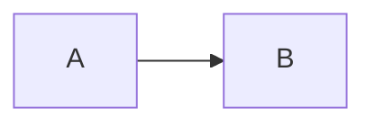

# \<Feature name\> — Implementation Guide

**Audience:** teammates and AI agents implementing this feature end-to-end.  
**Repos:** backend (`audio-social-backend`) + mobile app (`audio-social-app`) [adjust if one-sided].  
**Status:** `Planned` | `Partial` | `Done` — one line on what’s shipped vs open.  
**Do not** invent Prisma models or alternate APIs; read `prisma/schema.prisma` and this doc.

**Related docs:** `../project-context.md`, `./other-feature.md`

**Naming** (optional table):

| Term | Meaning |
|------|---------|

---

## 1. Goal

1. …
2. …



---

## 2. Scope

### In scope

| # | Item |
|---|------|
| 1 | … |

### Out of scope

- …

---

## 3. Locked product decisions

1. …
2. …

---

## 4. Data model (reference only)

Source of truth: `prisma/schema.prisma`.

| Model / field | Role |
|---------------|------|
| … | … |

---

## 5. Backend APIs

Auth + envelope: `{ success, message, data }` / `AppError`. Follow `.agents/skills/audio-backend-api-patterns`.

| Method | Path | Notes |
|--------|------|-------|
| `GET` | `/api/...` | … |

### DTOs

```ts
// sketches only — keep aligned with OpenAPI + services
```

---

## 6. Business rules (service)

- …

---

## 7. Architecture notes

```text
App → API → service → Prisma / storage
```

---

## 8. Backend code map

| Area | Path |
|------|------|
| Service | `src/server/modules/...` |
| Routes | `src/app/api/...` |
| OpenAPI | `src/server/openapi/paths/...` |

### Backend implement order

1. …

---

## 9. Mobile app

### Flows

- …

### Code map

| Area | Path |
|------|------|
| Feature | `src/features/...` |

---

## 10. Defaults

| Topic | v1 default |
|-------|------------|
| … | … |

---

## 11. Task list (code vs doc — keep honest)

Re-check against the repo before assigning. Unchecked = remaining work.

### Backend

- [ ] …
- [x] …

### App

- [ ] …
- [x] …

### Docs / tests / polish

- [ ] OpenAPI aligned  
- [ ] Unit tests (if required for this slice)  
- [ ] Update `../project-context.md` status row when this milestone closes  

---

## 12. Non-goals reminder

- …

---

## 13. Code review notes (optional)

Gaps found when comparing this doc to current code (date: YYYY-MM-DD):

- …
