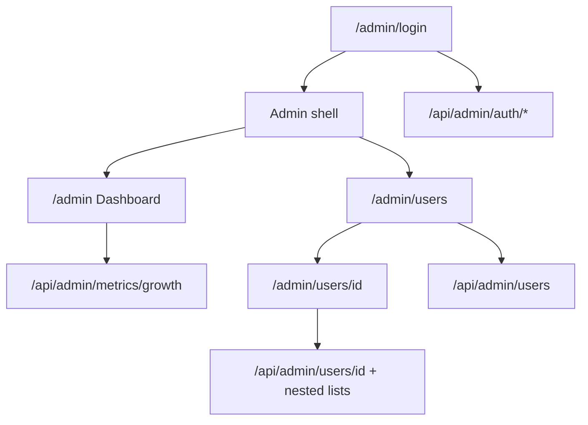

# Admin Panel — Implementation Guide

**Audience:** teammates and AI agents building the Next.js admin portal (UI + admin APIs) in `audio-social-backend`.  
**Repos:** `audio-social-backend` only (`/admin/*` pages, `src/admin/**`, `/api/admin/**`). Not the Expo app.  
**Status:** `Planned` — foundation auth in [`admin.md`](./admin.md); this doc locks v1 panel screens and supporting APIs.  
**Do not** invent Prisma models; read `prisma/schema.prisma`. Do not invent mobile routes.

**Related docs:** [`../project-context.md`](../project-context.md), [`./admin.md`](./admin.md), [`./contests.md`](./contests.md) (Contests admin UI - later slice), [`../../DESIGN.md`](../../DESIGN.md)  
**Skills:** `nextjs-admin-design-system`, `nextjs-admin-api-patterns`, `audio-backend-api-patterns`, `AGENTS.md` craftsmanship.

---

## 1. Goal

1. Ship a same-repo **admin web app** at `/admin` with Super Admin login (HttpOnly cookies).
2. Provide a **sidebar shell** and two working areas: **Dashboard** and **Users**.
3. Dashboard shows **real** growth charts (new users + newly published tracks) with **7d / 30d** range.
4. Users: searchable table + **read-only** detail (profile summary + published tracks, playlists, albums, feed clips).
5. Define the **admin APIs** required for those screens so UI and backend can land together.



---

## 2. Scope

### In scope (v1)

| # | Item |
|---|------|
| 1 | Login page + HttpOnly cookie session (login / me / logout; align cookie behavior with [`admin.md`](./admin.md)) |
| 2 | Authenticated shell: sidebar + top bar + page header |
| 3 | Nav: **Dashboard**, **Users** only |
| 4 | Dashboard: title + two growth charts (users, published tracks) + 7d/30d toggle |
| 5 | Users list: search + paginated table |
| 6 | User detail: read-only header + tabs (Tracks, Playlists, Albums, Feed clips) |
| 7 | Admin APIs: auth cookies, metrics growth, users list/detail/nested lists |
| 8 | Seed Super Admin (see [`admin.md`](./admin.md)) |

### Out of scope (v1)

- Coins, Contests, Subscriptions nav or pages (add when those modules ship)
- User moderation actions (disable, ban, edit profile) - **read-only**
- Multi-role RBAC
- Fake / decorative charts without API data
- Expo admin UI

### Later: Contests (not v1)

When Contests ship, add sidebar **Contests** and routes `/admin/contests`, `/admin/contests/new`, `/admin/contests/[id]`, `/admin/contests/[id]/edit`. Full screen specs, APIs, placement/payout modes, cancel, and confirm/auto resolve live in [`./contests.md`](./contests.md) - do not duplicate here.

---

## 3. Locked product / UX decisions

1. **Session:** HttpOnly cookies on same origin (`/admin` + `/api/admin`). No `localStorage` admin tokens. Mobile user JWTs never work on admin routes.
2. **Nav v1:** Dashboard + Users only. Do not stub other sections until built.
3. **Dashboard range:** toggle **7 days** or **30 days**; series is **one point per calendar day** in that window.
4. **Charts must be real:** if the metrics API fails, show error + retry; while loading, chart skeletons (not a full-page spinner).
5. **Users search:** query matches **username**, **name**, or **email** (case-insensitive contains). No “has published track” filter in v1.
6. **User detail:** read-only. No admin mutations on the user.
7. **Design:** follow root [`DESIGN.md`](../../DESIGN.md) + admin design skill + `AGENTS.md` anti-slop rules.
8. **Page titles:** e.g. `Dashboard | VibeOGram Admin`, `Users | VibeOGram Admin`.

---

## 4. Routes (UI)

| Path | Screen |
|------|--------|
| `/admin/login` | Admin login (public) |
| `/admin` | Dashboard (auth) |
| `/admin/users` | Users list (auth) |
| `/admin/users/[id]` | User detail (auth) |

Unauthenticated visits to `/admin/**` (except login) redirect to `/admin/login`.  
Authenticated visits to `/admin/login` redirect to `/admin`.

### Shell

- Fixed sidebar: brand mark “VibeOGram Admin”, links Dashboard + Users, active state uses primary accent.
- Top bar: admin name/email + logout.
- Main: page title + content.

### Login

- Centered `max-w-[360px]`: email, password (visibility toggle), primary Sign in.
- Errors via field or toast. No marketing chrome.

### Dashboard

- Title: Dashboard.
- Control: segment or tabs **7 days** | **30 days** (default **7 days**).
- Two charts side by side on wide screens (stack on narrow):
  1. **User growth** - new `User` rows per day (`createdAt`)
  2. **Published tracks growth** - tracks that became published per day (`publishedAt` where `status = PUBLISHED`)
- Optional KPI row above charts: total users, total published tracks (from same metrics payload). Allowed; keep sparse.

### Users list

**Columns**

| Column | Source |
|--------|--------|
| Avatar | `avatarUrl` |
| Name | `name` (fallback em dash alternative: show `-` or username) |
| Username | `username` |
| Email | `email` |
| Joined | `createdAt` |
| Tracks | count of **published** tracks |
| Followers | follower count |
| Following | following count |

Row click → `/admin/users/[id]`.  
Search input debounced (~300ms). Pagination: `page` + `pageSize` (default 20, max 50).  
Loading: `TableSkeleton`.

### User detail

**Header (read-only)**

- Avatar, cover thumb optional, name, `@username`, email, bio, joined
- Counts: published tracks, playlists (owned), albums (owned), feed clips, followers, following

**Tabs** (paginated tables)

| Tab | Shows |
|-----|--------|
| Tracks | Published tracks: title, cover, publishedAt, playCount, likeCount |
| Playlists | Owned playlists: title, visibility, track count, updatedAt |
| Albums | Owned albums: title, status, releasedAt, track count |
| Feed clips | Clips: linked track title, durationMs, likeCount, createdAt |

No edit/delete actions in v1.

---

## 5. APIs (all `withAdminAuth` except login)

Envelope: `{ success, message, data }` (errors include `code`). OpenAPI under `src/server/openapi/paths/`.

### 5.1 Auth (extends [`admin.md`](./admin.md))

| Method | Path | Notes |
|--------|------|--------|
| `POST` | `/api/admin/auth/login` | Body `{ email, password }`. On success set **HttpOnly** admin cookie(s); `data.admin` profile. Prefer not requiring client-stored Bearer for the portal. |
| `GET` | `/api/admin/auth/me` | Cookie session; returns admin profile. |
| `POST` | `/api/admin/auth/logout` | Clears admin cookie(s). |

Update [`admin.md`](./admin.md) implementation to set/clear cookies for the portal (may still return tokens for Postman if useful). Refresh endpoint: optional later; document before adding.

### 5.2 Metrics growth

`GET /api/admin/metrics/growth?range=7d|30d`

**Behavior**

- `range=7d` → last 7 calendar days including today (7 points).
- `range=30d` → last 30 calendar days including today (30 points).
- Each point: `{ date: "YYYY-MM-DD", usersCreated: number, tracksPublished: number }`.
- Also return totals: `{ totalUsers, totalPublishedTracks }` (all-time counts).

**Example `data`**

```ts
{
  range: "7d",
  series: [
    { date: "2026-11-21", usersCreated: 2, tracksPublished: 5 },
    // ...
  ],
  totals: {
    totalUsers: 1204,
    totalPublishedTracks: 890,
  },
}
```

Days with zero activity still appear with `0`.

### 5.3 Users list

`GET /api/admin/users?q=&page=1&pageSize=20`

| Query | Rules |
|-------|--------|
| `q` | Optional string; filter username / name / email contains |
| `page` | 1-based, default 1 |
| `pageSize` | default 20, max 50 |

**Item DTO**

```ts
{
  id: string;
  email: string;
  username: string;
  name: string | null;
  avatarUrl: string | null;
  createdAt: string; // ISO
  publishedTrackCount: number;
  followerCount: number;
  followingCount: number;
}
```

**`data`:** `{ items, page, pageSize, total }`.

### 5.4 User detail

`GET /api/admin/users/:id`

```ts
{
  id: string;
  email: string;
  username: string;
  name: string | null;
  bio: string | null;
  avatarUrl: string | null;
  coverUrl: string | null;
  createdAt: string;
  counts: {
    publishedTracks: number;
    playlists: number;
    albums: number;
    feedClips: number;
    followers: number;
    following: number;
  };
}
```

404 if user missing. Never return `password` or auth secrets.

### 5.5 User nested lists

All: `page`, `pageSize` (default 20, max 50). Return `{ items, page, pageSize, total }`.

| Method | Path | Items |
|--------|------|--------|
| `GET` | `/api/admin/users/:id/tracks` | Published only: `id`, `title`, `coverUrl`, `publishedAt`, `playCount`, `likeCount` |
| `GET` | `/api/admin/users/:id/playlists` | `id`, `title`, `visibility`, `trackCount`, `updatedAt` |
| `GET` | `/api/admin/users/:id/albums` | `id`, `title`, `status`, `releasedAt`, `trackCount` |
| `GET` | `/api/admin/users/:id/feed-clips` | `id`, `trackId`, `trackTitle`, `durationMs`, `likeCount`, `createdAt` |

---

## 6. Backend modules (suggested)

| Area | Location |
|------|----------|
| Auth | `src/server/modules/admin/` (existing plan in [`admin.md`](./admin.md)) |
| Metrics | `src/server/modules/admin/admin-metrics.service.ts` |
| Users admin | `src/server/modules/admin/admin-users.service.ts` |
| Routes | `src/app/api/admin/**` |
| UI | `src/app/admin/**`, `src/admin/components/**`, `src/admin/api/**` |

Follow `audio-backend-api-patterns` for services/validators/OpenAPI.  
Follow `nextjs-admin-api-patterns` for client hooks/registries.

---

## 7. Implementation checklist

### Backend
- [ ] Admin auth + cookies + seed ([`admin.md`](./admin.md))
- [ ] `GET /api/admin/metrics/growth`
- [ ] `GET /api/admin/users`
- [ ] `GET /api/admin/users/:id`
- [ ] Nested list routes (tracks, playlists, albums, feed-clips)
- [ ] OpenAPI paths for all of the above

### Admin UI
- [ ] Design tokens / ui primitives / shared composites (`DESIGN.md`)
- [ ] Login page
- [ ] Shell (sidebar Dashboard + Users, top bar logout)
- [ ] Dashboard charts + 7d/30d
- [ ] Users table + search + pagination
- [ ] User detail + four tabs

### Build order
1. Auth APIs + seed + login UI + session gate  
2. Shell  
3. Metrics API + Dashboard  
4. Users list API + table  
5. User detail API + nested lists + detail UI  

---

## 8. Non-goals reminder

- No Contests / Coins / Subscriptions in this **v1** slice (Contests UI → [`./contests.md`](./contests.md)).  
- No write actions on users.  
- No mobile app changes.  
- Charts only from `/api/admin/metrics/growth` (or documented successor).
