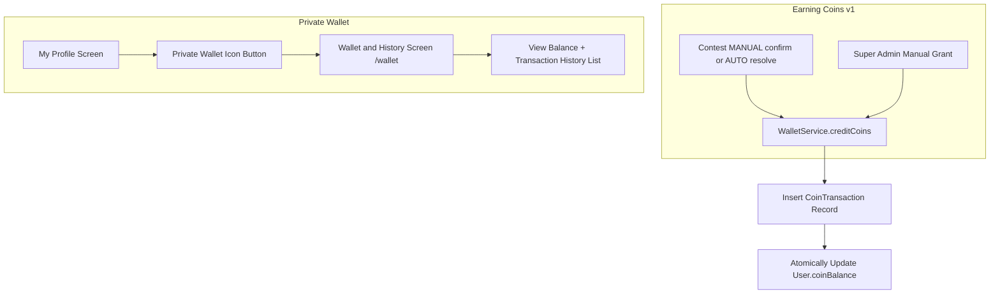

# Coin Wallet & Ledger — Implementation Guide

**Audience:** teammates and AI agents implementing the virtual coin wallet, transaction ledger, and admin grant features end-to-end.  
**Repos:** backend (`audio-social-backend`) + mobile app (`audio-social-app`).  
**Status:** `Done` (ledger + wallet v1) - Append-only coin ledger, `User.coinBalance`, admin grant/audit APIs, `creditCoins` for Contests, and private mobile Wallet screen.  
**Next (planned):** Admin portal Coins UI (grant + ledger) - see section 9 below and [`./admin-panel.md`](./admin-panel.md). Then contest receive UX - [`./contest-rewards-ux.md`](./contest-rewards-ux.md).  
**Do not** invent Prisma models or alternate APIs; read `prisma/schema.prisma` and this doc.

**Related docs:** [`../project-context.md`](../project-context.md), [`./admin.md`](./admin.md), [`./admin-panel.md`](./admin-panel.md), [`./contests.md`](./contests.md), [`./contest-rewards-ux.md`](./contest-rewards-ux.md)

**Terminology:**

| Term | Meaning |
|------|---------|
| **Coin Balance** | The current integer total of virtual coins owned by a user (`User.coinBalance`). |
| **Coin Transaction Ledger** | Append-only audit log table (`CoinTransaction`) recording every coin inflow (grant, reward) with running balance snapshot. |
| **Private Wallet** | User-facing mobile UI on `MyProfileScreen` showing coin balance and transaction history. Never visible on public profiles. |
| **Admin Grant** | Direct awarding of coins to a user by the Super Admin using `withAdminAuth`. |

---

## 1. Goal

1. Establish a secure **virtual coin currency system** for VibeOGram.
2. In v1, coins are **earned only** via:
   - **Contest Rewards** (MANUAL confirm or AUTO resolve on Closed — see [`./contests.md`](./contests.md)).
   - **Super Admin Grants** (manual rewards or promotions).
3. Use an **append-only ledger** (`CoinTransaction`) so every coin balance change is recorded with an audit trail, description, and `balanceAfter` snapshot (balance is never updated without a ledger row).
4. Provide Super Admin APIs under `withAdminAuth` to grant coins to any user.
5. Provide user APIs under `withAuth` to view personal private wallet balance and transaction history.
6. Provide a dedicated **Wallet Screen** in the mobile app, accessible exclusively from the user's own profile.
7. Enforce the invariant that coin balance can **never go negative** (`balance >= 0`).



---

## 2. Scope

### In scope

| # | Item |
|---|------|
| 1 | **Prisma Migration**: Add `coinBalance Int @default(0)` to `User` and create `CoinTransaction` model + `CoinTransactionType` enum. |
| 2 | **Wallet Service**: Shared backend service `wallet.service.ts` with atomic transaction handling (`creditCoins`, `getBalance`, `getHistory`). |
| 3 | **Super Admin API**: `POST /api/admin/coins/grant` guarded by `withAdminAuth` to award coins to any user. |
| 4 | **User Wallet APIs**: `GET /api/me/wallet` returning balance and paginated history; update `GET /api/user` to include `coinBalance`. |
| 5 | **Mobile Profile Entry**: Add private wallet icon/button to `MyProfileScreen` (hidden on `PublicProfileScreen`). |
| 6 | **Mobile Wallet Screen**: Dedicated screen (`/wallet`) showing current coin balance card, explanatory info banner, and transaction list. |

### Out of scope (v1)

- Spending coins / purchasing digital goods (deferred to later monetization phase).
- Cashing out / withdrawing coins for fiat money.
- Peer-to-peer tipping between users.
- In-app purchase (IAP) integration with Apple StoreKit or Google Play Billing.
- Admin portal Coins pages (planned next; APIs already shipped - see section 9).

---

## 3. Locked Product Decisions

1. **Earned Only in v1:** In this phase, coins are acquired exclusively through **Contest Rewards** (`creditCoins` from contest MANUAL confirm or AUTO Closed resolve — see [`./contests.md`](./contests.md)) and **Super Admin Grants**. No spending or cashout mechanisms are enabled yet.
2. **Append-only Ledger Audit Trail:** Coin balances must **never** be updated in isolation. Any change to `User.coinBalance` MUST occur inside a Prisma interactive transaction (`prisma.$transaction`) alongside an inserted `CoinTransaction` record. Idempotent contest payouts use unique `(type, referenceId)`.
3. **No Negative Balance:** Under no circumstances can a user's coin balance drop below 0 (`balance >= 0`).
4. **Strictly Private:** A user's coin balance and transaction history are private financial data. They are **never** exposed on public artist profiles (`GET /api/users/:id`), public search, or feed cards.
5. **Admin Isolation:** Manual grants can only be issued by the authenticated Super Admin via `POST /api/admin/coins/grant` using `withAdminAuth`.
6. **Running Balance Snapshot:** Every ledger row stores `balanceAfter` at the moment of execution for instant reconciliation and fraud prevention.
7. **Contest payout UX (planned):** Contest coins remain **auto-credit** into spendable balance (no claimable pending state). Receive moment, notifications, celebration, `prizeNote` privacy, and public wins medals are specified in [`./contest-rewards-ux.md`](./contest-rewards-ux.md) — do not invent a Claim ledger without updating that doc.

---

## 4. Data Model & Prisma Migration

Add to `prisma/schema.prisma`:

```prisma
enum CoinTransactionType {
  CONTEST_REWARD
  ADMIN_GRANT
}

model CoinTransaction {
  id           String              @id @default(uuid(7)) @db.Uuid
  userId       String              @db.Uuid
  user         User                @relation(fields: [userId], references: [id], onDelete: Cascade)
  
  /// Positive integer for earned coins in v1 (e.g. +500)
  amount       Int
  
  /// Running snapshot of balance after this transaction completed
  balanceAfter Int

  type         CoinTransactionType
  description  String              // e.g. "Awarded by admin: Great beta track feedback" or "Won 1st place in Summer Acoustic Jam"
  
  /// Optional reference key (e.g. contest payout id); unique with type when set
  referenceId  String?
  
  createdAt    DateTime            @default(now())

  @@unique([type, referenceId])
  @@index([userId, createdAt(sort: Desc)])
}
```

Update `User` model in `prisma/schema.prisma`:
```prisma
model User {
  // ... existing fields
  coinBalance      Int               @default(0)
  coinTransactions CoinTransaction[]
  // ... existing relations
}
```

### Migration Instructions:
1. Run migration in development:
   ```sh
   npx prisma migrate dev --name add_coin_wallet_and_ledger
   ```
2. Generate the updated Prisma client:
   ```sh
   npx prisma generate
   ```

---

## 5. Backend Architecture & APIs

All endpoints follow `@/server/utils/route`, Zod validation, and the standard envelope:
`{ "success": true, "message": "...", "data": { ... } }`.

### 5.1 Super Admin: Grant Coins (`POST /api/admin/coins/grant`)
- **Auth:** Required via `withAdminAuth`.
- **Body Schema (Zod):**
  ```ts
  export const adminGrantCoinsSchema = z.object({
    userId: z.string().uuid(),
    amount: z.number().int().positive().max(100000), // Max 100k per grant
    reason: z.string().min(3).max(255).trim(),
  });
  ```
- **Service Behavior:**
  - Verifies target user exists.
  - Runs in `prisma.$transaction`:
    1. Updates `User`: `coinBalance = coinBalance + amount`.
    2. Inserts `CoinTransaction`:
       - `userId`: target user id
       - `amount`: `+amount`
       - `balanceAfter`: `user.coinBalance + amount`
       - `type`: `ADMIN_GRANT`
       - `description`: `reason`
  - Returns:
    ```json
    {
      "success": true,
      "message": "Coins granted successfully",
      "data": {
        "userId": "uuid",
        "grantedAmount": 500,
        "newBalance": 1500
      }
    }
    ```

### 5.2 Super Admin: View All Transactions (`GET /api/admin/coins/transactions`)
- **Auth:** Required via `withAdminAuth`.
- **Query:** `limit=20&cursor=...&userId=...`
- **Behavior:** Global audit view of all transactions across all users.

### 5.3 User: Get Private Wallet (`GET /api/me/wallet`)
- **Auth:** Required via `withAuth`.
- **Query:** `limit=20&cursor=...`
- **Behavior:**
  - Fetches viewer's `coinBalance`.
  - Fetches paginated list of `CoinTransaction` rows ordered by `createdAt desc`.
- **Response `200`:**
  ```ts
  export type WalletDto = {
    balance: number;
    transactions: {
      id: string;
      amount: number;
      balanceAfter: number;
      type: 'CONTEST_REWARD' | 'ADMIN_GRANT';
      description: string;
      createdAt: string;
    }[];
    nextCursor: string | null;
  };
```

### 5.4 Update Me Endpoint (`GET /api/user`)
- Add `coinBalance: number` to the private user session payload so mobile app header/profile has the current balance cached without an extra network call.

---

## 6. Shared Wallet Service (`wallet.service.ts`)

File: `src/server/modules/wallet/wallet.service.ts`

```ts
import { prisma } from '@/server/config/prisma';
import { AppError } from '@/server/utils/app-error';
import type { CoinTransactionType } from '@/generated/prisma';

export class WalletService {
  async creditCoins(params: {
    userId: string;
    amount: number;
    type: CoinTransactionType;
    description: string;
    referenceId?: string | null;
  }) {
    if (params.amount <= 0) {
      throw new AppError('Credit amount must be greater than zero', 400, 'BAD_REQUEST');
    }

    return prisma.$transaction(async (tx) => {
      const user = await tx.user.findUnique({
        where: { id: params.userId },
        select: { id: true, coinBalance: true },
      });

      if (!user) {
        throw new AppError('User not found', 404, 'NOT_FOUND');
      }

      const newBalance = user.coinBalance + params.amount;

      const [updatedUser, transaction] = await Promise.all([
        tx.user.update({
          where: { id: params.userId },
          data: { coinBalance: newBalance },
          select: { id: true, coinBalance: true },
        }),
        tx.coinTransaction.create({
          data: {
            userId: params.userId,
            amount: params.amount,
            balanceAfter: newBalance,
            type: params.type,
            description: params.description,
            referenceId: params.referenceId ?? null,
          },
        }),
      ]);

      return {
        newBalance: updatedUser.coinBalance,
        transaction,
      };
    });
  }

  async getWallet(userId: string, limit = 20, cursor?: string) {
    const user = await prisma.user.findUnique({
      where: { id: userId },
      select: { coinBalance: true },
    });

    if (!user) {
      throw new AppError('User not found', 404, 'NOT_FOUND');
    }

    const items = await prisma.coinTransaction.findMany({
      where: { userId },
      take: limit + 1,
      cursor: cursor ? { id: cursor } : undefined,
      orderBy: { createdAt: 'desc' },
    });

    const hasNext = items.length > limit;
    const records = hasNext ? items.slice(0, limit) : items;
    const nextCursor = hasNext ? records[records.length - 1].id : null;

    return {
      balance: user.coinBalance,
      transactions: records,
      nextCursor,
    };
  }
}

export const walletService = new WalletService();
```

---

## 7. Mobile App Experience & Architecture

### 7.1 Profile Screen Integration
1. **`MyProfileScreen` (Owner View):**
   - Private **Wallet** action next to Edit / Library (label includes cached balance).
   - Tapping navigates to `/wallet`.
2. **`PublicProfileScreen` (Other Users' View):**
   - Strictly **hidden**. No visitor can see another artist's coin balance or transactions.

### 7.2 Wallet Screen (`src/features/wallet/screens/wallet-screen.tsx`)
- **Route:** `/wallet` (Expo Router).
- **Header:** Back button + "Wallet & Rewards".
- **Balance Card (Hero):**
  - Surface card with total available coins.
  - Large balance number.
- **Info Banner:**
  - *"Earn coins by winning community contests and admin rewards. More perks coming later."*
- **Transaction History List:**
  - Title: *"Activity History"*.
  - Empty state: *"No transactions yet. Win a contest or receive a grant to earn coins."*
  - Item Row:
    - Left: Icon badge (Award for `CONTEST_REWARD`, Star for `ADMIN_GRANT`).
    - Center: Transaction description and relative date (`2 days ago`).
    - Right: Incoming amount: `+500`.

---

## 8. Implementation Checklist

### Backend:
- [x] Update `prisma/schema.prisma` with `coinBalance` on `User` and `CoinTransaction` model.
- [x] Run migration: `add_coin_wallet_and_ledger`.
- [x] Run client generation: `npx prisma generate`.
- [x] Create `src/server/modules/wallet/wallet.validator.ts`.
- [x] Create `src/server/modules/wallet/wallet.service.ts`.
- [x] Implement user route: `src/app/api/me/wallet/route.ts` (GET).
- [x] Update `GET /api/user` (`MeDto`) to include `coinBalance`.
- [x] Implement admin routes: grant + transactions (`withAdminAuth`).
- [x] Register routes in OpenAPI under `src/server/openapi/paths/wallet.paths.ts`.

### Mobile App:
- [x] Create `src/features/wallet/api/service.ts`, `hooks.ts`, and `types.ts`.
- [x] Build `WalletScreen` in `src/features/wallet/screens/wallet-screen.tsx`.
- [x] Add route `/wallet` in Expo Router (`src/app/wallet.tsx`).
- [x] Add wallet action with coin balance to `MyProfileScreen`.
- [x] Wallet entry is my-profile only (not on public profile).

### Admin portal Coins UI (planned - section 9):
- [ ] Sidebar **Coins** + `/admin/coins` (ledger) + `/admin/coins/grant`
- [ ] Wire grant form to `POST /api/admin/coins/grant`
- [ ] Wire ledger table to `GET /api/admin/coins/transactions` (filter `userId`)
- [ ] Optional: show `coinBalance` on `/admin/users/[id]`

---

## 9. Admin portal Coins UI (planned)

**Priority:** Build this **before** contest-rewards UX so ops can grant and inspect credits without Prisma Studio.

**APIs already exist** (no new backend required for v1 of this UI):

| Method | Path | UI use |
|--------|------|--------|
| `POST` | `/api/admin/coins/grant` | Grant form |
| `GET` | `/api/admin/coins/transactions?limit=&cursor=&userId=` | Global ledger + filter by user |

### Locked UI decisions

1. Sidebar nav item **Coins** (alongside Dashboard, Users, Contests).
2. **Grant screen** (`/admin/coins/grant` or primary action on Coins): pick user (search existing users API), positive amount (respect API max), required reason; success shows new balance.
3. **Ledger screen** (`/admin/coins`): paginated table of all `CoinTransaction` rows (amount, type, description, user, `balanceAfter`, createdAt). Optional filter by `userId`.
4. No charts, no fake telemetry, no debit/clawback UI.
5. Optional polish: show read-only `coinBalance` on user detail header (extend admin user DTO only if not already present).
6. Follow [`./admin-panel.md`](./admin-panel.md) + `DESIGN.md` + admin design/API skills.
