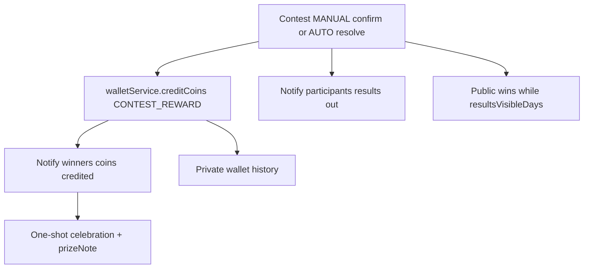

# Contest Rewards UX - Implementation Guide

**Audience:** teammates and AI agents implementing contest win receive UX (notifications, celebration, wallet polish, public wins).  
**Repos:** backend (`audio-social-backend`) + mobile app (`audio-social-app`).  
**Status:** `Planned` - product locks below; Contests payout ledger and Wallet v1 already exist.  
**Build after:** Admin Coins UI (grant + ledger) - [`./coins-and-wallet.md`](./coins-and-wallet.md) section 9.  
**Do not** invent a second coin system; extend [`./coins-and-wallet.md`](./coins-and-wallet.md), [`./contests.md`](./contests.md), [`./notifications.md`](./notifications.md), and [`./follow.md`](./follow.md).

**Related docs:** [`../project-context.md`](../project-context.md), [`./coins-and-wallet.md`](./coins-and-wallet.md), [`./admin-panel.md`](./admin-panel.md), [`./contests.md`](./contests.md), [`./notifications.md`](./notifications.md), [`./follow.md`](./follow.md)

---

## 1. Goal

1. When contest coins are credited (MANUAL confirm or AUTO Closed resolve), winners get a clear **receive moment**: in-app notification + one-shot celebration.
2. Participants get a **results are out** notification (not only winners).
3. Wallet history rows for contest rewards stay private but clearly labeled (contest title, place, amount).
4. Public profiles show **contest wins social proof** (count + expandable 1st/2nd/3rd medals) without exposing wallet balance or `prizeNote`.
5. Keep v1 simple: **auto-credit** into spendable balance (no claimable pending state).

---

## 2. Scope

### In scope

| # | Item |
|---|------|
| 1 | Notification types for contest results + contest win / coins credited |
| 2 | Emit notifications from contest resolve / MANUAL confirm (best-effort) |
| 3 | One-shot celebration modal when user opens the win notification (mark seen) |
| 4 | Show `prizeNote` only on celebration / private reward detail (never on browse cards) |
| 5 | Wallet row polish for `CONTEST_REWARD` (clear intention; tap goes nowhere in v1) |
| 6 | Winner banner on closed contest detail for the winning user |
| 7 | Public winners list on closed contest (already intended; ensure UX) |
| 8 | Public profile: contests-won count + expandable medal list (1 / 2 / 3 only) |
| 9 | Wins on profile only while contest is inside `resultsVisibleDays` window |

### Out of scope

- Claimable / pending coins / Claim button / Claim all
- Push or email delivery (in-app inbox only unless push is already free to wire)
- Spending coins / cashout / clawback
- Admin-custom badge art (use place medals 1st / 2nd / 3rd only)
- Deep links from profile wins into contest pages
- Consolation coins on cancel
- Notifying non-participants about contest results

---

## 3. Locked product decisions

### Credit model

1. **Auto-credit:** On MANUAL admin confirm or AUTO Closed resolve, call existing `walletService.creditCoins` with `CONTEST_REWARD` and idempotent `referenceId`. Coins are **immediately spendable** (when spend exists later).
2. **No claim flow** in this slice. Celebration copy is receive-oriented (“You received +N coins”), not Claim.
3. **Cancelled contests:** no coins, no win notifications.
4. **Clawback / reverse payout:** out of scope.
5. **Ties (dense rank):** each tied user in a place band gets that band’s coins and the same win UX.
6. **Missing / banned user at payout:** do not create a credit or win notification if the user cannot receive; do not invent special recovery UI in v1.

### Notifications (in-app)

7. Add contest-related notification types (exact enum names to match schema when implementing), at minimum:
   - **Results out** - to each participant (entered and/or voted; lock exact set at implement time: prefer all users who entered, optionally voters too if cheap).
   - **Contest won / coins credited** - to each paid place winner when coins are credited.
8. Never notify yourself for self-actions; emission remains **best-effort** (must not fail payout).
9. **MANUAL:** results may be visible before coins; win/credit notification fires when admin confirms and credit succeeds. Results-out can fire when Closed results become available.
10. **AUTO:** results + credit + win notification in the same resolve step (plus results-out to participants).
11. Deep links:
    - Results-out → closed contest detail / leaderboard
    - Win / coins credited → open inbox item → celebration modal (wallet optional secondary, not required)
12. Push: **not required** for v1.

### Celebration modal

13. Show **once** when the user opens the win / coins-credited notification (or first open of that notification payload). Persist seen via mark-read / a seen flag so it does not repeat.
14. Content: place medal (1st/2nd/3rd), contest title, coin amount, `prizeNote` if non-empty, primary dismiss (“Got it”).
15. No Claim button. No requirement to visit the contest from this modal.

### `prizeNote`

16. **Never** on Home/Explore cards, contest browse, or public profile.
17. Show only on private receive surfaces (celebration / reward detail).

### Wallet

18. Balance and ledger remain **private** (never on public profile).
19. Flat transaction list with clear per-row intention (`CONTEST_REWARD` vs `ADMIN_GRANT`).
20. Contest reward row should surface contest name + place + amount when data is available (extend description and/or DTO as needed).
21. Row tap: **nowhere** in v1.
22. Receive-only; no spend UI in this slice.

### Closed contest UX

23. Public leaderboard / winners with places and coin tiers visible to everyone.
24. If the viewer is a winner: show a **You won** banner (place + coins received).

### Public profile wins

25. Visible to **everyone** (public profile).
26. Show **wins only** (place bands that received prize coins: 1st only or top 3 per placement mode).
27. UI: collapsed **contests won count**; expandable list of medal entries (1st / 2nd / 3rd). No admin-designed custom badges in v1.
28. **No** deep link to the contest from a win row (dead end).
29. A win appears on profile only while `now < voteEndAt + resultsVisibleDays` for that contest. After the window, drop it from the public wins list (count decreases). Historical wallet ledger rows remain private forever.
30. Do not expose total contest coins earned or wallet balance publicly.

### Dates

31. Display win / credit times in **device local** timezone in the app.

---

## 4. Relationship to existing systems

---

## 5. Implementation notes (for later coding)

- Prefer extending `Notification` enum + emission in contest resolve paths.
- Public wins: derive from settled contest entries / payouts filtered by `resultsVisibleDays`; do not denormalize wallet balance onto public profile.
- Keep idempotent credits; notifications should be idempotent or deduped per contest+user+type where practical.
- Do not reintroduce claimable pending balances without a new product lock.

---

## 6. Task list

### Docs

- [x] Locks captured in this guide
- [x] Cross-links from contests / coins / notifications / follow / project-context

### Implementation (not started)

- [ ] Notification types + emit on resolve / confirm
- [ ] App: celebration modal once on win notification open
- [ ] Wallet contest row polish
- [ ] Closed contest winner banner
- [ ] Public profile wins count + expandable medals
- [ ] Wins filtered by `resultsVisibleDays`
