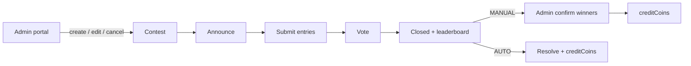

# Contests — Implementation Guide

**Audience:** teammates and AI agents implementing Contests end-to-end.  
**Repos:** backend (`audio-social-backend`) + mobile app (`audio-social-app`) + Next.js admin portal (`/admin/contests*`).  
**Status:** `Planned` — depends on **Admin foundation** + **Admin panel v1** + **Coins wallet** first. Replaces Home/Explore **Challenge** naming/UI with **Contest**.  
**Do not** invent alternate reward systems; coin payouts use [`./coins-and-wallet.md`](./coins-and-wallet.md) `creditCoins` (via confirm or auto-resolve). Subscriptions/payments are **out of scope**.

**Related docs:** [`../project-context.md`](../project-context.md), [`./admin.md`](./admin.md), [`./admin-panel.md`](./admin-panel.md) (shell; Contests nav ships with this slice), [`./coins-and-wallet.md`](./coins-and-wallet.md), [`./publish.md`](./publish.md), [`./home.md`](./home.md), [`./explore.md`](./explore.md)

**Naming:**

| Term | Meaning |
|------|---------|
| **Contest** | Timed themed competition (replaces product name "Challenge") |
| **Entry** | One published track submitted by one user into a contest |
| **Vote** | One vote per user per contest (not track Like / Liked Songs) |
| **Phase** | Announce → Submit → Vote → Closed (driven by timestamps); Cancelled via admin |
| **Placement mode** | `FIRST` (1st place only) or `TOP_THREE` (1st / 2nd / 3rd bands) |
| **Payout mode** | `MANUAL` (admin confirms → grant) or `AUTO` (on Closed, results + coins together) |

---

## 1. Goal

1. Super Admin creates Contests in the **admin portal** (title, description, rules, genres, optional cover, prize note, placement/payout modes, coin amounts, phase timestamps).
2. Eligible artists submit **one** published track during **Submit**; may publish during that window then enter.
3. Users cast **one vote** during **Vote** (not for their own entry).
4. After Vote ends (**Closed**): public leaderboard; ranking by votes.
5. **Prizes:** `prizeNote` (free text / physical offline) + **pre-configured coin amounts** by place. Payout is either **MANUAL** (admin confirms → grant) or **AUTO** (when results go public, winners get coins in the same resolve step).
6. Admin can **cancel** a contest (before winners paid); entry track locks release.
7. App: Contest list/detail/leaderboard + submit picker; Home + Explore Contest cards for **active, upcoming, and recently closed**.



---

## 2. Scope

### In scope

| # | Item |
|---|------|
| 1 | Prisma: `Contest`, `ContestEntry`, `ContestVote` (+ placement/payout enums, cancel, cover, prize tiers) |
| 2 | Admin APIs: create/update/list/detail, cancel, confirm-winners (MANUAL), payout-mode toggle |
| 3 | Closed resolve helper: ranking + optional AUTO `creditCoins` (idempotent) |
| 4 | User APIs: list, detail, submit, vote, eligible-tracks, leaderboard (Closed only) |
| 5 | Genre gate: contest `genreIds` length **1–5**; entry track needs **≥1** overlap |
| 6 | Track lock until contest resolved (winners paid/confirmed) or **cancelled** |
| 7 | Admin UI: Contests list / new / detail / edit under `/admin/contests*` |
| 8 | Mobile: Contest screens + Home/Explore cards (rename Challenge → Contest) |

### Out of scope

- Subscriptions / payments / paid entry  
- In-app courier / physical gift logistics  
- Multi-admin roles  
- Replacing Liked Songs with contest votes  
- Cherry-picking winners outside computed rank bands  

### Dependencies (implement first)

1. [`./admin.md`](./admin.md) — `withAdminAuth`, admin login  
2. [`./admin-panel.md`](./admin-panel.md) — portal shell + session (add Contests nav in this slice)  
3. [`./coins-and-wallet.md`](./coins-and-wallet.md) — `creditCoins` / admin grant primitives  

---

## 3. Locked product decisions

1. Product name is **Contest** (not "Challenge"); update Home/Explore fixture copy and future real cards.
2. **Only users with published track(s)** can enter; they may **publish during Submit** then submit.
3. **One entry per user per contest.**
4. Contest genres: **1–5** ids from `TRACK_GENRES`. Track must share **≥1** genre with contest.
5. **Voting:** exactly **one vote per user per contest**; **cannot vote for own entry**; participants may vote for others.
6. **Phases by time:** Announce → Submit → Vote → Closed. **Cancel** is an admin override (see below).
7. At **Submit end**, entry is **locked**; submitted track cannot be unpublished/edited until winners are settled (`winnersConfirmedAt` set) or contest is **cancelled**.
8. During **Vote**, **no new submits** (and no entry replace).
9. **Placement mode** (set on create; editable only before Submit starts):
   - `FIRST` — pay 1st-place band only (`prizeCoinsFirst`).
   - `TOP_THREE` — pay 1st / 2nd / 3rd bands (`prizeCoinsFirst`, `prizeCoinsSecond`, `prizeCoinsThird`).
10. **Payout mode** (editable anytime until winners settled or cancelled):
    - `MANUAL` — after Closed, admin clicks **Confirm winners**; service grants pre-set coins to the computed set.
    - `AUTO` — when Vote ends and results become public, **same resolve step** ranks winners and credits coins (no confirm).
11. **Confirm UX (MANUAL):** one primary action. Service computes the winner set; admin does **not** multi-select or cherry-pick.
12. **Ties:**
    - Dense rank by vote count desc.
    - **FIRST:** all entries tied for #1 are co-winners; **each** receives full `prizeCoinsFirst`.
    - **TOP_THREE:** assign place bands by dense rank; every entry in ranks 1–3 receives that band’s amount. If ties expand a band, all tied entries in that band are paid that band’s amount.
13. **Prize copy:** `prizeNote` (free text, physical/offline) always available; coin tiers are contest content set **before** close.
14. **Leaderboard** visible to users **only after Vote ends** (Closed), and not when cancelled (or show cancelled state without payout).
15. **Cancel:** allowed until winners settled; sets `cancelledAt`; stops submit/vote; **releases track locks**; no coin grants.
16. **Cover:** optional `coverUrl` (object storage upload, same patterns as track covers). App uses branded placeholder if missing.
17. Home + Explore show **active + upcoming + recently closed** (different card designs).
18. Dedicated app Contest area: list, detail, leaderboard, Submit → eligible published tracks.

---

## 4. Data model (reference only)

Add to `prisma/schema.prisma` (exact fields may be adjusted in migration; do not invent parallel systems):

```prisma
enum ContestPlacementMode {
  FIRST
  TOP_THREE
}

enum ContestPayoutMode {
  MANUAL
  AUTO
}

model Contest {
  id                 String               @id @default(uuid(7)) @db.Uuid
  title              String
  description        String
  rules              String
  genreIds           String[]             // 1–5 TRACK_GENRES ids
  coverUrl           String?
  prizeNote          String
  placementMode      ContestPlacementMode
  payoutMode         ContestPayoutMode
  prizeCoinsFirst    Int
  prizeCoinsSecond   Int?                 // required when TOP_THREE
  prizeCoinsThird    Int?                 // required when TOP_THREE
  announceAt         DateTime
  submitStartAt      DateTime
  submitEndAt        DateTime
  voteEndAt          DateTime
  cancelledAt        DateTime?
  winnersConfirmedAt DateTime?            // set by MANUAL confirm or AUTO resolve
  createdAt          DateTime             @default(now())
  updatedAt          DateTime             @updatedAt
  entries            ContestEntry[]
  votes              ContestVote[]
}

model ContestEntry {
  id        String   @id @default(uuid(7)) @db.Uuid
  contestId String   @db.Uuid
  userId    String   @db.Uuid
  trackId   String   @db.Uuid
  createdAt DateTime @default(now())
  contest   Contest  @relation(...)
  // @@unique([contestId, userId])
  // optional @@unique([contestId, trackId])
}

model ContestVote {
  id        String   @id @default(uuid(7)) @db.Uuid
  contestId String   @db.Uuid
  userId    String   @db.Uuid
  entryId   String   @db.Uuid
  createdAt DateTime @default(now())
  // @@unique([contestId, userId])
}
```

**Phase derivation (server):** if `cancelledAt` set → **Cancelled**. Else:

| Now vs timestamps | Phase |
|-------------------|--------|
| `now < announceAt` | Upcoming (listed as upcoming) |
| `announceAt <= now < submitStartAt` | **Announce** |
| `submitStartAt <= now < submitEndAt` | **Submit** |
| `submitEndAt <= now < voteEndAt` | **Vote** |
| `now >= voteEndAt` | **Closed** |

**Upcoming** = before Submit (or `announceAt` in the future). **Active** = Submit or Vote. **Closed** = past `voteEndAt` and not cancelled.

**Track lock:** if a `ContestEntry` exists for `trackId` and contest is not cancelled and `winnersConfirmedAt` is null, reject unpublish / published-field edits.

**Closed resolve (idempotent):** when `now >= voteEndAt` and not cancelled and `winnersConfirmedAt` is null:
- Compute dense-rank bands from votes.
- If `payoutMode === AUTO`: credit coins per band amounts, set `winnersConfirmedAt`, then serve leaderboard.
- If `MANUAL`: serve leaderboard; wait for admin confirm to credit + set `winnersConfirmedAt`.
- Prefer: run resolve on first Closed read (leaderboard/detail) and optionally a small cron; never double-pay (guard on `winnersConfirmedAt` + ledger idempotency key / description).

---

## 5. Backend APIs

Envelope `{ success, message, data }`. User routes: `withAuth`. Admin: `withAdminAuth`.

### 5.1 Admin

| Method | Path | Notes |
|--------|------|-------|
| `POST` | `/api/admin/contests` | Create (all content fields + modes + timestamps + optional coverUrl) |
| `PATCH` | `/api/admin/contests/:id` | **Before `submitStartAt`:** full content edit (title, copy, genres, cover, placement, prize tiers, timestamps). **After:** only `prizeNote` and `payoutMode` (until settled/cancelled). Reject edits when cancelled or winners settled (except no-ops). |
| `GET` | `/api/admin/contests` | List; query `phase=all\|upcoming\|active\|closed\|cancelled` |
| `GET` | `/api/admin/contests/:id` | Detail + counts + computed ranking when Closed |
| `POST` | `/api/admin/contests/:id/cancel` | Sets `cancelledAt`; only if not settled; releases locks |
| `POST` | `/api/admin/contests/:id/confirm-winners` | **MANUAL** only, after Closed; no body cherry-pick — service computes set, grants, sets `winnersConfirmedAt` |
| `POST` | `/api/admin/coins/grant` | Existing low-level grant; contest payouts should prefer contest resolve/confirm helpers that call `creditCoins` with contest ledger descriptions |

### 5.2 User / app

| Method | Path | Notes |
|--------|------|-------|
| `GET` | `/api/contests` | Filter/tabs: upcoming, active, closed (recent); exclude cancelled (or include with cancelled flag if needed later) |
| `GET` | `/api/contests/:id` | Detail + phase + viewer flags (`hasEntered`, `hasVoted`, `myEntryId`); triggers AUTO resolve when Closed |
| `GET` | `/api/contests/:id/entries` | Paginated entries; **no public vote totals until Closed** |
| `GET` | `/api/contests/:id/leaderboard` | **403/404 until Closed**; triggers AUTO resolve; ranked entries + vote counts + place band |
| `POST` | `/api/contests/:id/entries` | Body `{ trackId }` — Submit phase only |
| `POST` | `/api/contests/:id/votes` | Body `{ entryId }` — Vote phase only; not own entry |
| `GET` | `/api/contests/:id/eligible-tracks` | Viewer’s published tracks passing genre gate |

### DTOs (sketch)

```ts
{
  id: string;
  title: string;
  description: string;
  rules: string;
  genreIds: string[];
  coverUrl: string | null;
  prizeNote: string;
  placementMode: "FIRST" | "TOP_THREE";
  payoutMode: "MANUAL" | "AUTO";
  prizeCoinsFirst: number;
  prizeCoinsSecond: number | null;
  prizeCoinsThird: number | null;
  phase: "upcoming" | "announce" | "submit" | "vote" | "closed" | "cancelled";
  announceAt: string;
  submitStartAt: string;
  submitEndAt: string;
  voteEndAt: string;
  entryCount: number;
  winnersConfirmed: boolean;
  cancelled: boolean;
}
```

---

## 6. Business rules (service)

**Create validation:**
- `announceAt <= submitStartAt < submitEndAt < voteEndAt`
- `genreIds` unique, length 1–5, each ∈ `TRACK_GENRES`
- `prizeCoinsFirst >= 0` (0 allowed if prize is note-only; prefer documenting expected positive for coin contests)
- If `TOP_THREE`: `prizeCoinsSecond` and `prizeCoinsThird` required (`>= 0`)

**Edit:**
- Full edit only while `now < submitStartAt` and not cancelled
- After Submit starts: allow `prizeNote`, `payoutMode` only, until settled/cancelled
- Switching `MANUAL` ↔ `AUTO` allowed until `winnersConfirmedAt` or `cancelledAt`

**Submit / Vote:** unchanged gates (phase, one entry, genre overlap, no self-vote).

**Ranking:** dense rank by vote count desc.

**MANUAL confirm:**
- Requires Closed, not cancelled, `payoutMode === MANUAL`, `winnersConfirmedAt` null
- Compute place bands from `placementMode`
- `creditCoins` each winner for their band amount with ledger description referencing contest id
- Set `winnersConfirmedAt`

**AUTO resolve:**
- On Closed access (or cron): if `payoutMode === AUTO` and not settled/cancelled → same grant + `winnersConfirmedAt` as confirm
- Users see leaderboard/results only after this step completes (same request path)

**Cancel:**
- Not cancelled, `winnersConfirmedAt` null
- Set `cancelledAt`; no further submit/vote; no grants; unlock entry tracks

---

## 7. Admin panel (UI)

Ships with the Contests slice (not Admin panel v1). Same shell as [`./admin-panel.md`](./admin-panel.md); add **Contests** to the sidebar when this module lands. Follow `DESIGN.md` + admin design/API skills + `AGENTS.md` craftsmanship.

### Routes

| Path | Screen |
|------|--------|
| `/admin/contests` | List |
| `/admin/contests/new` | Create |
| `/admin/contests/[id]` | Detail + actions |
| `/admin/contests/[id]/edit` | Edit (gated by rules above) |

Page titles: `Contests | VibeOGram Admin`, `New Contest | VibeOGram Admin`, etc.

### List

- Filter tabs: **All | Upcoming | Active | Closed | Cancelled**
- Columns: title, phase, placement mode, payout mode, entries, vote end, winners status
- Row click → detail
- Primary CTA: **New contest**
- Loading: table skeleton

### Create / edit form

- title, description, rules
- genres multi-select (1–5)
- optional cover upload
- prizeNote
- placementMode (`FIRST` | `TOP_THREE`)
- prizeCoinsFirst; if TOP_THREE also second + third
- payoutMode (`MANUAL` | `AUTO`)
- announceAt, submitStartAt, submitEndAt, voteEndAt
- React Hook Form + Zod; clear field errors

### Detail

- Header: cover, title, phase pill, placement + payout modes, dates, entry/vote counts
- Prize summary (note + coin tiers)
- When Closed: ranked table (entry, artist, votes, place band)
- Actions:
  - **Edit** (if still editable)
  - **Cancel contest** (confirm dialog; until settled)
  - **Confirm winners** (MANUAL + Closed + not settled) — grants pre-set amounts
  - AUTO Closed: status text that winners were paid with results (no confirm button)
- Toggle payout mode on detail when still allowed (PATCH)

---

## 8. Architecture notes

```text
Admin portal /admin/contests*
  → withAdminAuth → contests CRUD + cancel + confirm-winners
  → creditCoins (contest resolve helpers)

App
  → GET /api/contests (Home/Explore cards + list)
  → detail → submit / vote / leaderboard (phase-gated; AUTO resolve on Closed)
  → publish (during Submit) → eligible-tracks → POST entry
```

Home/Explore **ChallengeCard** → Contest cards fed by API (different designs per surface).

---

## 9. Backend code map

| Area | Path (suggested) |
|------|------------------|
| Module | `src/server/modules/contest/` |
| Admin routes | `src/app/api/admin/contests/**` |
| User routes | `src/app/api/contests/**` |
| Publish guard | extend `track.service` unpublish/update |
| Admin UI | `src/app/admin/contests/**`, `src/admin/**` |
| OpenAPI | `contests.paths.ts`, admin contests paths |

### Backend implement order

1. Prisma models + migrate  
2. Phase helper + admin CRUD + cancel  
3. Submit + track lock in publish paths  
4. Vote + leaderboard gate  
5. Resolve helper (ranking + AUTO grant + MANUAL confirm)  
6. Admin Contests UI  
7. OpenAPI + tests  
8. Mobile screens + Home/Explore cards  

---

## 10. Mobile app

### Screens / flows

1. **Contest list** — upcoming / active / closed  
2. **Contest detail** — cover, description, rules, genres, phase countdown, prize note + coin tiers  
3. **Submit** — eligible published tracks → confirm entry  
4. **Vote** — browse entries (no public ranking until closed) → one vote  
5. **Leaderboard** — after Closed (AUTO already paid; MANUAL may show results before/after confirm — results visible; coin status from `winnersConfirmed`)  
6. **Home / Explore** — Contest cards; remove Challenge fixture naming  

### Code map (suggested)

| Area | Path |
|------|------|
| Feature | `src/features/contests/` |
| Home/Explore cards | replace Challenge usage in `home-screen`, `explore-screen` |

---

## 11. Defaults

| Topic | v1 default |
|-------|------------|
| Genres per contest | 1–5 |
| Genre match | ≥1 overlap |
| Entries per user | 1 |
| Votes per user | 1 |
| Self-vote | Forbidden |
| Leaderboard | After vote end only |
| Placement | FIRST or TOP_THREE (admin chooses) |
| Ties | Dense rank; co-winners get full band amount |
| Payout | MANUAL or AUTO (admin chooses; editable until settled) |
| AUTO timing | Results public + coins in same Closed resolve |
| Cover | Optional |
| Cancel | Yes, until settled |
| Physical prize | prizeNote + offline |
| Subscriptions | Out |

---

## 12. Task list

### Dependencies

- [ ] Admin foundation shipped ([`./admin.md`](./admin.md))  
- [ ] Admin panel v1 shell shipped ([`./admin-panel.md`](./admin-panel.md))  
- [ ] Coins + `creditCoins` shipped ([`./coins-and-wallet.md`](./coins-and-wallet.md))  

### Backend

- [ ] Prisma Contest / Entry / Vote (+ enums, cover, cancel, prize tiers)  
- [ ] Admin contest CRUD + cancel + payoutMode patch rules  
- [ ] Closed resolve (ranking + AUTO grant) + MANUAL confirm-winners  
- [ ] User list/detail/submit/vote/leaderboard/eligible-tracks  
- [ ] Track lock on unpublish/edit while entry active  
- [ ] OpenAPI + tests  

### Admin UI

- [ ] Nav: Contests  
- [ ] List + phase tabs  
- [ ] Create / edit forms  
- [ ] Detail + cancel + confirm winners  

### App

- [ ] Contest feature screens  
- [ ] Submit picker + vote UX  
- [ ] Home Contest cards (design distinct from Explore)  
- [ ] Explore Contest cards  
- [ ] Rename/remove Challenge fixture copy  

### Docs

- [x] This guide (admin UI + placement/payout/cancel/cover)  
- [x] Linked from admin-panel / project-context / coins  
- [ ] Update home/explore Challenge → Contest when wiring  
- [ ] `project-context` status → Done when shipped  

---

## 13. Non-goals reminder

- Not payments / subscriptions  
- Not Liked Songs as contest votes  
- Not multi-entry or multi-vote  
- Not in-app shipping for physical prizes  
- Not admin cherry-pick of winners outside computed bands  

---

## 14. Code review notes

Baseline **2026-11-27:** Home/Explore still show **Challenge** fixtures. No Contest models/APIs. Admin panel v1 + Coins plans exist but Contests wait on those. Admin Contests UI is part of this feature doc, not Admin panel v1.
