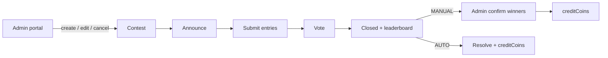

# Contests — Implementation Guide

**Audience:** teammates and AI agents implementing Contests end-to-end.  
**Repos:** backend (`audio-social-backend`) + mobile app (`audio-social-app`) + Next.js admin portal (`/admin/contests*`).  
**Status:** `Done` — Prisma Contests, admin/user APIs, admin `/admin/contests*` UI, mobile contests + Home/Explore cards. Replaces Home/Explore **Challenge** fixtures with live Contest cards.  
**Do not** invent alternate reward systems; coin payouts use [`./coins-and-wallet.md`](./coins-and-wallet.md) `creditCoins` (via confirm or auto-resolve). Receive UX (notifications, celebration, public wins) is planned in [`./contest-rewards-ux.md`](./contest-rewards-ux.md). Subscriptions/payments are **out of scope**.

**Related docs:** [`../project-context.md`](../project-context.md), [`./admin.md`](./admin.md), [`./admin-panel.md`](./admin-panel.md) (shell; Contests nav ships with this slice), [`./coins-and-wallet.md`](./coins-and-wallet.md), [`./contest-rewards-ux.md`](./contest-rewards-ux.md), [`./notifications.md`](./notifications.md), [`./publish.md`](./publish.md), [`./home.md`](./home.md), [`./explore.md`](./explore.md)

**Naming:**

| Term | Meaning |
|------|---------|
| **Contest** | Timed themed competition (replaces product name "Challenge") |
| **Entry** | One published track submitted by one user into a contest |
| **Vote** | One vote per user per contest (not track Like / Liked Songs) |
| **Phase** | Announce → Submit → Vote → Closed (driven by timestamps); Cancelled via admin |
| **Placement mode** | `FIRST` (1st place only) or `TOP_THREE` (1st / 2nd / 3rd bands) |
| **Payout mode** | `MANUAL` (admin confirms → grant) or `AUTO` (on Closed, results + coins together) |
| **Results window** | `resultsVisibleDays` presets after `voteEndAt` for Home/Explore/Closed list |

---

## 1. Goal

1. Super Admin creates Contests in the **admin portal** (title, description, rules, genres, prize note, placement/payout modes, coin amounts, phase timestamps, results visibility days).
2. Eligible artists submit **one** published track during **Submit**; may publish during that window then enter. **No entry swap** after submit.
3. **Any signed-in user** casts **one vote** during **Vote** (not for their own entry).
4. After Vote ends (**Closed**): public leaderboard; ranking by votes.
5. **Prizes:** `prizeNote` (free text / physical offline) + **pre-configured coin amounts** by place. Payout is either **MANUAL** (admin confirms → auto-credit) or **AUTO** (when results go public, winners get coins in the same resolve step). Coins are **auto-credited** (no Claim button). `prizeNote` is never shown on browse cards; show only on private receive/celebration UI — see [`./contest-rewards-ux.md`](./contest-rewards-ux.md).
6. Admin can **cancel** a contest (before winners paid); entry track locks release.
7. App: Contest list/detail/leaderboard + submit picker; Home + Explore Contest cards for **active, upcoming, and recently closed** (within `resultsVisibleDays`). Branded **placeholder** art only (no cover upload in v1).



---

## 2. Scope

### In scope

| # | Item |
|---|------|
| 1 | Prisma: `Contest`, `ContestEntry`, `ContestVote` (+ placement/payout enums, cancel, prize tiers, `resultsVisibleDays`) |
| 2 | Admin APIs: create/update/list/detail, cancel, confirm-winners (MANUAL), payout-mode + resultsVisibleDays patch |
| 3 | Closed resolve helper: ranking + optional AUTO `creditCoins` (idempotent) |
| 4 | User APIs: list, detail, submit, vote, eligible-tracks, leaderboard (Closed only) |
| 5 | Genre gate: contest `genreIds` length **1–5**; entry track needs **≥1** overlap |
| 6 | Track lock until contest resolved or **cancelled**; **at most one active contest per track** |
| 7 | Admin UI: Contests list / new / detail / edit under `/admin/contests*` |
| 8 | Mobile: Contest screens + Home/Explore cards (rename Challenge → Contest) |

### Out of scope

- Contest cover upload (v1 uses placeholder only)  
- Subscriptions / payments / paid entry  
- In-app courier / physical gift logistics  
- Multi-admin roles  
- Replacing Liked Songs with contest votes  
- Cherry-picking winners outside computed rank bands  
- Showing users a results-end countdown timer  

### Dependencies (implement first)

1. [`./admin.md`](./admin.md) — `withAdminAuth`, admin login (**Done**)  
2. [`./admin-panel.md`](./admin-panel.md) — portal shell + session (**Done**; add Contests nav in this slice)  
3. [`./coins-and-wallet.md`](./coins-and-wallet.md) — `creditCoins` / admin grant primitives (**Done**)  

---

## 3. Locked product decisions

1. Product name is **Contest** (not "Challenge"); update Home/Explore fixture copy and future real cards.
2. **Only users with published track(s)** can enter; they may **publish during Submit** then submit.
3. **One entry per user per contest.** First submit is final — **no swap** even during Submit.
4. Contest genres: **1–5** ids from `TRACK_GENRES`. Track must share **≥1** genre with contest.
5. **Voting:** any signed-in user; exactly **one vote per user per contest**; **cannot vote for own entry**.
6. **Phases by time:** Announce → Submit → Vote → Closed. **Cancel** is an admin override.
7. From **submit moment**, entry track is **locked**: cannot unpublish/edit until winners settled (`winnersConfirmedAt`) or contest **cancelled**.
8. During **Vote**, **no new submits**.
9. **At most one active contest per track.** Active = entry on a contest that is not cancelled and `winnersConfirmedAt` is null. After settle/cancel, track may enter another contest.
10. **Placement mode** (editable only before Submit starts):
    - `FIRST` — pay 1st-place band only (`prizeCoinsFirst`).
    - `TOP_THREE` — pay 1st / 2nd / 3rd bands.
11. **Payout mode** (editable anytime until winners settled or cancelled):
    - `MANUAL` — after Closed, admin **Confirm winners** → grant pre-set coins.
    - `AUTO` — when Vote ends and results become public, **same resolve step** ranks winners and credits coins.
12. **Confirm UX (MANUAL):** one primary action; service computes winner set (no cherry-pick).
13. **Ties:** dense rank by vote count desc; each entry in a place band gets **full** band amount.
14. **Prize copy:** `prizeNote` + coin tiers set before close.
15. **Leaderboard** only after Vote ends (Closed); not when cancelled.
16. **Cancel:** until winners settled; releases track locks; no coin grants.
17. **Cover:** none in v1 schema; UI uses branded placeholder.
18. **`resultsVisibleDays`:** presets **5 | 10 | 15 | 20 | 25 | 30** (default **15**). Closed contests appear on Home/Explore/Closed tab while `now < voteEndAt + resultsVisibleDays`. **Do not** show users a timer for when results stop appearing. Editable until settled/cancelled.
19. Home + Explore show **active + upcoming + recently closed** (different card designs).
20. Dedicated app Contest area: list, detail, leaderboard, Submit → eligible published tracks.

---

## 4. Data model (reference only)

```prisma
enum ContestPlacementMode {
  FIRST
  TOP_THREE
}

enum ContestPayoutMode {
  MANUAL
  AUTO
}

model Contest {
  id                 String               @id @default(uuid(7)) @db.Uuid
  title              String
  description        String
  rules              String
  genreIds           String[]
  prizeNote          String
  placementMode      ContestPlacementMode
  payoutMode         ContestPayoutMode
  prizeCoinsFirst    Int
  prizeCoinsSecond   Int?
  prizeCoinsThird    Int?
  announceAt         DateTime
  submitStartAt      DateTime
  submitEndAt        DateTime
  voteEndAt          DateTime
  resultsVisibleDays Int                  @default(15)
  cancelledAt        DateTime?
  winnersConfirmedAt DateTime?
  createdAt          DateTime             @default(now())
  updatedAt          DateTime             @updatedAt
  entries            ContestEntry[]
  votes              ContestVote[]
}

model ContestEntry {
  id        String   @id @default(uuid(7)) @db.Uuid
  contestId String   @db.Uuid
  userId    String   @db.Uuid
  trackId   String   @db.Uuid
  createdAt DateTime @default(now())
  // @@unique([contestId, userId])
  // @@index([trackId])
}

model ContestVote {
  id        String   @id @default(uuid(7)) @db.Uuid
  contestId String   @db.Uuid
  userId    String   @db.Uuid
  entryId   String   @db.Uuid
  createdAt DateTime @default(now())
  // @@unique([contestId, userId])
}
```

**Phase derivation:** if `cancelledAt` set → **Cancelled**. Else by timestamps (upcoming / announce / submit / vote / closed).

**Closed resolve (idempotent):** on Closed access when AUTO (or MANUAL confirm): dense-rank → `creditCoins` with `referenceId = contest:{id}:entry:{entryId}` → set `winnersConfirmedAt`. Lazy resolve on first Closed detail/leaderboard read (no cron required in v1).

---

## 5. Backend APIs

Envelope `{ success, message, data }`. User: `withAuth`. Admin: `withAdminAuth`.

### 5.1 Admin

| Method | Path | Notes |
|--------|------|-------|
| `POST` | `/api/admin/contests` | Create (all content + modes + timestamps + resultsVisibleDays) |
| `PATCH` | `/api/admin/contests/:id` | Before `submitStartAt`: full edit. After: `prizeNote`, `payoutMode`, `resultsVisibleDays` until settled/cancelled |
| `GET` | `/api/admin/contests` | `phase=all\|upcoming\|active\|closed\|cancelled` |
| `GET` | `/api/admin/contests/:id` | Detail + counts + ranking when Closed |
| `POST` | `/api/admin/contests/:id/cancel` | Until settled |
| `POST` | `/api/admin/contests/:id/confirm-winners` | MANUAL only; compute set + grant |

### 5.2 User / app

| Method | Path | Notes |
|--------|------|-------|
| `GET` | `/api/contests` | `tab=upcoming\|active\|closed` |
| `GET` | `/api/contests/:id` | Viewer flags; AUTO resolve when Closed |
| `GET` | `/api/contests/:id/entries` | Newest first; no vote totals until Closed |
| `GET` | `/api/contests/:id/leaderboard` | Closed only; AUTO resolve |
| `POST` | `/api/contests/:id/entries` | `{ trackId }` Submit only; no replace; one active contest/track |
| `POST` | `/api/contests/:id/votes` | `{ entryId }` Vote only |
| `GET` | `/api/contests/:id/eligible-tracks` | Published + genre gate + not in another active contest |

### DTO sketch

```ts
{
  id: string;
  title: string;
  description: string;
  rules: string;
  genreIds: string[];
  prizeNote: string;
  placementMode: "FIRST" | "TOP_THREE";
  payoutMode: "MANUAL" | "AUTO";
  prizeCoinsFirst: number;
  prizeCoinsSecond: number | null;
  prizeCoinsThird: number | null;
  resultsVisibleDays: 5 | 10 | 15 | 20 | 25 | 30;
  phase: "upcoming" | "announce" | "submit" | "vote" | "closed" | "cancelled";
  announceAt: string;
  submitStartAt: string;
  submitEndAt: string;
  voteEndAt: string;
  entryCount: number;
  winnersConfirmed: boolean;
  cancelled: boolean;
}
```

---

## 6. Business rules (service)

**Create:** timestamp order; genres 1–5 unique ∈ `TRACK_GENRES`; `resultsVisibleDays` in presets; TOP_THREE requires 2nd/3rd coins.

**Edit:** full before `submitStartAt`; after: `prizeNote`, `payoutMode`, `resultsVisibleDays` until settled/cancelled.

**Submit:** Submit phase; no existing entry; track owned, PUBLISHED, genre overlap; track not in another active contest.

**Vote:** Vote phase; one vote; not own entry; any signed-in user.

**Cancel / MANUAL confirm / AUTO resolve:** as locked above. Skip `creditCoins` when amount is 0. Empty contest: settle without credits.

---

## 7. Admin panel (UI)

| Path | Screen |
|------|--------|
| `/admin/contests` | List + phase tabs |
| `/admin/contests/new` | Create (incl. resultsVisibleDays select) |
| `/admin/contests/[id]` | Detail + cancel / confirm / payout toggle |
| `/admin/contests/[id]/edit` | Edit |

No cover upload. Placeholder in UI if needed.

---

## 8–10. Architecture / code map / mobile

Module: `src/server/modules/contest/`. Admin routes: `src/app/api/admin/contests/**`. User routes: `src/app/api/contests/**`. App: `src/features/contests/`. Replace Home/Explore Challenge fixtures with Contest cards (placeholder art; phase countdown for Submit/Vote only — not results-end).

---

## 11. Defaults

| Topic | v1 default |
|-------|------------|
| resultsVisibleDays | 15 (presets 5–30 step 5) |
| Cover | None (placeholder UI) |
| Entry replace | Forbidden |
| Active contests per track | 1 |
| Voters | Any signed-in user |
| AUTO timing | Lazy resolve on Closed read |
| Subscriptions | Out |

---

## 12. Task list

### Dependencies

- [x] Admin foundation  
- [x] Admin panel v1 shell  
- [x] Coins + `creditCoins`  

### Backend / Admin UI / App

- [x] Prisma Contest / Entry / Vote  
- [x] Admin + user APIs + track lock + resolve/payout  
- [x] Admin Contests UI  
- [x] Mobile contests + Home/Explore cards  

### Docs

- [x] This guide (final locks)  
- [x] Home/explore Challenge → Contest when wiring  
- [x] `project-context` status → Done  

---

## 13. Non-goals reminder

- Not cover upload, payments, Liked Songs as votes, multi-entry/vote, cherry-pick winners, results-end user timer
- Not claimable/pending coin balances (auto-credit only; receive UX in [`./contest-rewards-ux.md`](./contest-rewards-ux.md))

---

## 14. Code review notes

Shipped **2026-11-28:** Contests end-to-end per locked plan (no cover upload; `resultsVisibleDays` presets; lazy AUTO resolve).

**Follow-up planned:** Contest rewards UX (notifications, celebration, public wins medals) — [`./contest-rewards-ux.md`](./contest-rewards-ux.md).
