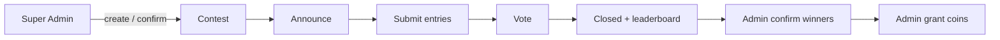

# Contests — Implementation Guide

**Audience:** teammates and AI agents implementing Contests end-to-end.  
**Repos:** backend (`audio-social-backend`) + mobile app (`audio-social-app`) + Super Admin APIs (`withAdminAuth`).  
**Status:** `Planned` — depends on **Admin foundation** + **Coins wallet** first. Replaces Home/Explore **Challenge** naming/UI with **Contest**.  
**Do not** invent alternate reward systems; coin payouts use [`./coins-and-wallet.md`](./coins-and-wallet.md) admin grant. Subscriptions/payments are **out of scope**.

**Related docs:** [`../project-context.md`](../project-context.md), [`./admin.md`](./admin.md), [`./coins-and-wallet.md`](./coins-and-wallet.md), [`./publish.md`](./publish.md), [`./home.md`](./home.md), [`./explore.md`](./explore.md)

**Naming:**

| Term | Meaning |
|------|---------|
| **Contest** | Timed themed competition (replaces product name “Challenge”) |
| **Entry** | One published track submitted by one user into a contest |
| **Vote** | One vote per user per contest (not track Like / Liked Songs) |
| **Phase** | Announce → Submit → Vote → Closed (driven by timestamps) |

---

## 1. Goal

1. Super Admin creates Contests with title, description, rules, allowed genres, prize note, and phase timestamps.
2. Eligible artists submit **one** published track during **Submit**; may publish during that window then enter.
3. Users cast **one vote** during **Vote** (not for their own entry).
4. After Vote: public leaderboard; auto ranking by votes; **admin confirms** winner(s); **co-winners** on ties.
5. Prize: free-text note + **coins via admin grant** (physical gifts offline / courier).
6. App: Contest list/detail/leaderboard + submit picker; Home + Explore Contest cards (different layouts) for **active, upcoming, and recently closed**.



---

## 2. Scope

### In scope

| # | Item |
|---|------|
| 1 | Prisma: `Contest`, `ContestEntry`, `ContestVote` (+ enums / phase helpers) |
| 2 | Admin APIs: create/update contest, list, confirm winners |
| 3 | User APIs: list contests, detail, submit entry, vote, my entry, leaderboard (when allowed) |
| 4 | Genre gate: contest `genreIds` length **1–5** (`TRACK_GENRES`); entry track needs **≥1** overlap |
| 5 | Track lock: after submit until contest fully resolved — no unpublish/edit of entry track |
| 6 | Mobile: Contest screens + Home/Explore cards (rename Challenge → Contest) |
| 7 | Wire winner payout via existing admin coin grant + ledger description |

### Out of scope

- Subscriptions / payments / paid entry  
- Automatic coin credit without admin confirm  
- In-app courier / physical gift logistics  
- Multi-admin roles  
- Replacing Liked Songs with contest votes  

### Dependencies (implement first)

1. [`./admin.md`](./admin.md) — `withAdminAuth`, admin login  
2. [`./coins-and-wallet.md`](./coins-and-wallet.md) — `creditCoins` / `POST /api/admin/coins/grant`  

---

## 3. Locked product decisions

1. Product name is **Contest** (not “Challenge”); update Home/Explore fixture copy and future real cards.
2. **Only users with published track(s)** can enter; they may **publish during Submit** then submit.
3. **One entry per user per contest.**
4. Contest genres: **1–5** ids from `TRACK_GENRES` (not forced to 3). Track must share **≥1** genre with contest.
5. **Voting:** exactly **one vote per user per contest**; **cannot vote for own entry**; participants may vote for others.
6. **Phases by time:** Announce → Submit → Vote → Closed.
7. At **Submit end**, entry is **locked**; the submitted track **cannot be unpublished or edited** until contest is fully closed/resolved (winner confirmed or contest cancelled by admin).
8. During **Vote**, **no new submits** (and no entry replace).
9. **Winner:** sort by vote count; **admin confirms**; **co-winners** allowed on ties.
10. **Prize:** `prizeNote` (free text) + coins granted manually by admin after confirm.
11. **Leaderboard** visible to users **only after Vote ends** (Closed phase).
12. Home + Explore show **active + upcoming + recently closed** contests (different card designs).
13. Dedicated Contest area: list, detail, leaderboard, **Submit** → picker of user’s published tracks that pass genre gate.

---

## 4. Data model (reference only)

Add to `prisma/schema.prisma` (exact fields may be adjusted in migration; do not invent parallel systems):

```prisma
enum ContestPhase {
  // Derived from timestamps in service; optional stored status for admin overrides
}

model Contest {
  id          String   @id @default(uuid(7)) @db.Uuid
  title       String
  description String
  rules       String
  genreIds    String[] // 1–5 TRACK_GENRES ids
  prizeNote   String
  // Suggested coin amount for admin UX (grant still manual):
  prizeCoins  Int?
  announceAt  DateTime
  submitStartAt DateTime
  submitEndAt   DateTime
  voteEndAt     DateTime
  // After admin confirms winners:
  winnersConfirmedAt DateTime?
  createdAt   DateTime @default(now())
  updatedAt   DateTime @updatedAt
  entries     ContestEntry[]
  votes       ContestVote[]
}

model ContestEntry {
  id        String   @id @default(uuid(7)) @db.Uuid
  contestId String   @db.Uuid
  userId    String   @db.Uuid
  trackId   String   @db.Uuid
  createdAt DateTime @default(now())
  contest   Contest  @relation(...)
  // @@unique([contestId, userId])
  // @@unique([contestId, trackId]) optional
}

model ContestVote {
  id        String   @id @default(uuid(7)) @db.Uuid
  contestId String   @db.Uuid
  userId    String   @db.Uuid
  entryId   String   @db.Uuid
  createdAt DateTime @default(now())
  // @@unique([contestId, userId])
}
```

**Phase derivation (server):**

| Now vs timestamps | Phase |
|-------------------|--------|
| `now < announceAt` | Hidden / not listed as upcoming until announce (or listed as upcoming if `announceAt` is “go public”) |
| `announceAt <= now < submitStartAt` | **Announce** |
| `submitStartAt <= now < submitEndAt` | **Submit** |
| `submitEndAt <= now < voteEndAt` | **Vote** |
| `now >= voteEndAt` | **Closed** |

Clarify in implementation: treat **upcoming** as contests with `announceAt` in the future or Announce phase; **active** = Submit or Vote; **closed** = past `voteEndAt` (show for results for a while).

**Track lock:** if a `ContestEntry` exists for `trackId` and contest not fully resolved (`winnersConfirmedAt` null and not admin-cancelled), reject unpublish / published-field edits (extend publish service guards).

---

## 5. Backend APIs

Envelope `{ success, message, data }`. User routes: `withAuth`. Admin: `withAdminAuth`.

### 5.1 Admin

| Method | Path | Notes |
|--------|------|-------|
| `POST` | `/api/admin/contests` | Create (title, description, rules, genreIds 1–5, prizeNote, prizeCoins?, timestamps) |
| `PATCH` | `/api/admin/contests/:id` | Update before Submit starts (strict); limited fields after |
| `GET` | `/api/admin/contests` | List all |
| `GET` | `/api/admin/contests/:id` | Detail + entry/vote counts |
| `POST` | `/api/admin/contests/:id/confirm-winners` | Body: entry ids (co-winners) after Closed; validates top-tied set |
| `POST` | `/api/admin/coins/grant` | Existing — grant prize coins with description referencing contest |

### 5.2 User / app

| Method | Path | Notes |
|--------|------|-------|
| `GET` | `/api/contests` | Filter/tabs: upcoming, active, closed (recent) |
| `GET` | `/api/contests/:id` | Detail + phase + viewer flags (`hasEntered`, `hasVoted`, `myEntryId`) |
| `GET` | `/api/contests/:id/entries` | Paginated entries (no vote totals until Closed, or anonymized counts — **leaderboard only after Closed**) |
| `GET` | `/api/contests/:id/leaderboard` | **404/403 until Closed**; then ranked entries + vote counts |
| `POST` | `/api/contests/:id/entries` | Body `{ trackId }` — Submit phase only |
| `POST` | `/api/contests/:id/votes` | Body `{ entryId }` — Vote phase only; not own entry |
| `GET` | `/api/contests/:id/eligible-tracks` | Viewer’s published tracks passing genre gate |

### DTOs (sketch)

```ts
// Contest summary
{
  id: string;
  title: string;
  description: string;
  rules: string;
  genreIds: string[];
  prizeNote: string;
  prizeCoins: number | null;
  phase: "announce" | "submit" | "vote" | "closed";
  announceAt: string;
  submitStartAt: string;
  submitEndAt: string;
  voteEndAt: string;
  entryCount: number;
  winnersConfirmed: boolean;
}
```

---

## 6. Business rules (service)

**Create validation:** `announceAt <= submitStartAt < submitEndAt < voteEndAt`; `genreIds` unique, length 1–5, each ∈ `TRACK_GENRES`.

**Submit:**
- Phase = Submit  
- User has no existing entry  
- Track owned by user, `PUBLISHED`, genre overlap ≥1  
- Creates entry → track becomes contest-locked  

**Vote:**
- Phase = Vote  
- One vote per user  
- Entry in this contest; `entry.userId !== voterId`  

**Leaderboard:** only if `now >= voteEndAt`. Rank by vote count desc; ties share rank (co-winner candidates).

**Confirm winners:** admin must pick the full tied top group or a subset only if product allows — **lock: all tied for first become co-winners when confirmed**, or admin passes all tied entry ids. Prefer: service computes top vote count; admin confirms that set (must include all ties for first place).

**Coin grant:** after confirm, admin calls grant API per winner (or batch helper later). Contests do not auto-mutate balances.

---

## 7. Architecture notes

```text
Admin portal / Postman
  → withAdminAuth → contests CRUD + confirm-winners
  → coins grant

App
  → GET /api/contests (Home/Explore cards + list screen)
  → detail → submit picker / vote / leaderboard (phase-gated)
  → publish (during Submit) → eligible-tracks → POST entry
```

Home/Explore **ChallengeCard** → rename/replace with Contest cards fed by API (different designs per surface).

---

## 8. Backend code map

| Area | Path (suggested) |
|------|------------------|
| Module | `src/server/modules/contest/` |
| Admin routes | `src/app/api/admin/contests/**` |
| User routes | `src/app/api/contests/**` |
| Publish guard | extend `track.service` unpublish/update |
| OpenAPI | `contests.paths.ts`, admin contests paths |

### Backend implement order

1. Prisma models + migrate  
2. Phase helper + admin CRUD  
3. Submit + track lock in publish paths  
4. Vote + leaderboard gate  
5. Confirm winners  
6. OpenAPI + tests  

---

## 9. Mobile app

### Screens / flows

1. **Contest list** — upcoming / active / closed  
2. **Contest detail** — description, rules, genres, phase countdown, prize note  
3. **Submit** — list eligible published tracks → confirm entry  
4. **Vote** — browse entries (no public ranking until closed) → one vote  
5. **Leaderboard** — after Closed  
6. **Home / Explore** — Contest cards (active + incoming + closed results); remove Challenge fixture naming  

### Code map (suggested)

| Area | Path |
|------|------|
| Feature | `src/features/contests/` |
| Home/Explore cards | replace Challenge usage in `home-screen`, `explore-screen` |

---

## 10. Defaults

| Topic | v1 default |
|-------|------------|
| Genres per contest | 1–5 |
| Genre match | ≥1 overlap |
| Entries per user | 1 |
| Votes per user | 1 |
| Self-vote | Forbidden |
| Leaderboard | After vote end only |
| Ties | Co-winners |
| Prize delivery | Admin coin grant + prizeNote; physical offline |
| Subscriptions | Out |

---

## 11. Task list

### Dependencies

- [ ] Admin foundation shipped ([`./admin.md`](./admin.md))  
- [ ] Coins + admin grant shipped ([`./coins-and-wallet.md`](./coins-and-wallet.md))  

### Backend

- [ ] Prisma Contest / Entry / Vote  
- [ ] Admin contest CRUD + confirm-winners  
- [ ] User list/detail/submit/vote/leaderboard/eligible-tracks  
- [ ] Track lock on unpublish/edit while entry active  
- [ ] OpenAPI + tests  

### App

- [ ] Contest feature screens  
- [ ] Submit picker + vote UX  
- [ ] Home Contest cards (design distinct from Explore)  
- [ ] Explore Contest cards  
- [ ] Rename/remove Challenge fixture copy  

### Docs

- [x] This guide  
- [x] Linked from `project-context` / admin / coins / README  
- [ ] Update home/explore Challenge → Contest when wiring  
- [ ] `project-context` status → Done when shipped  

---

## 12. Non-goals reminder

- Not payments / subscriptions  
- Not auto-payout without admin  
- Not Liked Songs as contest votes  
- Not multi-entry or multi-vote  
- Not in-app shipping for physical prizes  

---

## 13. Code review notes

Baseline **2026-11-26:** Home/Explore still show **Challenge** fixtures. No Contest models/APIs. Admin + Coins plans exist but are not fully implemented — Contests must wait on those.
