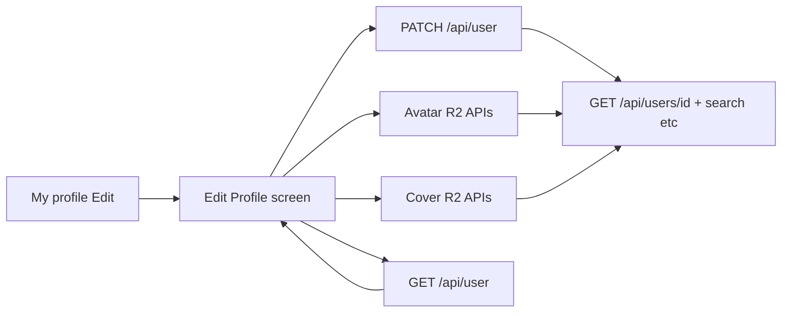

# Edit Profile — Implementation Guide

**Audience:** humans and AI agents implementing this feature end-to-end.  
**Repos:** backend (`audio-social-backend`) + mobile app (`audio-social-app`) + **Cloudflare R2** (avatar/cover objects only).  
**Status:** `Done` — audited 2026-11-14: Prisma fields, `GET`/`PATCH` `/api/user`, avatar/cover R2 upload, Edit Profile screen, and profile DTO surfaces are shipped. Fixtures remain only for `SKIP_AUTH` / demo artists.

**UI design:** Take layout, spacing, and visual language from **Figma** (Edit Profile). Product owner will point the implementing developer at the correct frame in chat — **do not** rely on an image or link inside this doc.

**Schema:** User fields live in `prisma/schema.prisma` (`bio`, `avatarPath`, `coverPath`, `usernameChangedAt`). Do **not** paste a full Prisma dump here. Run migrate + generate yourselves after pulling schema changes.

**Storage split (important):**

| Asset | Store |
|-------|--------|
| Track mix / stems / chat audio (existing) | **Supabase Storage** — leave as-is; do **not** migrate in this slice |
| Profile **avatar** + **cover** (new) | **Cloudflare R2** — add alongside; new code path only |

---

## 1. Goal

Let the logged-in user open **Edit Profile** from their profile screen and update:

1. **Cover image** and **profile photo** (upload / replace / remove)
2. **Display name**, **username**, **bio**
3. See live username availability + cooldown messaging
4. Have **all profile-facing APIs** return the new fields so Profile, public artist, search, chat participants, etc. show real avatar / cover / bio / name



---

## 2. Scope

### In scope

| # | Item |
|---|------|
| 1 | Prisma User fields already in schema — migrate + generate |
| 2 | Confirm signup / user create leaves `usernameChangedAt` set (default or explicit) |
| 3 | `GET /api/user` enriched for edit form + cooldown meta + signed/public media URLs |
| 4 | `PATCH /api/user` — dirty fields only (`name`, `bio`, `username`) |
| 5 | Username availability endpoint |
| 6 | Avatar + cover: R2 signed upload → complete → delete; independent of Save |
| 7 | Extend **all user/profile fetch DTOs** with bio, name, username, avatar, cover as appropriate |
| 8 | Mobile Edit Profile screen + wire Profile “Edit profile” |
| 9 | Cloudflare R2 client/config for **profile media only** |

### Out of scope

- Migrating track/stem/chat audio from Supabase → R2
- Changing existing track backup / signed-url audio code
- Redesigning Profile hero beyond consuming real API fields
- Push notifications, verified badge logic, genres editor
- Reserved-username denylist (optional later)

---

## 3. Locked product decisions

1. **Entry:** Profile tab → **Edit profile** → Edit Profile screen (replace “Coming soon”).
2. **Save** applies **text fields only** (dirty fields). Media updates immediately via their own APIs.
3. **Username cooldown:** `usernameChangedAt` set at **signup** and reset on every successful username change. Window = **7 days**. While locked: UI sets `canChangeUsername === false` → **disable** username field and show unlock date. Do not rely on Save failing after the user edited bio.
4. **PATCH policy:** Client should omit `username` when locked. If `username` is sent while locked → `409` / `USERNAME_CHANGE_COOLDOWN` and **apply nothing** (hard fail only for that bad request). When username omitted, name/bio save normally.
5. **Username rules:** reuse existing `usernameSchema` (3–20, `[a-z0-9._]`, lowercased, no leading/trailing/double `.`).
6. **Display name:** optional on edit; **max 30** characters; empty → store `null`.
7. **Bio:** optional; **max 300** characters (Figma counter may show 160 — **implement 300**).
8. **Avatar remove:** `avatarPath = null` → UI shows **initials** (first letter of name, else username).
9. **Cover remove:** `coverPath = null` → empty / placeholder cover on profile.
10. **Media files:** max **5 MB**; `image/jpeg`, `image/jpg`, `image/png`, `image/webp`.
11. **Crop:** avatar **1:1**; cover **wide** — match Profile hero aspect (`COVER_HEIGHT` ≈ 200 vs screen width in `profile-hero.tsx`), not 1:1.
12. **Layout note for implementers:** Figma/Stitch may show avatar **below** the cover. **Ship overlap like Profile screen** (`marginTop: -(AVATAR_SIZE / 2)` on avatar row). Treat Figma as fields/chrome reference; hero stacking follows existing profile hero.
13. **R2 only for avatar/cover** in this module; Supabase storage code for audio stays untouched.

---

## 4. Data model (reference only)

Source of truth: `prisma/schema.prisma` on `User`.

| Field | Role |
|-------|------|
| `bio` | Optional; max 300 in Zod |
| `avatarPath` | R2 key; null → initials in UI |
| `coverPath` | R2 key; null → placeholder cover |
| `usernameChangedAt` | Default `now()` at create; reset on username change; 7-day cooldown |

**Signup:** `@default(now())` covers new rows; if any create path sets fields explicitly, still ensure `usernameChangedAt` is set.

**URLs in API responses:** return resolved `avatarUrl` / `coverUrl` from paths — clients should not need raw keys for display. Upload complete flows may still use `path`.

---

## 5. Cloudflare R2 (profile media)

### 5.1 Why here

Profile images are new. Introducing R2 for **avatars/covers only** avoids touching track upload logic while starting the storage shift.

### 5.2 Backend pieces to add

- Env: `R2_ACCOUNT_ID`, `R2_ACCESS_KEY_ID`, `R2_SECRET_ACCESS_KEY`, `R2_BUCKET`, `R2_PUBLIC_BASE_URL` (or equivalent for signed GET)
- Small `r2` client module (S3-compatible SDK)
- Helpers: create presigned **PUT**, optional **HEAD**/exists, **DELETE**, build display URL
- Key layout examples:
  - `avatars/{userId}/{uuid}.jpg`
  - `covers/{userId}/{uuid}.jpg`

### 5.3 Do not

- Refactor `track.service.ts` Supabase calls in this slice
- Dual-write audio to R2
- Share the Supabase bucket for avatars

---

## 6. Backend APIs

Auth envelope unchanged: `{ success, message, data }`.

### 6.1 Current user (edit bootstrap + profile tab)

`GET /api/user`

Extend beyond stripping `password`. Return a stable **me** DTO, e.g.:

```ts
{
  id: string;
  email: string;
  username: string;
  name: string | null;
  bio: string | null;
  avatarUrl: string | null;  // resolved from avatarPath
  coverUrl: string | null;   // resolved from coverPath
  canChangeUsername: boolean;
  usernameChangeAvailableAt: string | null; // ISO when cooldown ends; null if can change now
  createdAt: string;
  updatedAt: string;
}
```

`canChangeUsername = now >= usernameChangedAt + 7 days`.

### 6.2 Patch profile (text)

`PATCH /api/user`

Body: **only dirty fields**, each optional:

```ts
{
  name?: string | null;   // max 30; empty string → null
  bio?: string | null;    // max 300; empty → null
  username?: string;      // usernameSchema; only if canChangeUsername
}
```

- If `username` present and cooldown active → `USERNAME_CHANGE_COOLDOWN`, no updates
- If `username` present and taken → conflict
- On successful username change → set `usernameChangedAt = now()`
- Return updated **me** DTO (same shape as GET)

### 6.3 Username availability

`GET /api/user/username-availability?username=`

- Validate with `usernameSchema`
- Available if no other user has it (current user’s own name counts as available)
- Response: `{ username, available: boolean }`

Debounce on client (~300ms). Re-check on PATCH.

### 6.4 Avatar (R2)

| Method | Path | Purpose |
|--------|------|---------|
| `POST` | `/api/user/avatar/upload-url` | Presigned PUT + `path` (+ contentType) |
| `PUT` or `POST` | `/api/user/avatar` | Complete: verify object, set `avatarPath`, delete previous object if any |
| `DELETE` | `/api/user/avatar` | Clear `avatarPath`, delete R2 object |

Does **not** require pressing Save on the form.

### 6.5 Cover (R2)

Same pattern as avatar:

| Method | Path |
|--------|------|
| `POST` | `/api/user/cover/upload-url` |
| `PUT` / `POST` | `/api/user/cover` (complete) |
| `DELETE` | `/api/user/cover` |

Crop aspect differs (wide); APIs are otherwise parallel.

---

## 7. Update all “fetch user / profile” surfaces

Any API that powers Profile UI, public artist page, search rows, follow payloads, or chat participant chips must expose the new display fields so the app can drop fixtures.

### 7.1 Required expansions

| Endpoint / DTO | Add |
|----------------|-----|
| `GET /api/user` | bio, avatarUrl, coverUrl, cooldown meta ([§6.1](#61-current-user-edit-bootstrap--profile-tab)) |
| `GET /api/users/:id` public profile | `bio`, `avatarUrl`, `coverUrl` (keep counts + relationship flags) |
| `GET /api/users/search` | at least `avatarUrl` (+ `name`, `username` already); bio optional |
| Follow / relationship responses that embed user | prefer avatar + name + username |
| Chat participant snapshots (when chat lands) | avatarUrl, name, username |

Exact OpenAPI schemas should be updated in the same PR as the service changes.

### 7.2 Public profile example

```ts
{
  id: string;
  username: string;
  name: string | null;
  bio: string | null;
  avatarUrl: string | null;
  coverUrl: string | null;
  followerCount: number;
  followingCount: number;
  isFollowing: boolean;
  isFollowedBy: boolean;
  isMutual: boolean;
  isSelf: boolean;
}
```

### 7.3 Mobile consumers

- Replace / reduce `profile.fixtures` for **my** profile via `GET /api/user`
- Keep mapping helpers (`mapPublicProfileToProfile`) updated for bio + media URLs
- Initials fallback when `avatarUrl` is null

Also update `./follow.md` public-profile response section when implementing (or leave a short “superseded by edit-profile §7” note there).

---

## 8. Mobile — Edit Profile

### 8.1 Design

- **Source of truth for look:** Figma Edit Profile frame (owner will identify it to the developer in chat).
- **Hero stacking:** overlap avatar on cover like `profile-hero.tsx`, even if Figma shows them stacked separately.
- Bio counter: **`n / 300`**.
- Reuse shared `Input`, `Button`, `Text`, existing **Sheet** for media actions.
- Sheet options (Lucide-appropriate icons): **Take photo**, **Choose from gallery**, **Remove**.
- Native camera / gallery only — no custom camera screen.
- Crop on device, then upload.

### 8.2 Behavior

1. Open → `GET /api/user` → fill form; lock username if `!canChangeUsername`.
2. Cover / avatar camera control → sheet → crop → R2 upload APIs → refresh local preview from returned URLs.
3. Remove → DELETE API → initials / empty cover.
4. Save → PATCH dirty text fields only → toast / back.
5. Availability line under username when editable (debounce availability API).

### 8.3 Routing

- `ProfileSelfActions` “Edit profile” → push edit route (e.g. `/(tabs)/profile/edit` or stack route — match Expo Router conventions in the app).

---

## 9. Backend code map

| Area | Suggested path |
|------|----------------|
| Prisma | `prisma/schema.prisma` + migration |
| R2 config | `src/server/config/r2.ts` |
| Profile / me service | extend `user.service.ts` or `src/server/modules/user/profile.service.ts` |
| Validators | `user.validator.ts` / `profile.validator.ts` |
| Routes | `src/app/api/user/route.ts` (GET + PATCH) |
| | `src/app/api/user/username-availability/route.ts` |
| | `src/app/api/user/avatar/...`, `src/app/api/user/cover/...` |
| Auth signup | set `usernameChangedAt` |
| OpenAPI | user/profile paths + schemas |

---

## 10. Defaults summary

| Topic | v1 |
|-------|-----|
| Cooldown | 7 days from signup and from each username change |
| Username lock UX | Disable field + show date |
| Name | Optional, max 30 |
| Bio | Optional, max 300 |
| Avatar / cover store | Cloudflare R2 |
| Audio / tracks store | Supabase (unchanged) |
| Dirty PATCH | Yes |
| Media vs Save | Media independent |

---

## 11. Explicit non-goals

- No Supabase Storage for avatars/covers in this slice  
- No rewrite of track upload  
- No Figma URL required in-repo  

---

## 12. Task list (honest vs current code)

Audited against repo **2026-11-14**.

1. [x] Migrate + generate for User profile fields; verify signup cooldown default
2. [x] R2 env + client helpers (profile keys only)
3. [x] Expand `GET /api/user` + public profile + search DTOs ([§7](#7-update-all-fetch-user--profile-surfaces))
4. [x] `PATCH /api/user` + username availability + cooldown enforcement
5. [x] Avatar upload-url / complete / delete (R2)
6. [x] Cover upload-url / complete / delete (R2)
7. [x] OpenAPI + smoke tests
8. [x] App: Edit Profile screen + wire navigation (`profile/edit`, `edit-profile-screen`)
9. [x] App: my profile + public profile consume new fields; initials / cover placeholders
10. [x] Trim fixture dependency for live API fields _(fixtures kept only for SKIP_AUTH / demo)_
