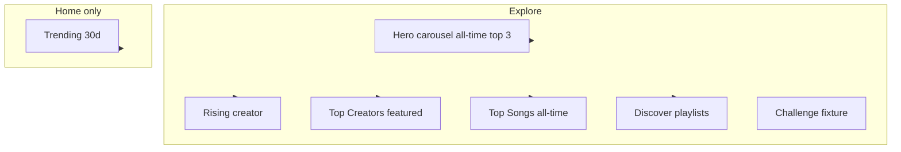

# Explore Screen — Implementation Guide

**Audience:** teammates and AI agents implementing this feature end-to-end.  
**Repos:** backend (`audio-social-backend`) + mobile app (`audio-social-app`).  
**Status:** `Planned` — Explore body is mostly fixtures; Search is a **separate** plan. Wire public discovery rails per this doc.  
**Do not** invent Prisma models. Reuse Track / User / Follow / Playlist. Do **not** reuse Home’s personal playlists or Made for you here.

**Related docs:** [`../project-context.md`](../project-context.md), [`./home.md`](./home.md), [`./publish.md`](./publish.md), [`./playlists-and-albums.md`](./playlists-and-albums.md), [`./follow-and-artist-search.md`](./follow-and-artist-search.md), [`./taste-and-recommendations.md`](./taste-and-recommendations.md)

**Naming:**

| Term | Meaning |
|------|---------|
| **30d trending** | `PUBLISHED` in last 30 days by `playCount` — **Home only** |
| **All-time top** | All `PUBLISHED` by total `playCount` — **Explore** hero + Top Songs |
| **Rising creator** | Newer / recently active publisher, not the same sort as Featured |
| **Discover playlists** | Public catalog playlists (anyone’s `PUBLIC`), not viewer library |

---

## 1. Goal

1. Replace Explore fixture rails with real **public** discovery APIs.
2. Keep Explore distinct from Home: **charts / all-time / rising / public playlists**, not a second 30d trending page.
3. Reuse shared UI (`FeaturedArtistsSection`, `TrendingSection` / track list, `CuratedPlaylistsSection`) with **live data**.
4. Remove filter chips and “View all” / chart deep-links (no destination screens yet).
5. Leave Search bar → `/explore/search` as-is (owned by a future search plan).



---

## 2. Scope

### In scope

| # | Section | Work |
|---|---------|------|
| 1 | Search bar | Keep navigation to search; **no** Explore-plan API work |
| 2 | Filter chips | **Remove** from UI entirely |
| 3 | Featured hero | All-time top **3** tracks; ~10s crossfade carousel; real badges |
| 4 | Rising creator | New rising artists API; **hide** section if empty |
| 5 | Trending Now (30d) | **Remove** from Explore (Home keeps it) |
| 6 | Top Creators | Shared section + existing featured artists API |
| 7 | Challenge | Keep **dummy fixture** |
| 8 | Top Songs | All-time list, limit **12**; same API family as hero |
| 9 | Playlists | New public discover playlists API + shared section |
| 10 | View all / Full Chart / See All | **Remove** |

### Out of scope

- Explore Search screen / multi-kind Results (separate plan)
- Genre filter chips
- Challenge product module
- Made for you / personalization (→ [`./taste-and-recommendations.md`](./taste-and-recommendations.md))
- Home latest project / my playlists
- Player queue product (pass `mixUrl` when playing; full queue is separate)

---

## 3. Locked product decisions

1. **No filter chips** — remove component usage from Explore (don’t leave dead chips).
2. **No 30d trending rail on Explore** — avoids duplicating Home. Home keeps `window=30d` (default).
3. **All-time tracks** via extending trending: `GET /api/discover/tracks/trending?window=30d|all`  
   - Default **`30d`** (backward compatible for Home).  
   - Explore uses **`window=all`**.
4. **Hero:** fetch `window=all&limit=3`. Carousel rotates every **~10s** with crossfade (~300–500ms). Pause when Explore tab / screen unfocused or app backgrounded. Stable order by `playCount` desc.
5. **Hero badges:** real copy only — e.g. `#1 All time`, `#2 All time`, `#3 All time`, and/or `{playCount} plays`. No fake “stems” / marketing badges.
6. **Top Songs:** `window=all&limit=12`; shared track-section UI; pass real UUIDs + `mixUrl` / cover into player.
7. **Top Creators:** existing `GET /api/discover/artists/featured?limit=8` — public; **may include self** (same as Home).
8. **Rising:** new `GET /api/discover/artists/rising?limit=1` (allow up to 3 in API max; Explore shows one card). **Hide** entire block if `data` empty.
9. **Rising rule:** users with ≥1 `PUBLISHED` track in last **30 days**; sort by **latest `publishedAt` desc**, then **`followerCount` asc** (recently active, not the same as high-follower Featured). Do **not** exclude self.
10. **Discover playlists:** `PUBLIC` playlists only; sort **`saveCount` desc**, then `updatedAt` desc; limit **8**; may include viewer’s own public playlists.
11. **Auth:** all Explore discovery endpoints in this doc are **public** (JWT optional). No personalization on this screen.
12. **Challenge:** fixture only until Challenge module exists.
13. Remove “View all ›”, “Explore All”, “Full Chart”, “See All” actions from Explore for v1.

---

## 4. Data model (reference only)

No new Prisma models.

| Model / field | Role |
|---------------|------|
| `Track` | `PUBLISHED`, `playCount`, `publishedAt`, cover/mix, `genres` |
| `User` + `Follow` | Featured / rising artists + `followerCount` |
| `Playlist` | `visibility=PUBLIC`, `saveCount`, `updatedAt`, cover |

---

## 5. Backend APIs

Envelope `{ success, message, data }`. Follow `.agents/skills/audio-backend-api-patterns`.

### 5.1 Trending / all-time tracks (extend existing)

| Method | Path | Auth | Notes |
|--------|------|------|-------|
| `GET` | `/api/discover/tracks/trending` | Optional | Query: `limit` (1–12, default 12), **`window=30d\|all`** (default **`30d`**) |

| `window` | Rule |
|----------|------|
| `30d` | `publishedAt >= now - 30d`, order `playCount` desc, `publishedAt` desc (current Home behavior) |
| `all` | All `PUBLISHED`, order `playCount` desc, `publishedAt` desc (Explore hero + Top Songs) |

DTO: existing discover track item (`id`, `title`, `coverUrl`, `mixUrl`, `playCount`, `likeCount`, `publishedAt`, `genres`, `artist`).

### 5.2 Featured artists (existing)

| Method | Path | Auth | Notes |
|--------|------|------|-------|
| `GET` | `/api/discover/artists/featured?limit=8` | Optional | Unchanged; Explore Top Creators |

### 5.3 Rising artists (new)

| Method | Path | Auth | Notes |
|--------|------|------|-------|
| `GET` | `/api/discover/artists/rising?limit=1` | Optional | Default 1; max 3 |

**Item sketch** (align with featured where possible):

```ts
{
  id: string;
  username: string;
  name: string | null;
  avatarUrl: string | null;
  followerCount: number;
  latestPublishedAt: string | null;
  // optional for card: sample track title / cover from latest publish
  sampleTrack?: {
    id: string;
    title: string;
    coverUrl: string | null;
    mixUrl: string | null;
  } | null;
}
```

### 5.4 Discover playlists (new)

| Method | Path | Auth | Notes |
|--------|------|------|-------|
| `GET` | `/api/discover/playlists?limit=8` | Optional | Default/max 8 |

```ts
{
  id: string;
  title: string;
  coverUrl: string | null;
  coverFallbackUrls?: string[];
  trackCount: number;
  saveCount: number;
  owner: { id: string; username: string; name: string | null; avatarUrl: string | null };
}
```

---

## 6. Business rules (service)

**`window=all` tracks:** `status=PUBLISHED`; no `publishedAt` lower bound; sort `playCount` desc, `publishedAt` desc; limit as requested. Do not exclude self.

**`window=30d`:** keep current Home logic.

**Rising:**  
1. Candidates = users with ≥1 track `PUBLISHED` and `publishedAt >= now - 30d`.  
2. Sort by latest qualifying `publishedAt` desc, then `followerCount` asc.  
3. Attach optional sample = that user’s latest published track in window (for play on card).  
4. Empty → `[]` (app hides UI).

**Discover playlists:** `visibility=PUBLIC`; sort `saveCount` desc, `updatedAt` desc; resolve covers; empty → `[]` (section can hide or show empty state — prefer **hide** if zero).

---

## 7. Architecture notes

```text
ExploreScreen
  → GET /api/discover/tracks/trending?window=all&limit=3   (hero)
  → GET /api/discover/tracks/trending?window=all&limit=12  (Top Songs)
  → GET /api/discover/artists/rising?limit=1
  → GET /api/discover/artists/featured?limit=8
  → GET /api/discover/playlists?limit=8
  → ChallengeCard (fixture)
  → Search bar → /explore/search (other plan)

HomeScreen (unchanged contract)
  → GET /api/discover/tracks/trending            (default window=30d)
  → GET /api/discover/artists/featured
```

Share React Query keys carefully: include `window` in the trending query key so Home and Explore caches don’t collide.

---

## 8. Backend code map

| Area | Path (suggested) |
|------|------------------|
| Discover service | `src/server/modules/discover/discover.service.ts` — add `window`, `listRisingArtists`, `listDiscoverPlaylists` |
| Validator | `discover.validator.ts` — `window` enum; rising + playlists query schemas |
| Routes | `trending` (extend), `artists/rising`, `playlists` under `src/app/api/discover/` |
| OpenAPI | `discover.paths.ts` |

### Backend implement order

1. Add `window` to trending (default `30d`; verify Home unchanged)  
2. Rising artists endpoint  
3. Discover playlists endpoint  
4. OpenAPI + tests (window filter, rising empty, public playlist sort)

---

## 9. Mobile app

### Flows

1. Remove `ExploreFilterChips` and filter state from `explore-screen.tsx`.  
2. Remove “View all” / “Full Chart” / “See All” / unused section `actionLabel` deep-links.  
3. Remove 30d “Trending Now” block from Explore.  
4. Hero: map top-3 all-time into carousel (reuse/adapt `ExploreSongCard`); rotate index every 10s; crossfade; clear interval on blur/unmount.  
5. Rising: one card; hide if no data; tap → `/artist/[id]`; sample play with `mixUrl` when present.  
6. Top Creators: `FeaturedArtistsSection` + featured hook (same as Home).  
7. Top Songs: shared track section + `window=all&limit=12`; play with real id + `mixUrl`.  
8. Playlists: `CuratedPlaylistsSection` with discover playlist DTOs; navigate `/playlists/[id]`.  
9. Challenge: keep fixture component.  
10. Drop fixture modules once rails are live (`featured-song`, `rising-creator`, explore-only use of shared fixture defaults).

### Code map

| Area | Path |
|------|------|
| Screen | `src/features/explore/screens/explore-screen.tsx` |
| Filters to remove | `explore-filter-chips.tsx`, `data/explore-filters.ts` |
| Hero card | `explore-song-card.tsx` (+ carousel wrapper) |
| Rising | `rising-creator-card.tsx` |
| Shared sections | `src/shared/components/music/*` |
| API | extend `src/features/discover/api/*` |

### Home wiring note

When `window` ships, Home must keep calling trending **without** `all` (or explicit `30d`). Update [`./home.md`](./home.md) OpenAPI/query note if needed in the same PR.

---

## 10. Defaults

| Topic | v1 default |
|-------|------------|
| Trending default window | `30d` (Home) |
| Explore track window | `all` |
| Hero count / rotate | 3 tracks / ~10s / crossfade |
| Top Songs limit | 12 |
| Top Creators limit | 8 |
| Rising limit (UI) | 1; hide if empty |
| Discover playlists limit | 8 |
| Exclude self on catalog | No |
| Challenge | Fixture |
| Filter chips | Removed |

---

## 11. Task list (code vs doc — keep honest)

### Backend

- [ ] `window=30d|all` on `GET /api/discover/tracks/trending` (default `30d`)  
- [ ] `GET /api/discover/artists/rising`  
- [ ] `GET /api/discover/playlists`  
- [ ] OpenAPI + tests  

### App

- [ ] Remove filter chips + View-all style actions from Explore  
- [ ] Remove Explore 30d Trending Now section  
- [ ] Hero carousel (top 3 all-time, 10s crossfade, pause off-screen)  
- [ ] Rising card wired; hide if empty  
- [ ] Top Creators ← featured API  
- [ ] Top Songs ← `window=all`  
- [ ] Discover playlists section  
- [ ] Keep Challenge fixture  
- [ ] Play with real UUIDs + `mixUrl`  
- [ ] Remove Explore fixtures for replaced rails  

### Docs / polish

- [x] This guide created  
- [ ] Link + status in `../project-context.md`  
- [ ] Note Home trending default when `window` lands  

---

## 12. Non-goals reminder

- Not Search Results / catalog search UI  
- Not genre filters on Explore  
- Not Challenge backend  
- Not Made for you on Explore  
- Not 30d trending duplication on Explore  
- Not “View all” destinations without screens  

---

## 13. Code review notes

Baseline **2026-11-21:**

- `explore-screen.tsx` uses fixtures for hero / rising; shared sections fall back to fixture data; filter chips present; two track rails both fixture; Challenge fixture.  
- Discover already has featured + 30d trending + made-for-you; **no** `window=all`, rising, or discover playlists yet.  
- Search route exists separately under Explore stack.
