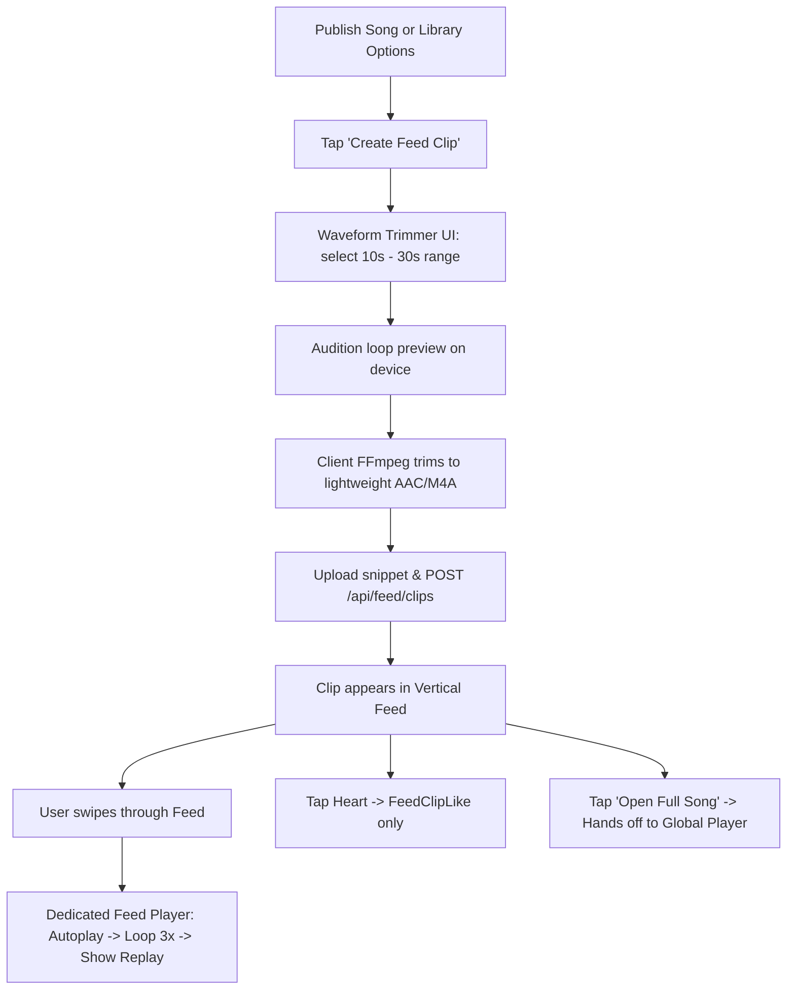

# Feed (Audio Shorts / Reels) — Implementation Guide

**Audience:** teammates and AI agents implementing the Feed clip creation and discovery feature end-to-end.  
**Repos:** backend (`audio-social-backend`) + mobile app (`audio-social-app`).  
**Status:** `In Progress` — Backend FeedClip CRUD/like + rewritten `GET /api/feed` shipped; app create/consume wired (trimmer + 3-loop player). Device E2E still pending.  
**Do not** invent Prisma models or alternate APIs; read `prisma/schema.prisma` and this doc.

**Related docs:** `../project-context.md`, `./publish.md`, `./global-player.md`, `./follow.md`, `./track-comments.md`

**Terminology:**

| Term | Meaning |
|------|---------|
| **Feed Clip** | A standalone 10s–30s audio snippet extracted from a PUBLISHED song, designed specifically for rapid scrolling. |
| **Clip Trimmer** | In-app waveform screen where the artist drags start/end handles to preview and select their best 10s–30s hook. |
| **Feed Player** | Dedicated, self-contained playback engine (separate from Global Listen Player) that autoplays on swipe, loops up to 3 times, then shows a center replay button. |
| **FeedClipLike** | Dedicated like system for feed clips. Liking a clip does **not** add the full song to the listener's Liked Songs library. |
| **Full Track CTA** | Button on the feed card that opens the full published song in the Global Listen Player. |

---

## 1. Goal

1. Allow artists to convert any of their **PUBLISHED** tracks into a short **Feed Clip** (10–30 seconds) from:
   - Their **Library** (under Published tracks options menu).
   - The **Publish Success Screen** (prompt: *"Make a short Feed Clip for this song?"*).
2. Provide a clean, interactive **waveform trimmer screen** with playhead and timer handles (min 10s, max 30s).
3. Client-side trim and transcode the snippet via local **FFmpeg** on the phone, uploading a lightweight dedicated clip audio file to cloud storage.
4. Deliver a TikTok/Reels-style vertical scroll feed:
   - **Card Visuals:** Full-screen blurred background of the album cover art, with the square artwork in the center and an animated audio waveform.
   - **Standalone playback:** Autoplays instantly on scroll into view.
   - **3-Loop limit:** Loops the clip up to 3 times, then stops and displays a prominent center **Replay / Play** button (or user can swipe next).
   - **Completely isolated from Global Player:** Does not mutate the global player queue or mini-player.
5. Provide a **smart semi-random discovery algorithm** (interleaving followed artists and popular clips, avoiding consecutive repeats).
6. Provide distinct social interactions:
   - **Like:** Dedicated `FeedClipLike` (bumps clip like count, does not clutter Liked Songs).
   - **Comments:** Shared with the parent track (`TrackComment`) so conversation stays unified in one place.
7. Enable the artist to remove/delete their clip from the Feed at any time without unpublishing or affecting the full song.



---

## 2. Scope

### In scope

| # | Item |
|---|------|
| 1 | **Prisma Models**: `FeedClip` (1-to-1 with `Track`, `clipAudioPath`, `startMs`, `endMs`, `durationMs`, `likeCount`) + `FeedClipLike` (viewer like join). |
| 2 | **Backend CRUD**: `POST /api/feed/clips` (create/replace), `DELETE /api/feed/clips/:id` (remove from feed), `POST/DELETE /api/feed/clips/:id/like`. |
| 3 | **Trimmer UI Screen**: Mobile waveform visualizer (`@shopify/react-native-skia`), draggable 10s–30s slider window, and live loop auditioning. |
| 4 | **Client Transcoding (Option A)**: Fast local trim and bounce on the phone using `@wokcito/ffmpeg-kit-react-native` before upload. |
| 5 | **Dedicated Feed Player**: Local card audio controller using `expo-audio` with 3-loop counter and center replay button, independent of Global Player. |
| 6 | **Discovery Algorithm**: Weighted semi-random query: 40% followed artists, 60% trending/popular clips, randomized order per session. |
| 7 | **Social Actions Rail**: Heart button (`FeedClipLike`), comment button (opens existing `TrackComment` sheet), artist follow, and "Open Full Song" CTA. |

### Out of scope

- Video recording / canvas background (v1 is pure high-energy audio snippet with blurred cover art & waveform).
- Multiple clips per song (strictly 1 active clip per published track; creating a new one replaces the old clip).
- Adding full song to "Liked Songs" from the feed heart (must be done via the full player).

---

## 3. Locked Product Decisions

1. **1 Clip per Published Track:** An artist can have at most one active feed clip per song (`@@unique([trackId])`). Creating a new clip replaces the existing one.
2. **Track Must Be Published:** Clips can only be made from `PUBLISHED` tracks. If the full track is unpublished or deleted, cascade deletes the `FeedClip`.
3. **Clip Duration Constraint:** Minimum **10 seconds**, maximum **30 seconds**.
4. **Client-Side Bounced Clip Asset (Option A):** Trimming happens directly on the device using FFmpeg. The resulting compressed file (e.g. 128kbps AAC/M4A ~500KB) is uploaded to object storage. This eliminates server transcode load and guarantees zero buffering when swiping.
5. **Feed Visuals:** Full-screen blurred background of the album artwork, with the square cover in the center and animated waveform bars.
6. **Feed Player Isolation:** The feed playback engine is strictly local. It **never** sets `usePlayerStore` state, never affects the bottom mini-player dock, and ducks/pauses if the user launches the Global Player.
7. **3-Loop Rule with Replay:** When a card becomes active, it loops automatically. On the 3rd completion, audio pauses and shows a prominent center **Replay / Play** button. The user can tap to replay or swipe to the next card.
8. **Likes Separation (`FeedClipLike`):** Tapping the heart on a feed card likes the **Feed Clip** only and increments `FeedClip.likeCount`. It does **not** insert into `LikedTrack` or add the full song to the listener's library.
9. **Shared Comments:** Comments on a feed card link directly to the parent `Track.id` (`TrackComment`), keeping conversations unified between the feed and the main player without duplicate threads.
10. **Clip Deletion Independence:** An artist can delete their `FeedClip` anytime via the library or track `⋮` menu. Deleting the clip does **not** unpublish or alter the full song.

---

## 4. Data Model & Prisma Migration

Add the `FeedClip` and `FeedClipLike` models to `prisma/schema.prisma`:

```prisma
model FeedClip {
  id            String         @id @default(uuid(7)) @db.Uuid
  trackId       String         @unique @db.Uuid
  track         Track          @relation(fields: [trackId], references: [id], onDelete: Cascade)
  userId        String         @db.Uuid
  user          User           @relation(fields: [userId], references: [id], onDelete: Cascade)
  
  /// Object storage key for the trimmed lightweight audio snippet
  clipAudioPath String
  
  /// Start and end offsets in the original master mix
  startMs       Int
  endMs         Int
  durationMs    Int            // Must be between 10000 and 30000
  
  /// Denormalized count of FeedClipLike
  likeCount     Int            @default(0)
  
  createdAt     DateTime       @default(now())
  updatedAt     DateTime       @updatedAt
  
  likes         FeedClipLike[]

  @@index([userId, createdAt(sort: Desc)])
  @@index([createdAt(sort: Desc)])
}

model FeedClipLike {
  id         String   @id @default(uuid(7)) @db.Uuid
  clipId     String   @db.Uuid
  userId     String   @db.Uuid
  createdAt  DateTime @default(now())

  clip       FeedClip @relation(fields: [clipId], references: [id], onDelete: Cascade)
  user       User     @relation(fields: [userId], references: [id], onDelete: Cascade)

  @@unique([clipId, userId])
  @@index([userId, createdAt(sort: Desc)])
}
```

Add reverse relations:
- `Track.feedClip FeedClip?`
- `User.feedClips FeedClip[]`
- `User.feedClipLikes FeedClipLike[]`

### Migration Instructions:
1. Run migration in development:
   ```sh
   npx prisma migrate dev --name add_feed_clips_and_likes
   ```
2. Generate the updated Prisma client:
   ```sh
   npx prisma generate
   ```

---

## 5. Backend APIs

Standard envelope: `{ "success": true, "message": "...", "data": { ... } }`.

### 5.1 Create / Replace Feed Clip (`POST /api/feed/clips`)
- **Auth:** Required (must own the track).
- **Body Schema (Zod):**
  ```ts
  export const createFeedClipSchema = z.object({
    trackId: z.string().uuid(),
    clipAudioPath: z.string().min(1),
    startMs: z.number().int().min(0),
    endMs: z.number().int().min(10000),
    durationMs: z.number().int().min(10000).max(30000),
  });
  ```
- **Rules:**
  - Verify track exists, belongs to authenticated user, and `status === 'PUBLISHED'`.
  - Validate `endMs - startMs == durationMs`.
  - Upsert into `FeedClip` (replaces if exists).

### 5.2 Delete Feed Clip (`DELETE /api/feed/clips/:id`)
- **Auth:** Required (owner only).
- **Rules:** Deletes `FeedClip` row and deletes object storage file. The parent `Track` remains completely intact.

### 5.3 Like / Unlike Feed Clip (`POST /api/feed/clips/:id/like` & `DELETE /api/feed/clips/:id/like`)
- **Auth:** Required.
- **Rules:** Idempotent insert/delete into `FeedClipLike`. Atomically updates `FeedClip.likeCount`.

### 5.4 Get Personalized Feed (`GET /api/feed`)
- **Auth:** Optional / Required (uses viewer ID if authenticated for follow weighting and like state).
- **Query Params:** `limit=10&cursor=...`
- **Algorithm (Semi-Random Discovery):**
  1. Fetch unviewed clips from:
     - Followed artists (weighted ~40%).
     - Top trending / popular tracks by `likeCount` & `playCount` (~60%).
  2. Shuffle results in-memory with a pseudo-random seed per session to avoid showing the same artist twice in a row.
  3. Returns cursor for infinite scrolling.
- **DTO:**
  ```ts
  export type FeedClipItemDto = {
    id: string;
    trackId: string;
    title: string;
    caption: string | null;
    clipAudioUrl: string;
    coverUrl: string;
    durationMs: number;
    startMs: number;
    endMs: number;
    likeCount: number;
    commentCount: number; // pulled from parent Track.commentCount
    isLiked: boolean;     // whether viewer liked this FeedClip
    artist: {
      id: string;
      username: string;
      name: string | null;
      avatarUrl: string | null;
      isFollowing: boolean;
    };
  };
  ```

---

## 6. Mobile App Experience & Architecture

### 6.1 Trimmer & Creation Flow
1. **Entry Points:** 
   - **Publish Success Screen:** Immediate CTA after publishing: *"Create a 15–30s Feed Clip"*.
   - **Library:** Published tab -> Track `⋮` menu -> **"Add to Feed / Create Clip"**.
   - If a clip already exists, the menu displays **"Edit Feed Clip"** and **"Remove from Feed"**.
2. **Trimmer Screen (`/studio/create-feed-clip?trackId=...`)**:
   - Shows the full audio waveform of the track.
   - Draggable selection window constrained between 10s and 30s.
   - Real-time time indicator: `00:45.0` to `01:15.0 (30.0s)`.
   - **Play/Pause loop button**: Continuously loops the selected segment so the artist hears exactly what users in the feed will hear.
3. **Save Action (Client FFmpeg):**
   - App runs FFmpeg command locally on the phone:
     ```sh
     ffmpeg -ss [startSec] -t [durationSec] -i input_mix.wav -c:a aac -b:a 128k output_clip.m4a
     ```
   - Uploads `output_clip.m4a` to object storage via storage adapter.
   - Calls `POST /api/feed/clips`.
   - Shows success toast: *"Clip added to Feed!"*

### 6.2 Feed Screen (`FeedScreen`)
1. **Vertical FlatList:**
   - Full screen paging (`pagingEnabled={true}`, `showsVerticalScrollIndicator={false}`).
   - `viewabilityConfig`: Item is considered active when 80% visible.
2. **Visual Presentation:**
   - Full-screen blurred backdrop using the track's cover artwork.
   - Centered square artwork with active sound waveform animation.
   - Overlay metadata: Artist avatar, artist name, track title, and caption.
3. **Card Playback Engine (`useFeedCardPlayer`)**:
   - As soon as a card becomes active, `expo-audio` plays `clipAudioUrl`.
   - Tracks loop count internally:
     ```ts
     const [loopCount, setLoopCount] = useState(0);
     const [isFinished, setIsFinished] = useState(false);
     
     function onClipFinished() {
       if (loopCount < 2) {
         setLoopCount((c) => c + 1);
         player.seekTo(0);
         player.play();
       } else {
         setIsFinished(true);
         player.pause(); // Pauses after 3 full loops
       }
     }
     ```
   - When paused after 3 loops: Displays a semi-transparent **Play / Replay** icon in the center of the screen. Tapping it resets `loopCount = 0` and resumes playback.
   - If user swipes to next card: immediately pauses previous audio and resets loop count.
4. **Social Rail Actions:**
   - **Heart Icon:** Toggles `FeedClipLike`. Increments/decrements local like count optimistically.
   - **Comment Icon:** Opens the comment drawer for `trackId` (uses existing `useTrackComments`).
   - **Follow Button:** Follows/unfollows artist without interrupting playback.
   - **"Listen Full Song" CTA:** Button at the bottom bar. Pauses feed audio, hands the track over to `usePlayerStore`, and opens the Now Playing screen (`/player`).

---

## 7. Implementation Checklist

### Backend:
- [x] Add `FeedClip` and `FeedClipLike` models in `prisma/schema.prisma`.
- [x] Run Prisma migration: `add_feed_clips_and_likes`.
- [x] Create `src/server/modules/feed/feed-clip.service.ts` with create, delete, like toggle, and discovery query logic.
- [x] Implement `src/app/api/feed/clips/route.ts` (POST) and `src/app/api/feed/clips/[id]/route.ts` (DELETE).
- [x] Implement `src/app/api/feed/clips/[id]/like/route.ts` (POST/DELETE).
- [x] Update `src/app/api/feed/route.ts` to return `FeedClipItemDto` using semi-random discovery.
- [x] Register paths in OpenAPI.

### Mobile App:
- [x] Build `CreateFeedClipScreen` with range selection (10s–30s) + loop preview.
- [x] Implement client-side FFmpeg trimming and audio upload service.
- [x] Add "Create Feed Clip" from Library published menu and post-publish navigation.
- [x] Update `FeedScreen` / `FeedVibePage` for `clipAudioUrl`, 3-loop auto-stop, center replay.
- [x] Hook up `FeedClipLike` to the rail heart icon.
- [x] In-feed comments sheet on parent `trackId`.
- [x] Library Edit / Remove Feed Clip (via `feedClipId` on track list).
- [x] Blurred cover + centered artwork on Feed cards; save stub removed from rail.
- [ ] Verify "Listen Full Song" CTA seamlessly hands off playback to Global Player (device E2E).
- [ ] Device E2E for create → feed swipe → like → open full song.
