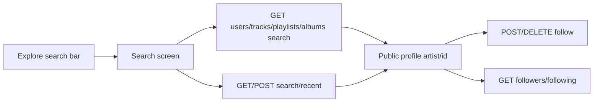

# Follow + Artist Search — Implementation Guide

**Audience:** humans and AI agents implementing this feature end-to-end.  
**Repos:** backend (`audio-social-backend`) + mobile app (`audio-social-app`).  
**Status:** `Done` — audited 2026-11-14: follow, relationship, artist + catalog search, recent search (all kinds), public profile, and followers/following lists are shipped. Search UI chips remain Recent | Results | Artists | Local (Local = Coming soon).

---

## 1. Goal

Let a logged-in user:

1. Open **Explore** → tap the search bar  
2. Land on a **dedicated Search screen**  
3. Search **artists**, **published songs**, **public playlists**, and **released albums**  
4. Open public profiles / play media / open collections  
5. **Follow / unfollow** artists  
6. See **live follower / following counts** and open **paginated lists**  
7. Persist **recent searches** (artist + media) on the backend  



---

## 2. Scope

### In scope (shipped)

| # | Item |
|---|------|
| 1 | Dedicated Search screen (route from Explore) |
| 2 | Search UI chips: Recent, Results, Artists, Local |
| 3 | Live data: Artists + Songs + Playlists + Albums on **Results**; Artists-only on **Artists**; **Local** = Coming soon |
| 4 | Backend **recent searches** (list, record artist/media, clear, remove one) |
| 5 | Public profile loaded from API |
| 6 | Prisma `Follow` + follow / unfollow / relationship APIs |
| 7 | Live `followerCount` / `followingCount` + `isFollowing` on profile |
| 8 | Optimistic Follow button UI + query invalidation |
| 9 | Paginated `GET .../followers` + `GET .../following` + list screens |
| 10 | Profile Followers / Following count taps → list screens |

### Out of scope

- Message / Chat behavior beyond existing stubs  
- Feed ranking / notifications polish  
- Local/device search (Local chip stays Coming soon)  
- Private accounts, follow requests, close friends  
- Block / mute  
- Push notifications (“X followed you”)

---

## 3. Locked product decisions

1. **Search UX:** dedicated route `/(tabs)/explore/search`.  
2. **Recent searches:** Backend, authenticated user. Cap last **20** entries. Kinds: `ARTIST` | `SONG` | `ALBUM` | `PLAYLIST`.  
3. **Follow only** for social graph actions that must work.  
4. **Public follows** — no approval flow.  
5. Identify users by **UUID** in routes (`/artist/[uuid]`).  
6. Catalog search filters: tracks `PUBLISHED`, playlists `PUBLIC`, albums `RELEASED`.

---

## 4. Prisma schema

`SearchRecentKind` already includes `ARTIST | SONG | ALBUM | PLAYLIST`.  
`SearchRecent` uses `targetKey` (+ optional `targetUserId` for artists) with media snapshot fields (`title`, `subtitle`, `coverUrl`).

`Follow` indexes support newest-first follower/following lists.

---

## 5. Backend APIs

All routes require auth (`withAuth`), success envelope `{ success, message, data }`.

### 5.1 Search artists

`GET /api/users/search?q={string}&limit={number}` — unchanged.

### 5.2 Search catalog

| Method | Path | Filters |
|--------|------|---------|
| GET | `/api/tracks/search?q=&limit=` | `status = PUBLISHED` (title/caption/artist) |
| GET | `/api/playlists/search?q=&limit=` | `visibility = PUBLIC` (title/description/owner) |
| GET | `/api/albums/search?q=&limit=` | `status = RELEASED` (title/description/artist) |

`q` required (trim, min 1). `limit` default 20, max 20.

### 5.3 Public profile

`GET /api/users/:id` — includes counts + relationship flags (+ bio/avatar/cover).

### 5.4 Follow / unfollow / relationship

`POST` / `DELETE` `/api/users/:id/follow`  
`GET /api/users/:id/relationship`

### 5.5 Followers / following lists

`GET /api/users/:id/followers?limit=&cursor=`  
`GET /api/users/:id/following?limit=&cursor=`

| Query | Rules |
|-------|--------|
| `limit` | Optional, default `20`, max `50` |
| `cursor` | Optional follow-row UUID from prior `nextCursor` |

**Response `data`:**

```ts
{
  items: Array<{
    id: string;
    username: string;
    name: string | null;
    avatarUrl: string | null;
    isFollowing: boolean; // viewer → listed user
  }>;
  nextCursor: string | null;
}
```

Order: newest follow edge first (`createdAt` desc).

### 5.6 Recent searches

`GET` / `POST` / `DELETE` `/api/search/recent`  
`DELETE /api/search/recent/:id`

POST body:

```ts
| { kind: "ARTIST"; targetUserId: string; query?: string }
| { kind: "SONG" | "ALBUM" | "PLAYLIST"; targetId: string; title: string; subtitle?: string; coverUrl?: string; query?: string }
```

---

## 6. Backend code map

| Area | Path |
|------|------|
| Follow service | `src/server/modules/follow/follow.service.ts` (+ `follow.validator.ts`) |
| Catalog search | `src/server/modules/search/catalog-search.service.ts` (+ validator) |
| Recent search | `src/server/modules/search/search-recent.service.ts` |
| Routes | `src/app/api/users/[id]/followers/route.ts`, `.../following/route.ts` |
| | `src/app/api/tracks/search/route.ts`, `playlists/search`, `albums/search` |
| OpenAPI | `users.paths.ts`, `search.paths.ts`, schemas in `openapi/schemas.ts` |

---

## 7. Mobile app

### Search

- Chips: **Recent | Results | Artists | Local**  
- **Results:** parallel artist + song + playlist + album search, sectioned list  
- **Artists:** artist search only  
- **Local:** Coming soon  
- Row tap records recent (matching kind) then navigates / plays  

### Follow lists

- `FollowListScreen` + routes:
  - `/artist/[id]/followers`, `/artist/[id]/following`
  - `/(tabs)/profile/followers`, `/(tabs)/profile/following`
- Profile stats: **Plays | Followers | Following** — Followers/Following tappable  
- Row **Follow / Following** toggle (hidden for self)  
- Recent **SONG** re-open resolves a fresh `mixUrl` via catalog search then plays  


### Hooks

| Hook | API |
|------|-----|
| `useSearchUsers` | `GET /api/users/search` |
| `useSearchTracks` | `GET /api/tracks/search` |
| `useSearchPlaylists` | `GET /api/playlists/search` |
| `useSearchAlbums` | `GET /api/albums/search` |
| `useFollowers` / `useFollowing` | infinite query on list endpoints |
| Recent + follow mutations | unchanged keys + invalidate follow lists on follow/unfollow |

---

## 8. Task list

### Backend

- [x] Follow + SearchRecent schema  
- [x] Follow / unfollow / relationship / public profile / artist search  
- [x] Recent search GET/POST/DELETE (+ remove one)  
- [x] `GET /api/users/:id/followers` + `following` (cursor pagination)  
- [x] `GET /api/tracks|playlists|albums/search`  
- [x] OpenAPI  

### Mobile app

- [x] Search screen + Explore entry  
- [x] Public profile + Follow  
- [x] Multi-kind Results + recent media recording  
- [x] Followers/following list screens + profile count taps  
- [x] My profile live follower/following counts via public profile  

---

## 9. Quick reference — endpoints

| Method | Path | Purpose |
|--------|------|---------|
| GET | `/api/users/search?q=` | Artist search |
| GET | `/api/tracks/search?q=` | Published track search |
| GET | `/api/playlists/search?q=` | Public playlist search |
| GET | `/api/albums/search?q=` | Released album search |
| GET | `/api/users/:id` | Public profile + counts + flags |
| POST | `/api/users/:id/follow` | Follow |
| DELETE | `/api/users/:id/follow` | Unfollow |
| GET | `/api/users/:id/relationship` | Relationship flags |
| GET | `/api/users/:id/followers` | Paginated followers |
| GET | `/api/users/:id/following` | Paginated following |
| GET | `/api/search/recent` | List recent |
| POST | `/api/search/recent` | Record artist/media recent |
| DELETE | `/api/search/recent` | Clear recent |
| DELETE | `/api/search/recent/:id` | Remove one recent |
