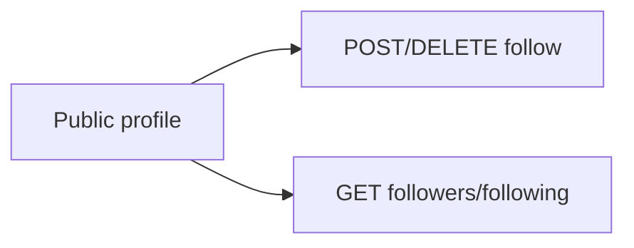

# Follow & Public Profile — Implementation Guide

**Audience:** teammates and AI agents implementing this feature end-to-end.  
**Repos:** backend (`audio-social-backend`) + mobile app (`audio-social-app`).  
**Status:** `Done` — follow, relationship, public profile, followers/following lists shipped.  
**Search UI / catalog search** moved to [`./search.md`](./search.md) (do not implement Search chips here).

**Related docs:** [`../project-context.md`](../project-context.md), [`./search.md`](./search.md), [`./edit-profile.md`](./edit-profile.md)

**Naming:**

| Term | Meaning |
|------|---------|
| **Follow** | Viewer → artist edge (`Follow` row) |
| **Public profile** | `GET /api/users/:id` for `/artist/[uuid]` |

---

## 1. Goal

1. Follow / unfollow artists from public profile.  
2. Live follower / following counts + relationship flags.  
3. Paginated followers / following lists.  
4. Public profile loaded from API (bio/avatar/cover via edit-profile surfaces).



---

## 2. Scope

### In scope

| # | Item |
|---|------|
| 1 | Prisma `Follow` + follow / unfollow / relationship APIs |
| 2 | Public profile + counts + `isFollowing` / `isSelf` |
| 3 | Paginated followers / following + list screens |
| 4 | Optimistic Follow button + query invalidation |

### Out of scope

- Search screen / Music / Artists chips / recent searches → [`./search.md`](./search.md)  
- Private accounts, follow requests  
- Block / mute  
- Push “X followed you” (notifications may cover separately)

---

## 3. Locked product decisions

1. **Public follows** — no approval flow.  
2. Identify users by **UUID** (`/artist/[uuid]`).  
3. Follow only artists (users); no follow playlists.  
4. Newest follow edge first on lists (`createdAt` desc).

---

## 4. Data model (reference only)

| Model | Role |
|-------|------|
| `Follow` | `followerId` + `followingId` unique |

---

## 5. Backend APIs

Auth + envelope `{ success, message, data }`.

| Method | Path | Purpose |
|--------|------|---------|
| `GET` | `/api/users/:id` | Public profile + counts + flags |
| `POST` | `/api/users/:id/follow` | Follow |
| `DELETE` | `/api/users/:id/follow` | Unfollow |
| `GET` | `/api/users/:id/relationship` | Relationship flags |
| `GET` | `/api/users/:id/followers?limit=&cursor=` | Paginated followers |
| `GET` | `/api/users/:id/following?limit=&cursor=` | Paginated following |

**List `data` sketch:**

```ts
{
  items: Array<{
    id: string;
    username: string;
    name: string | null;
    avatarUrl: string | null;
    isFollowing: boolean;
  }>;
  nextCursor: string | null;
}
```

`limit` default 20, max 50. `cursor` = prior follow-row UUID.

---

## 6. Business rules

- Cannot follow self.  
- Idempotent follow/unfollow where already implemented.  
- Hide Follow control when `isSelf`.

---

## 7. Architecture notes

```text
Artist / profile screens
  → GET /api/users/:id
  → POST|DELETE follow
  → GET followers|following (lists)
```

Artist discovery via Search is owned by [`./search.md`](./search.md).

---

## 8. Backend code map

| Area | Path |
|------|------|
| Follow service | `src/server/modules/follow/follow.service.ts` |
| User public profile | `src/server/modules/user/user.service.ts` |
| Routes | `src/app/api/users/[id]/follow`, `relationship`, `followers`, `following` |
| OpenAPI | `users.paths.ts` |

---

## 9. Mobile app

| Area | Path |
|------|------|
| Follow lists | `FollowListScreen`; `/artist/[id]/followers|following`; profile followers/following |
| Profile stats | Followers / Following tappable |
| Follow button | Optimistic toggle; invalidate lists |

---

## 10. Defaults

| Topic | v1 default |
|-------|------------|
| List page size | 20 |
| Follow requests | None |
| Search | See search.md |

---

## 11. Task list

### Backend

- [x] Follow schema + follow/unfollow/relationship  
- [x] Public profile counts/flags  
- [x] Followers/following cursor pagination + OpenAPI  

### App

- [x] Public profile + Follow button  
- [x] Followers/following list screens + count taps  

### Docs

- [x] Split from old follow+search guide; Search → [`./search.md`](./search.md)  

---

## 12. Non-goals reminder

- Not Search UI  
- Not catalog search endpoints ownership (search.md / catalog module)  
- Not block/mute  

---

## 13. Code review notes

Was previously `follow.md`, which overclaimed multi-kind Search Results UI. Follow APIs remain Done; Search UX tracked in `search.md`.
