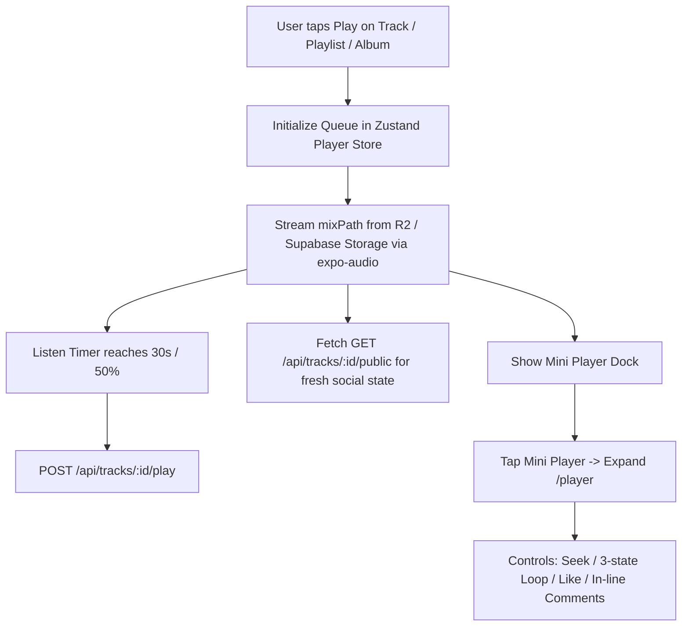

# Global Listen Player & Queue — Implementation Guide

**Audience:** teammates and AI agents implementing the social listening player end-to-end.  
**Repos:** backend (`audio-social-backend`) + mobile app (`audio-social-app`).  
**Status:** `Partial` — App player shell exists; shipping `GET /api/tracks/:id/public` (social detail) + 3-state repeat + 30s play accounting. Owner studio `GET /api/tracks/:id` stays unchanged.  
**Do not** invent Prisma models or alternate APIs; read `prisma/schema.prisma` and this doc.

**Related docs:** `../project-context.md`, `./publish.md`, `./track-comments.md`, `./library-saves.md`, `./follow.md`

**Terminology:**

| Term | Meaning |
|------|---------|
| **Mini Player** | Persistent floating bar docked directly above the bottom tab navigation. |
| **Now Playing Screen** | Full-screen modal player (`/player`) showing large cover art, waveform scrubber, controls, and in-line comments. |
| **Queue** | Ordered list of `PlayerTrack` items from the current context (Playlist, Album, Liked Songs, Search, or Profile). |
| **Repeat Mode** | 3-state toggle: `OFF` (stop at end of queue) → `REPEAT_ALL` (loop entire playlist/queue) → `REPEAT_ONE` (loop current track continuously). |
| **Meaningful Play** | A play recorded after 30 seconds of listening (or 50% for tracks under 30s) to prevent spamming `playCount`. |

---

## 1. Goal

1. Allow casual listeners and artists to play any **`PUBLISHED`** track anywhere in the app (Feed, Explore, Playlists, Albums, Liked Songs, Search, Profile).
2. Maintain a seamless **floating mini-player** that docks above bottom tabs and expands into the **Now Playing** screen.
3. Fetch fresh real-time metadata (like count, play count, comments, and artist follow status) when opening or playing a track.
4. Support queue playback with **3-state repeat** (`OFF` → `REPEAT_ALL` → `REPEAT_ONE`).
5. Keep the in-line comments section below player controls inside the Now Playing screen.
6. Record verified play accounting to `TrackPlay` with the 30-second listening rule.



---

## 2. Scope

### In scope

| # | Item |
|---|------|
| 1 | **Backend API**: `GET /api/tracks/:id/public` returning published social track detail (plays, likes, comments, artist info, `isLiked`, `isFollowing`). Owner studio remains `GET /api/tracks/:id`. |
| 2 | **Backend API**: Verify `POST /api/tracks/:id/play` increments `playCount` and inserts `TrackPlay` correctly. |
| 3 | **Player State**: Zustand `usePlayerStore` managing `track`, `queue`, `queueIndex`, `repeatMode` (`off`, `all`, `one`), `isPlaying`, `progress`. |
| 4 | **Lock Screen & Background Audio**: Native notification controls and lock screen metadata (`expo-audio`). |
| 5 | **3-State Loop**: Cycle through `OFF` → `REPEAT_ALL` (loops queue) → `REPEAT_ONE` (loops single track) on loop button press. |
| 6 | **Play Accounting**: App timers only trigger `recordPlay(trackId)` after 30s (or 50% for shorter tracks), debounced per track session. |
| 7 | **In-Line Comments**: Interactive comment preview and input directly below player controls on `/player`. |
| 8 | **Mini Player Dock**: Coexists cleanly with bottom tab bar; tapping opens `/player`; play/pause/close controls. |

### Out of scope

- **Shuffle toggle** (explicitly excluded for this phase; playback follows queue order).
- **Lyrics display** (handled in separate pipeline: `docs/pipeline/lyrics-beats.md`).
- **Offline audio downloads** (stream only from object storage).
- **Stems playback** (player streams `mixPath` bounce only, never layer stems).

---

## 3. Locked Product Decisions

1. **Social playback is mix only:** Player streams `mixPath` signed/public URL from object storage. Never touches multitrack stems.
2. **Published only:** If an unpublished/draft track is triggered (e.g. from a private join), player displays `Unavailable` state and skips to the next playable item.
3. **No Shuffle:** Tracks play in their natural playlist/album/list order.
4. **Repeat Behavior (3-State):**
   - `OFF`: When the last track in the queue finishes, audio stops.
   - `REPEAT_ALL`: When the last track finishes, it wraps around to index `0` of the queue.
   - `REPEAT_ONE`: Uses native `player.loop = true` to replay the same audio file indefinitely.
5. **Fresh Metadata on Track Change:** When a track begins playing, the client fires `GET /api/tracks/:id/public` to fetch server-authoritative `likeCount`, `playCount`, `commentCount`, `isLiked`, and artist `isFollowing`.
6. **Play Tracking (30-second rule):**
   - Track duration ≥ 30s: trigger `POST /api/tracks/:id/play` once playback reaches 30 seconds.
   - Track duration < 30s: trigger after 50% of the duration has elapsed.
   - Must not record duplicate plays for the same track within the same listening session unless the track restarted from the beginning.
7. **In-line Comments UI:** Comments stay integrated in the scrollable body of `/player` below controls (no modal overlay / separate screen).

---

## 4. Data Model (Reference Only)

Source of truth: `prisma/schema.prisma`.

| Model / Field | Type | Role |
|---------------|------|------|
| `Track.status` | `TrackStatus` | Must be `PUBLISHED` for social playback. |
| `Track.mixPath` | `String?` | Object storage key for the master audio mix. |
| `Track.coverPath` | `String?` | Object storage key for track artwork. |
| `Track.durationMs` | `Int` | Track duration in milliseconds. |
| `Track.playCount` | `Int` | Denormalized count of `TrackPlay`. |
| `Track.likeCount` | `Int` | Denormalized count of `LikedTrack`. |
| `Track.commentCount` | `Int` | Denormalized count of `TrackComment` (top-level + replies). |
| `TrackPlay` | Model | Records each valid play event (`userId`, `trackId`, `createdAt`). |
| `LikedTrack` | Model | Determines `isLiked` for the authenticated listener. |
| `Follow` | Model | Determines `isFollowing` for the artist. |

---

## 5. Backend APIs

All routes follow `@/server/utils/route`, `withAuth` (optional/required), and standard envelope:
`{ "success": true, "message": "...", "data": { ... } }`.

### 5.1 Track Social Detail (`GET /api/tracks/[id]/public`)

Fetches authoritative social detail for a **published** track (global player). Does **not** replace owner studio `GET /api/tracks/[id]`.

- **Route:** `src/app/api/tracks/[id]/public/route.ts`
- **Auth:** Required (`withAuth`) — app session always authenticated for social listen.
- **Response `200`:**

```ts
export type PublicTrackDetail = {
  id: string;
  title: string;
  durationMs: number;
  durationSec: number;
  mixUrl: string | null;
  coverUrl: string | null;
  caption: string | null;
  description: string | null;
  genres: string[];
  keywords: string[];
  publishedAt: string | null;
  playCount: number;
  likeCount: number;
  commentCount: number;
  isLiked: boolean;
  artist: {
    id: string;
    username: string;
    name: string | null;
    avatarUrl: string | null;
    isFollowing: boolean;
  };
};
```

- **Validation / Errors:**
  - `404 NOT_FOUND`: Track does not exist, or `status !== 'PUBLISHED'`.

### 5.2 Record Play (`POST /api/tracks/[id]/play`)

Records a verified play event.

- **Route:** `src/app/api/tracks/[id]/play/route.ts`
- **Auth:** Optional / Required (supports authenticated user; anonymous plays can record `userId: null` if allowed, or require auth).
- **Behavior:**
  - Inserts `TrackPlay` row.
  - Atomically increments `Track.playCount` by 1.
  - Returns `{ success: true, message: "Play recorded", data: { playCount: number } }`.

---

## 6. App Architecture & State Management

### 6.1 State Store (`src/features/player/store/player.store.ts`)

```ts
export type RepeatMode = 'off' | 'all' | 'one';

export type PlayerState = {
  // Current Track & Playback
  track: PlayerTrack | null;
  isPlaying: boolean;
  progress: number; // 0.0 to 1.0
  currentTimeSec: number;
  durationSec: number;
  isUnavailable: boolean;

  // Social Flags
  isLiked: boolean;
  likeCount: number;
  commentCount: number;

  // Queue & Navigation
  queue: PlayerTrack[];
  queueIndex: number;
  repeatMode: RepeatMode;

  // Actions
  play: (track: PlayerTrack, options?: { queue?: PlayerTrack[] }) => void;
  playQueue: (tracks: PlayerTrack[], startIndex?: number) => void;
  pause: () => void;
  togglePlay: () => void;
  next: () => void;
  previous: () => void;
  cycleRepeatMode: () => void; // OFF -> ALL -> ONE -> OFF
  toggleLike: () => Promise<void>;
  seekTo: (ratio: number) => void;
  clear: () => void;
};
```

### 6.2 Repeat & Queue Advancement Logic

When `onEnded` callback fires from `listen-audio-controller.ts`:

1. **If `repeatMode === 'one'`**:
   - `expo-audio` native looping handles this seamlessly (`player.loop = true`). The track restarts immediately.
2. **If `repeatMode === 'all'`**:
   - If `queueIndex < queue.length - 1`: play `queue[queueIndex + 1]`.
   - If `queueIndex === queue.length - 1`: wrap around and play `queue[0]`.
3. **If `repeatMode === 'off'`**:
   - If `queueIndex < queue.length - 1`: play `queue[queueIndex + 1]`.
   - If `queueIndex === queue.length - 1`: stop playback, reset progress to `0`, set `isPlaying: false`.

### 6.3 30-Second Play Accounting Logic

Inside `usePlayerStore`:
```ts
let playRecordedForCurrentTrack = false;

// Triggered every 250ms on playback status update:
function onPlaybackTick(currentTimeSec: number, durationSec: number) {
  if (playRecordedForCurrentTrack || !currentTrackId) return;

  const threshold = durationSec >= 30 ? 30 : durationSec * 0.5;
  if (currentTimeSec >= threshold) {
    playRecordedForCurrentTrack = true;
    void recordPlayApi(currentTrackId);
  }
}

// Reset flag on track change or manual restart from 0:
function onTrackChanged() {
  playRecordedForCurrentTrack = false;
}
```

---

## 7. UI Components Map

```text
src/features/player/
├── components/
│   ├── mini-player-dock.tsx     # Floating bar docked above tab bar
│   ├── mini-player.tsx          # Artwork, track info, play/pause, close
│   ├── player-progress.tsx      # Waveform scrubber + current/total time
│   └── player-comments.tsx      # In-line interactive comment thread
├── screens/
│   └── now-playing-screen.tsx   # Modal screen (/player) with large art, controls, comments
├── services/
│   └── listen-audio-controller.ts # expo-audio wrapper (background, lock screen, loop)
└── store/
    └── player.store.ts          # Global Zustand store for player and queue
```

### 7.1 Repeat Icon Visual States on `/player`
- **OFF**: Icon color `#CBC3D7` (subtle).
- **REPEAT_ALL**: Icon color `#D0BCFF` (active tint).
- **REPEAT_ONE**: Icon color `#D0BCFF` with small badge `"1"` in top-right corner.

---

## 8. Implementation Steps & Verification

### Step 1: Backend Public Track API
1. Implement `src/app/api/tracks/[id]/public/route.ts` using `route().use(withAuth).handle(...)`.
2. Connect to `track.service.ts` method `getPublishedPublicDetail(id, viewerUserId)`.
3. Register path in `src/server/openapi/paths/tracks.paths.ts`.
4. Verify: returns `PublicTrackDetail` with correct `isLiked` and `isFollowing`. Owner studio `GET /api/tracks/{id}` unchanged.

### Step 2: App Player Store Upgrade
1. Update `PlayerState` to include `repeatMode: 'off' | 'all' | 'one'`.
2. Replace simple loop toggle with `cycleRepeatMode()`.
3. Add `onPlaybackTick` with 30-second play counting verification.
4. Hook up `GET /api/tracks/:id/public` upon `applyTrack` to refresh like count and artist relationship.

### Step 3: Now Playing Screen Polish
1. Update Repeat button in `now-playing-screen.tsx` to handle 3 states.
2. Confirm artist row links to public artist profile (`/users/[id]`).
3. Ensure in-line comments load real thread for the active `trackId`.

### Step 4: Verification Checklist
- [x] `GET /api/tracks/:id/public` returns published social detail (studio GET unchanged)
- [x] 3-state repeat (`off` → `all` → `one`) in player store + Now Playing UI
- [x] Play accounting after 30s / 50% (not on cold open)
- [x] Fresh metadata via public detail on track change
- [ ] Tapping any track in Explore / Search / Playlist plays audio via `mixUrl` (device QA)
- [ ] Mini player docks above bottom tabs without overlapping content (device QA)
- [ ] Lock screen controls show track title, artist name, and artwork (device QA)
- [ ] Repeat 1 / All / Off behavior verified on device
- [ ] Listening for 30 seconds increments `playCount` in DB by 1 (device QA)
