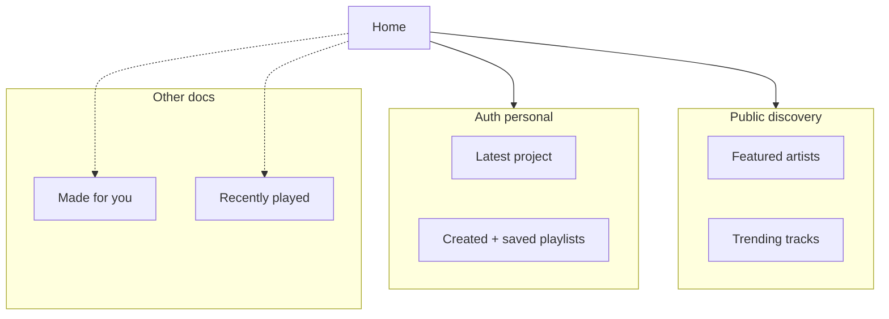

# Home Screen — Implementation Guide

**Audience:** teammates and AI agents implementing this feature end-to-end.  
**Repos:** backend (`audio-social-backend`) + mobile app (`audio-social-app`).  
**Status:** `Planned` — Home UI exists on fixtures; wire real discovery + personal sections per this doc.  
**Do not** invent Prisma models; reuse Project / Track / User / Playlist / SavedPlaylist. Made for you is **not** owned here — see [`./taste-and-recommendations.md`](./taste-and-recommendations.md).

**Related docs:** [`../project-context.md`](../project-context.md), [`./projects.md`](./projects.md), [`./publish.md`](./publish.md), [`./playlists-and-albums.md`](./playlists-and-albums.md), [`./library-saves.md`](./library-saves.md), [`./follow-and-artist-search.md`](./follow-and-artist-search.md), [`./taste-and-recommendations.md`](./taste-and-recommendations.md)

**Naming:**

| Term | Meaning |
|------|---------|
| **Discovery APIs** | Public catalog endpoints (featured artists, trending tracks) — reusable later on Explore |
| **Personal Home APIs** | Auth-required: latest project, my created + saved playlists |
| **Made for you** | Personalized rail — **out of this doc**; Home only calls its API when that module ships |

---

## 1. Goal

1. Replace Home fixture sections with real APIs (except Challenge + Recently played for now).
2. Ship **separate, reusable** discovery endpoints (not one fat `/api/home` blob).
3. Keep header / Challenge / Recently played as today until notifications / player work lands.
4. App-only music-flavored **greeting** by time of day (copy locked below).
5. Leave a clear hook for **Made for your vibe** once recommendation APIs exist.



---

## 2. Scope

### In scope

| # | Section | Work |
|---|---------|------|
| 1 | Header | Keep as-is (no API change) |
| 2 | Greeting | App-only time + music copy (locked §10) |
| 3 | Project card | Auth: latest project; **hide** if none |
| 4 | Featured artists | Public API; limit **8** |
| 5 | Trending | Public API; limit **12** |
| 6 | Playlists | Auth: viewer **created + saved**; limit **8** |
| 7 | Challenge | Keep fixture |
| 8 | Recently played | Keep fixture until real player/queue |
| 9 | Wiring | Drop Home fixtures for sections 3–6; play trending with real track UUIDs |

### Out of scope

- Made for your vibe / onboarding genres / taste (→ [`./taste-and-recommendations.md`](./taste-and-recommendations.md))
- Explore tab body (later; may reuse discovery endpoints)
- Challenge product, notifications badge logic, recently played server history
- ML recommendation engine
- Composite `GET /api/home` mega-payload

---

## 3. Locked product decisions

1. **Separate endpoints** so Explore can reuse trending / featured artists later.
2. **Public** (no auth): featured artists, trending tracks. App may still send JWT; routes must work without it.
3. **Auth required:** latest project, created + saved playlists.
4. Limits: artists **8**, trending **12**, playlists **8**.
5. Featured artists: users with **≥1 `PUBLISHED` track in last 30 days**; order primarily by **followerCount** (then recency of latest publish as tie-break). **Do not** exclude self (public catalog).
6. Trending: `PUBLISHED` tracks with `publishedAt` in **last 30 days**, sort by total **`playCount` desc** (not windowed play events).
7. Playlists rail: **viewer’s** owned playlists **plus** saved playlists (library-style merge), not global editorial “curated”.
8. No projects → **hide** project card (no empty CTA in this slice).
9. Trending (and any track rail) DTOs use **real track UUIDs** + cover/mix (or playable fields) — no fake `trending-` ids.
10. Greeting strings are **decided in this doc** — implementers must use §10, not invent copy.
11. Challenge + Recently played: unchanged fixtures.
12. Made for you: Home wires `GET` from taste doc when ready; until then keep fixture **or** hide section (prefer hide if fixture confuses QA).

---

## 4. Data model (reference only)

No new models for Home discovery. Use existing:

| Model / field | Role |
|---------------|------|
| `Project` | Latest by `updatedAt` for viewer |
| `User` + `Follow` | `followerCount` / relationship counts as already exposed |
| `Track` | `status=PUBLISHED`, `publishedAt`, `playCount`, cover/mix paths |
| `Playlist` + `SavedPlaylist` | Owned + saved lists for viewer |

---

## 5. Backend APIs

Envelope `{ success, message, data }`. Follow `.agents/skills/audio-backend-api-patterns`.

### 5.1 Public discovery

| Method | Path | Auth | Notes |
|--------|------|------|-------|
| `GET` | `/api/discover/artists/featured?limit=8` | Optional | Default/max limit 8 |
| `GET` | `/api/discover/tracks/trending?limit=12` | Optional | Default/max limit 12 |

**Featured artist item (sketch):**

```ts
{
  id: string;
  username: string;
  name: string;
  avatarUrl: string | null;
  followerCount: number;
  // optional: latestPublishedAt for debugging / tie-break
}
```

**Trending track item (sketch):**

```ts
{
  id: string; // UUID
  title: string;
  coverUrl: string | null;
  mixUrl: string | null; // or whatever publish play already returns
  playCount: number;
  publishedAt: string;
  artist: { id: string; username: string; name: string; avatarUrl: string | null };
  genres: string[];
}
```

Prefer aligning field names with existing published-track / public-profile serializers.

### 5.2 Auth personal

| Method | Path | Auth | Notes |
|--------|------|------|-------|
| `GET` | `/api/projects/latest` | Required | Single project summary or `data: null` |
| `GET` | `/api/home/playlists?limit=8` | Required | Merge owned + saved; see rules |

**Latest project (sketch):** reuse list-item shape from [`./projects.md`](./projects.md) (id, title, trackCount, updatedAt, …). `200` + `data: null` when empty (app hides card).

**Home playlist item (sketch):**

```ts
{
  id: string;
  title: string;
  coverUrl: string | null;
  coverFallbackUrls?: string[];
  trackCount: number;
  source: 'owned' | 'saved';
  owner?: { id: string; username: string; name: string }; // useful for saved
}
```

Ordering suggestion: `updatedAt` / `savedAt` desc interleaved or owned-first then saved — pick one in service and document in OpenAPI; default **most recently touched first** (owned `updatedAt` vs saved `savedAt`).

### 5.3 Made for you (reference only)

| Method | Path | Doc |
|--------|------|-----|
| `GET` | `/api/discover/tracks/made-for-you` (name per taste doc) | [`./taste-and-recommendations.md`](./taste-and-recommendations.md) |

Home app: call when section enabled; **auth required**.

---

## 6. Business rules (service)

**Featured artists**

- Candidate users who have ≥1 track with `status=PUBLISHED` and `publishedAt >= now - 30d`.
- Sort by `followerCount` desc, then latest qualifying `publishedAt` desc.
- Limit 8. Public.

**Trending tracks**

- `status=PUBLISHED` and `publishedAt >= now - 30d`.
- Sort by `playCount` desc, then `publishedAt` desc.
- Limit 12. Resolve cover/mix URLs. Public.

**Latest project**

- Viewer’s projects ordered by `updatedAt` desc, take 1.
- No rows → `null`.

**Home playlists**

- Union of viewer-owned playlists + `SavedPlaylist` rows (Unavailable handling per library-saves if playlist no longer public — prefer skip or mark unavailable; v1 may skip unavailable saved).
- Limit 8 after sort.

---

## 7. Architecture notes

```text
HomeScreen
  → GET /api/projects/latest          (auth)
  → GET /api/discover/artists/featured (public)
  → GET /api/discover/tracks/trending  (public)
  → GET /api/home/playlists            (auth)
  → [later] made-for-you               (auth) — taste doc
Greeting → local clock + §10 copy only
Challenge / Recently played → fixtures
```

---

## 8. Backend code map

| Area | Path (suggested) |
|------|------------------|
| Discover service | `src/server/modules/discover/discover.service.ts` |
| Routes | `src/app/api/discover/artists/featured`, `discover/tracks/trending`, `projects/latest`, `home/playlists` |
| OpenAPI | `discover.paths.ts`, extend projects/home as needed |

### Backend implement order

1. `GET /api/discover/tracks/trending`
2. `GET /api/discover/artists/featured`
3. `GET /api/projects/latest` (or thin wrapper over project service)
4. `GET /api/home/playlists`
5. OpenAPI + unit tests for windows/sort/limits

---

## 9. Mobile app

### Flows

- On Home mount: parallel React Query for the four endpoints above.
- Project card: render only if latest project non-null; tap → existing projects routes.
- Featured artists → `/artist/[id]`.
- Trending → `play` with **API track id** + cover/mix (same pattern as library/publish play once player supports streams).
- Playlists → `/playlists/[id]` (owned or saved).
- Greeting: `getHomeGreeting(name, Date)` using §10 buckets + lines.
- Made for you: when taste API ready, add query + section; see taste doc § Home wiring.

### Code map

| Area | Path |
|------|------|
| Screen | `src/features/home/screens/home-screen.tsx` |
| Greeting util | `src/features/home/utils/greeting.ts` |
| Fixtures to replace | `src/features/home/data/*`, shared `trending-tracks` / `featured-artists` / `curated-playlists` used by Home |
| New API | e.g. `src/features/home/api/` or `src/features/discover/api/` |

---

## 10. Defaults + locked greeting copy

| Topic | v1 default |
|-------|------------|
| Artist limit | 8 |
| Trending limit | 12 |
| Playlist limit | 8 |
| Trending window | 30 days since `publishedAt` |
| Featured window | 30 days since publish |
| Empty project | Hide card |
| Challenge / recent | Fixtures |

### Time buckets (device local time)

| Bucket | Hours | Prefix |
|--------|-------|--------|
| Morning | 05:00–11:59 | use morning lines |
| Afternoon | 12:00–16:59 | afternoon lines |
| Evening | 17:00–20:59 | evening lines |
| Night | 21:00–04:59 | night lines |

**Format:** `{line}, {displayName}` where `displayName` = `me.name` trim or `me.username`.

**Lines (pick one at random per session open, or rotate by day-of-year `% N` for stability — prefer **day-of-year stable** so the same day doesn’t flicker on re-render):**

**Morning**

1. Ready to lay down a take
2. Fresh ears, fresh session
3. Let’s find today’s tempo
4. Warm up those vocals
5. Coffee, cans, create

**Afternoon**

1. Keep the groove going
2. Midday mix energy
3. Drop into the pocket
4. Another pass on the hook
5. Soundcheck the afternoon

**Evening**

1. Golden-hour sessions hit different
2. Dim the lights, up the gain
3. Evening write mode
4. Soft light, loud ideas
5. Wind down with a melody

**Night**

1. Late-night booth vibes
2. After-hours inspiration
3. Quiet room, big sounds
4. Night owl playlist energy
5. One more take before sleep

Do **not** change this copy in implementation PRs without updating this doc.

---

## 11. Task list (code vs doc — keep honest)

### Backend

- [ ] `GET /api/discover/tracks/trending`
- [ ] `GET /api/discover/artists/featured`
- [ ] `GET /api/projects/latest`
- [ ] `GET /api/home/playlists` (owned + saved merge)
- [ ] OpenAPI + tests (30d windows, limits, null latest project)

### App

- [ ] Greeting util + locked copy (§10)
- [ ] Wire project card (hide if null)
- [ ] Wire featured artists + trending (real UUIDs)
- [ ] Wire playlists rail (created + saved)
- [ ] Remove Home fixtures for those sections
- [ ] Keep Challenge + Recently played fixtures
- [ ] Hook Made for you when taste API ships (cross-doc)

### Docs / polish

- [x] This guide created
- [ ] Update `../project-context.md` status when Home discovery ships

---

## 12. Non-goals reminder

- Not Explore redesign  
- Not Made for you architecture (taste doc)  
- Not Challenge / Recently played product  
- Not composite `/api/home`  
- Not excluding self from public featured artists  

---

## 13. Code review notes

Baseline **2026-11-14:** Home is fixture-driven (`home-screen.tsx` + shared music sections). Artist search on Explore is separate and already live. No `/api/discover/*` routes yet.
