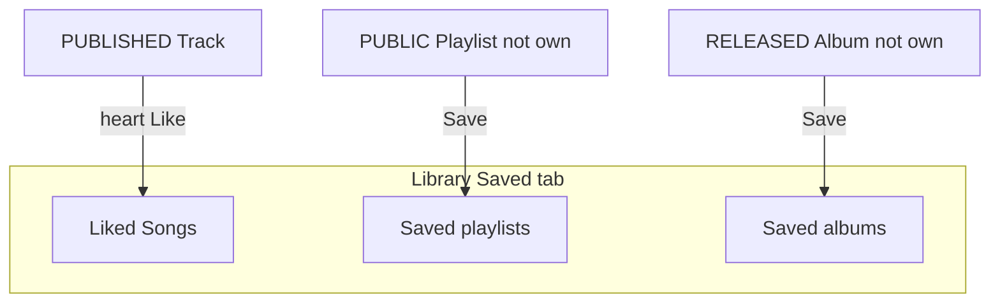

# Library Saves & Liked Songs — Implementation Guide

**Audience:** teammates and AI agents implementing this feature end-to-end.  
**Repos:** backend (`audio-social-backend`) + mobile app (`audio-social-app`).  
**Status:** `Partial` — core APIs + Library Saved tab + player heart + playlist/album Save are shipped; track GET/list DTOs still omit `likeCount` / `isLiked`.  
**Do not** invent Prisma models or a second “social like” table; Like **is** `LikedTrack`.

**Related docs:** [`../project-context.md`](../project-context.md), [`./publish.md`](./publish.md), [`./playlists-and-albums.md`](./playlists-and-albums.md), [`./track-comments.md`](./track-comments.md), [`./follow-and-artist-search.md`](./follow-and-artist-search.md)

**Naming:**

| Term | Meaning |
|------|---------|
| **Like** (songs) | Heart on a published track → `LikedTrack` + Liked Songs. Not a separate social-like system. |
| **Save** (playlists / albums) | Bookmark someone else’s public playlist or released album |
| **Liked Songs** | Viewer list from `LikedTrack` — not a `Playlist` row |
| **Follow** | Artists only — separate module |
| **Own playlist / own album** | Never saved; hide Save |

---

## 1. Goal

1. Like / unlike **PUBLISHED** tracks → personal **Liked Songs**
2. Save / unsave another user’s **PUBLIC** playlist
3. Save / unsave another user’s **RELEASED** album
4. Library → **Saved** tab (songs / playlists / albums)
5. Expose **`Track.likeCount`** and **`Playlist.saveCount`** (no album save count)
6. If target becomes ineligible later: **keep** join row → **Unavailable**



---

## 2. Scope

### In scope

| # | Item |
|---|------|
| 1 | Prisma: `LikedTrack`, `SavedPlaylist`, `SavedAlbum`, `Track.likeCount`, `Playlist.saveCount` |
| 2 | Idempotent like/unlike + save/unsave APIs |
| 3 | List Liked Songs / saved playlists / saved albums |
| 4 | `isLiked` on track DTOs; `isSaved` (+ `saveCount`) on playlist DTOs; `isSaved` on album DTOs |
| 5 | Unavailable rows in saved lists |
| 6 | Mobile Saved tab + heart + Save controls |

### Out of scope

- System Playlist named “Liked Songs”
- Separate TrackLike table
- Saving own playlists/albums
- Album `saveCount`
- Public “who liked/saved” lists
- Comment likes (see [`./track-comments.md`](./track-comments.md))
- Feed / notifications

---

## 3. Locked product decisions

1. Three tables — not one polymorphic save table.
2. Song heart = Like = Liked Songs = `LikedTrack` + `Track.likeCount`.
3. Users **may** like their own published tracks.
4. Own playlists/albums: never saved (`400` if attempted).
5. Eligibility at mutate: track `PUBLISHED`; playlist `PUBLIC` + not owner; album `RELEASED` + not owner.
6. After eligibility lost: keep row; Unavailable; do not auto-decrement counts on unpublish/private.
7. Idempotent mutations; bump counts only on real insert/delete.
8. Lists are viewer-private.
9. Share remains OS-only (not this module).

---

## 4. Data model (reference only)

Source of truth: `prisma/schema.prisma`.

| Model / field | Role |
|---------------|------|
| `LikedTrack` | `(userId, trackId)` unique; `likedAt` |
| `Track.likeCount` | Denormalized likes |
| `SavedPlaylist` | `(userId, playlistId)` unique; `savedAt` |
| `Playlist.saveCount` | Denormalized saves |
| `SavedAlbum` | `(userId, albumId)` unique; `savedAt` |

Cascades: delete User / Track / Playlist / Album removes related joins.

---

## 5. Backend APIs

Follow `.agents/skills/audio-backend-api-patterns`. Envelope `{ success, message, data }`.

### 5.1 Tracks (Liked Songs)

| Method | Path | Notes |
|--------|------|-------|
| `POST` | `/api/tracks/:id/like` | PUBLISHED; idempotent; `likeCount += 1` if new |
| `DELETE` | `/api/tracks/:id/like` | Idempotent; decrement if deleted |
| `GET` | `/api/likes/tracks` | Viewer Liked Songs; `likedAt` desc |

List item includes `available` + nested track summary when available.

**Required on track detail / published list (still open in code):**

```ts
{
  likeCount: number;
  isLiked: boolean; // viewer
}
```

### 5.2 Playlists

| Method | Path | Notes |
|--------|------|-------|
| `POST` | `/api/playlists/:id/save` | PUBLIC + not owner; bump `saveCount` if new |
| `DELETE` | `/api/playlists/:id/save` | Idempotent decrement |
| `GET` | `/api/saves/playlists` | Viewer saves |

Playlist detail should expose `saveCount` + `isSaved` (shipped).

### 5.3 Albums

| Method | Path | Notes |
|--------|------|-------|
| `POST` | `/api/albums/:id/save` | RELEASED + not owner |
| `DELETE` | `/api/albums/:id/save` | Idempotent |
| `GET` | `/api/saves/albums` | Viewer saves |

Album detail: `isSaved` only (no `saveCount`).

---

## 6. Business rules (service)

**Like track:** exists + `PUBLISHED` → create `LikedTrack` + increment if new; else 404/400 as appropriate.  
**Save playlist:** `PUBLIC` + not owner; private of others → prefer 404; own → 400.  
**Save album:** `RELEASED` + not owner; draft of others → 404; own → 400.  
**Unavailable in lists:** track not PUBLISHED; playlist not PUBLIC; album not RELEASED — still return the join with `available: false`.

Implemented in `src/server/modules/save/like.service.ts` and `save.service.ts`.

---

## 7. Architecture notes

```text
Library Saved tab / player heart / collection Save
  → POST|DELETE /api/tracks/:id/like | .../playlists|albums/:id/save
  → GET /api/likes/tracks | /api/saves/playlists | /api/saves/albums
  → LikedTrack / SavedPlaylist / SavedAlbum + denormalized counts
```

---

## 8. Backend code map

| Area | Path |
|------|------|
| Services | `src/server/modules/save/like.service.ts`, `save.service.ts` |
| Routes | `src/app/api/tracks/[id]/like`, `likes/tracks`, `playlists/[id]/save`, `albums/[id]/save`, `saves/playlists`, `saves/albums` |
| OpenAPI | `likes.paths.ts`, `saves.paths.ts` |

---

## 9. Mobile app

### Flows

- Library → **Saved**: Liked Songs / playlists / albums segments  
- Heart on mini player / Now Playing → like/unlike (optimistic; uses saves API)  
- Playlist / album detail (not owner) → Save / Saved  

### Code map

| Area | Path |
|------|------|
| Feature | `src/features/saves/` |
| Library UI | `src/features/library/` (`LibrarySavedPanel`, save button) |
| Player heart | `src/features/player/store/player.store.ts` |

---

## 10. Defaults

| Topic | v1 default |
|-------|------------|
| Song action | Like → `LikedTrack` |
| Playlist / album | Save |
| Own track like | Allowed if PUBLISHED |
| Own playlist/album save | Forbidden |
| Lost eligibility | Keep → Unavailable |
| Counts | `Track.likeCount` + `Playlist.saveCount` |

---

## 11. Task list (honest vs current code)

Audited against repo **2026-11-14**.

### Backend

- [x] Prisma `LikedTrack` / `SavedPlaylist` / `SavedAlbum` + counts  
- [x] Like/unlike + list Liked Songs  
- [x] Save/unsave playlists + `saveCount` / `isSaved` on playlist detail  
- [x] Save/unsave albums + `isSaved` on album detail  
- [x] Unavailable mapping on save/like lists  
- [x] OpenAPI paths for likes/saves  
- [ ] **Track DTO gap (not OpenAPI-only):** add `likeCount` + viewer `isLiked` in `track.service` serializers (`toDetail` / `toPublishedItem` / `toListItem` — and playlist/album collection track rows if those surfaces show hearts)  
- [ ] Mirror those fields in OpenAPI `TrackDetail` / `PublishedTrackItem` / `TrackListItem` (and collection track schemas if needed)  
- [ ] Unit tests for like/save eligibility + idempotent count bumps _(previously over-claimed)_

### App

- [x] `features/saves` service + hooks  
- [x] Library Saved tab (songs / playlists / albums)  
- [x] Player heart wired to like/unlike API (UUID tracks)  
- [x] Save controls on playlist/album detail  
- [ ] Extend track types to include `likeCount` / `isLiked` once API returns them  
- [ ] Player / profile / list rows: prefer server `isLiked` + `likeCount` on cold open (keep optimistic cache as overlay)  

### Docs / polish

- [x] This guide relocated under `docs/features/` and rewritten to template  
- [ ] Update `../project-context.md` status row when DTO gap is closed  

---

## 12. Non-goals reminder

- Not a Liked Songs Playlist entity  
- Not comment likes  
- Not Follow  
- Not Feed / notifications  
- Not album save counts  

---

## 13. Code review notes

Gaps vs this doc (2026-11-14):

- `track.service` `toDetail` / OpenAPI `TrackDetail` & `PublishedTrackItem` expose `playCount` / `commentCount` but **not** `likeCount` / `isLiked`.
- Playlist service correctly returns `saveCount` + `isSaved`.
- App player likes via direct `likeTrack` / `unlikeTrack` and cache helpers; still needs server-provided `isLiked` on track payloads for cold open / profiles.
