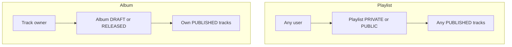

# Playlists & Albums — Implementation Guide

**Audience:** humans and AI agents implementing this feature end-to-end.  
**Repos:** backend (`audio-social-backend`) + mobile app (`audio-social-app`).  
**Status:** `Partial` — Spotify-style **detail** (open one playlist/album → cover + title + song list + play/add) is shipped. **Still open:** owner **Edit** via ⋮ menu → dedicated edit form screen (title / description / visibility or album fields / cover); playlist collage fallback; track reorder on detail. Do **not** invent alternate models.

**Related docs:** `./publish.md` (published-only tracks, Unavailable), `./projects.md` (private studio folders — different feature).

**Naming:**

| Term | Meaning |
|------|---------|
| **Playlist** | Listener-curated list of **any** PUBLISHED tracks; private or public |
| **Album** | Artist release grouping of **own** PUBLISHED tracks; DRAFT or RELEASED |
| **Project** | Private workplace (drafts + published); not this module |
| **Save / library** | See `./library-saves.md` (Liked Songs + saved playlists/albums) |

Mobile Library albums/playlists panels are **UI reference only**. API + Prisma are SSOT.

---

## 1. Goal

### Playlists (Spotify-style listening)

1. Any user creates playlists (title, description, optional cover, visibility)
2. Add **published** tracks from any artist
3. Reorder / remove tracks; delete playlist without deleting tracks
4. **PRIVATE** = owner only; **PUBLIC** = discoverable on profile / search later
5. Cover: custom upload **or** client collage of up to 4 track covers (1 / 2 / 3 / 4 layout)

### Albums (artist releases)

1. Artist creates albums from **own published** tracks only
2. One track belongs to **at most one** album
3. Album **DRAFT** while assembling; **RELEASED** when ready for album surface
4. While album is DRAFT, member tracks that are already PUBLISHED **still appear** as singles on the public profile (singles-first, then group into album)
5. Cover: custom upload **or** fallback to **first track** cover (by position) — not a collage
6. Delete album without deleting tracks



---

## 2. Scope

### In scope

| # | Item |
|---|------|
| 1 | Prisma: `Playlist`, `PlaylistTrack`, `Album`, `AlbumTrack` + enums |
| 2 | Playlist CRUD, visibility, ordered attach/detach/reorder, cover upload |
| 3 | Album CRUD, DRAFT/RELEASED, ordered attach/detach/reorder (own published only), cover upload |
| 4 | Detail DTOs: track rows with playable vs **Unavailable** when track no longer PUBLISHED |
| 5 | Owner lists + public list primitives (public playlists / released albums by user) |
| 6 | Mobile: replace Library playlist/album fixtures; wire create/edit/detail |
| 7 | Cover fallbacks documented (collage vs first-track) — collage is **client-side** |

### Out of scope

- **Save / follow** playlist, album, or song (see `./library-saves.md`)
- Collaborative playlist editors
- Unlisted / friends-only visibility
- Generating and storing collage images on the server
- Feed ranking / search indexing beyond basic list-by-owner endpoints
- Changing Project or Publish rules

---

## 3. Locked product decisions

### Shared

1. Membership only for tracks with `status === PUBLISHED` at **attach** time.
2. If a track is later unpublished: keep join row; detail UI shows **Unavailable** (not removed automatically).
3. Delete playlist/album → cascade join rows only; **tracks untouched**.
4. Title required (trim, 1–100); description optional (max 500).
5. Optional `coverPath`; same image limits as track cover (5 MB; jpeg/png/webp) via object-storage adapter (Supabase now).
6. Bump parent `updatedAt` on metadata change and on add/remove/reorder of tracks.
7. Collaborators / multi-owner: out of scope.

### Playlist

8. Visibility: **`PRIVATE` | `PUBLIC`** only.
9. Tracks: many-to-many with **any** user’s published tracks; ordered by `position` (0-based dense list).
10. Same track may appear in many playlists; not twice in the same playlist (`@@unique([playlistId, trackId])`).
11. Cover fallback: **client collage** of first 1–4 playable track covers (Spotify-style grids). Do not persist collage.
12. Owner does not “save” their own playlist (no-op / hide control). Others save public playlists via `./library-saves.md`.

### Album

13. Tracks: **owner’s** published tracks only; ordered by `position`.
14. **One album per track** — `AlbumTrack.trackId` is unique globally.
15. Status: **`DRAFT` | `RELEASED`**. Set `releasedAt` on first transition to RELEASED; keep on unrelease if you add unrelease later (v1: allow DRAFT ← → RELEASED).
16. Album DRAFT does **not** hide member tracks from public profile as singles.
17. Cover fallback: **first track by position** cover URL (not collage). Custom cover overrides.
18. Album save: others only, via `./library-saves.md` (own albums never saved).

### Relationship to singles workflow

19. Artists often publish singles first, then add them to an album — supported. Releasing the album is grouping + album surface, not a second publish of the audio.

---

## 4. Data model (reference only)

Source of truth: `prisma/schema.prisma`.

| Model / enum | Role |
|--------------|------|
| `PlaylistVisibility` | `PRIVATE` \| `PUBLIC` |
| `Playlist` | Owner, title, description, coverPath, visibility |
| `PlaylistTrack` | Join + `position` + `addedAt` |
| `AlbumStatus` | `DRAFT` \| `RELEASED` |
| `Album` | Owner, title, description, coverPath, status, releasedAt |
| `AlbumTrack` | Join + `position`; **`trackId` unique** (one album max) |

**Cascades:** delete User → playlists/albums; delete Playlist/Album → joins only; delete Track → its playlist/album join rows.

**Reorder:** no unique constraint on `position` (avoids swap deadlocks). Service rewrites positions 0..n-1 in a transaction.

---

## 5. Cover storage paths

Via existing object-storage adapter pattern (`./publish.md`):

| Asset | Path helper |
|-------|-------------|
| Playlist cover | `buildPlaylistCoverPath(userId, playlistId, ext)` → `{userId}/playlists/{playlistId}/cover.{ext}` |
| Album cover | `buildAlbumCoverPath(userId, albumId, ext)` → `{userId}/albums/{albumId}/cover.{ext}` |

Display DTO should resolve:

- `coverUrl` from `coverPath` when set  
- else playlist: `coverFallbackUrls: string[]` (up to 4 track cover URLs, skip unavailable) for client collage  
- else album: `coverFallbackUrl` from first positioned track’s cover  

---

## 6. Backend APIs

Auth + envelope same as tracks. All mutating routes require ownership unless noted.

### 6.1 Playlists — CRUD

| Method | Path | Notes |
|--------|------|-------|
| `POST` | `/api/playlists` | `{ title, description?, visibility? }` default PRIVATE |
| `GET` | `/api/playlists` | Owner’s playlists (`updatedAt` desc); include `trackCount`, `coverUrl` / fallback meta |
| `GET` | `/api/playlists/:id` | Owner **or** PUBLIC; else 404 |
| `PATCH` | `/api/playlists/:id` | title / description / visibility |
| `DELETE` | `/api/playlists/:id` | Joins only |

### 6.2 Playlist tracks

| Method | Path | Notes |
|--------|------|-------|
| `POST` | `/api/playlists/:id/tracks` | `{ trackIds: string[] }` — each must be PUBLISHED; append at end; idempotent skip dupes |
| `DELETE` | `/api/playlists/:id/tracks/:trackId` | Unlink; renumber positions |
| `PUT` | `/api/playlists/:id/tracks/reorder` | `{ trackIds: string[] }` full ordered id list (must match membership) |

Detail track item:

```ts
{
  id: string;
  position: number;
  addedAt: string;
  available: boolean; // false if not PUBLISHED anymore
  // when available: title, artist, durationMs, mixUrl, coverUrl, ...
  // when unavailable: minimal { id, title? } + available: false
}
```

### 6.3 Playlist cover

| Method | Path |
|--------|------|
| `POST` | `/api/playlists/:id/cover/upload-url` |
| `POST` | `/api/playlists/:id/cover/complete` |
| `DELETE` | `/api/playlists/:id/cover` |

### 6.4 Public playlists by user

`GET /api/users/:userId/playlists` → `visibility = PUBLIC` only (for profile).

### 6.5 Albums — CRUD

| Method | Path | Notes |
|--------|------|-------|
| `POST` | `/api/albums` | `{ title, description? }` status DRAFT |
| `GET` | `/api/albums` | Owner’s albums |
| `GET` | `/api/albums/:id` | Owner always; others only if `RELEASED` |
| `PATCH` | `/api/albums/:id` | title / description |
| `POST` | `/api/albums/:id/release` | → RELEASED, set `releasedAt` if null |
| `POST` | `/api/albums/:id/unrelease` | → DRAFT (optional but recommended for symmetry); tracks stay PUBLISHED |
| `DELETE` | `/api/albums/:id` | Joins only |

### 6.6 Album tracks

| Method | Path | Notes |
|--------|------|-------|
| `POST` | `/api/albums/:id/tracks` | `{ trackIds }` — must be **owner’s** PUBLISHED; fail if track already on another album |
| `DELETE` | `/api/albums/:id/tracks/:trackId` | Unlink; track remains published single |
| `PUT` | `/api/albums/:id/tracks/reorder` | Full ordered id list |

Unavailable rule same as playlist if a member track is unpublished while still linked.

### 6.7 Album cover

Same upload/complete/delete pattern under `/api/albums/:id/cover/...`.

### 6.8 Public albums by user

`GET /api/users/:userId/albums` → `status = RELEASED` only.

Public profile **tracks** list remains all PUBLISHED tracks (including those on a DRAFT album).

---

## 7. Business rules (service)

**Playlist attach**

- Track exists and `PUBLISHED`
- Not already in playlist
- Assign `position = max+1` (or 0 if empty)

**Album attach**

- `track.userId === album.userId`
- `track.status === PUBLISHED`
- No existing `AlbumTrack` for that `trackId` (else `409 CONFLICT`)
- Assign next position

**Reorder**

- Incoming `trackIds` must be a permutation of current members
- Rewrite `position` 0..n-1 in one transaction
- Touch parent `updatedAt`

**Release album**

- Allow empty album release? Prefer **require ≥1 track** (product: reject empty release with 400)

**Unpublish track** (existing publish module)

- Does not auto-remove from playlist/album; consumers use `available`

---

## 8. Architecture notes

```text
Mobile Library → Playlists / Albums tabs
       │
       ▼
REST JWT → playlist.service / album.service → Postgres
       │
       └─ covers → object storage adapter (Supabase)
```

- Collage rendering: **app only** using `coverFallbackUrls`
- Playback: use track mix URLs from publish module; skip or disable play when `available === false`

---

## 9. Backend code map

| Area | Path |
|------|------|
| Prisma | `schema.prisma` + migration |
| Services | `src/server/modules/playlist/`, `src/server/modules/album/` |
| Validators | Zod title/description/visibility/status/trackIds |
| Cover paths | `storage-path.ts` (`buildPlaylistCoverPath`, `buildAlbumCoverPath`) |
| Routes | `src/app/api/playlists/...`, `src/app/api/albums/...`, `src/app/api/users/[id]/playlists`, `.../albums` |
| OpenAPI | `playlists.paths.ts`, `albums.paths.ts` |

### Backend implement order

1. Migrate + generate  
2. Playlist CRUD + tracks attach/detach/reorder + cover  
3. Album CRUD + release/unrelease + tracks + cover  
4. Public-by-user list endpoints  
5. Unavailable mapping in detail DTOs  
6. OpenAPI + unit tests (ownership, published-only attach, one-album-per-track, visibility)

---

## 10. Mobile app

### 10.1 Design

Reuse Library **Playlists** / **Albums** tab chrome; replace fixtures with API.

### 10.2 Flows

**Playlist**

- Create (title, description, visibility)  
- Detail: ordered tracks; tap available → player; unavailable → Unavailable state  
- Add published tracks (search/picker — may start with “my published” + later any artist)  
- Owner ⋮ menu → **Edit** → dedicated edit form screen (not a dialog)  
- Reorder on detail; cover from edit screen or collage fallback  
- Delete playlist confirm (can stay on ⋮ menu)

**Album**

- Create DRAFT; add own published tracks; reorder  
- Owner ⋮ menu → **Edit** → dedicated edit form screen  
- Release / unrelease (detail or ⋮)  
- Cover custom (edit screen) or first-track fallback  
- Profile: list RELEASED albums; track grid still shows all published singles  

### 10.3 Owner edit UX (locked)

Detail stays the Spotify-style listen/manage list. Editing metadata/cover is a **separate simple form screen**:

1. Owner taps **⋮** on playlist/album detail (menu icon already present).  
2. Choose **Edit** → navigate to e.g. `/playlists/[id]/edit` or `/albums/[id]/edit`.  
3. Form fields: title, description, playlist visibility (PUBLIC/PRIVATE), cover (pick / upload / remove).  
4. Save → `PATCH` + cover upload APIs → back to detail.  

Replace today’s `CollectionEditDialog` for this path. Keep attach-tracks / delete / release as menu or detail actions as today unless product moves them later.

### 10.4 Collage

Client builds 1 / 2×1 / L-shape or 2×2 from `coverFallbackUrls` length 1–4 (match Spotify-ish layouts). No server image compose in v1. Show collage on **detail** (and library cards) when `coverUrl` is null.

---

## 11. Defaults

| Topic | v1 default |
|-------|------------|
| New playlist visibility | PRIVATE |
| New album status | DRAFT |
| Empty album release | Not allowed |
| Save playlist/album/song | `./library-saves.md` |
| Position | 0-based, rewritten on mutate |
| Unpublished member | Unavailable row |

---

## 12. Related plan

**Library saves / Liked Songs** — separate slice: `./library-saves.md` (`LikedTrack` + `Track.likeCount`; `SavedPlaylist` / `SavedAlbum` + playlist `saveCount`). Song heart = Like → Liked Songs (not a second social-like system).

---

## 13. Task list

1. [x] Prisma models + path helpers in repo  
2. [x] Migration applied + `prisma generate`  
3. [x] Playlist module APIs  
4. [x] Album module APIs + release  
5. [x] Cover upload APIs for both _(backend)_  
6. [x] Public-by-user endpoints  
7. [x] OpenAPI + tests  
8. [x] **Detail screen (Spotify visit-one-playlist/album):** Library → `/playlists/[id]` + `/albums/[id]` with overview cover, ordered song list, tap-to-play, Unavailable rows, owner attach/unlink/edit/delete, album release/unrelease, non-owner Save — `playlist-detail-screen.tsx` / `album-detail-screen.tsx`  
9. [x] Remove album/playlist fixtures from Library tabs  

### Remaining app work

8a. [ ] **Edit form screens** (owner): from detail ⋮ → Edit → `/playlists/[id]/edit` + `/albums/[id]/edit`  
     - Fields: title, description, playlist visibility; album title/description  
     - Cover: pick image → existing cover upload-url / complete / delete APIs (same pattern as track/profile)  
     - Replace `CollectionEditDialog` for metadata/cover edit  
8b. [ ] **Client collage** on detail/library when playlist has no `coverUrl`: 1–4 tiles from `coverFallbackUrls` (today only `[0]` is used)  
8c. [ ] **Track reorder UI** on owner **detail** (not edit form) — wire existing reorder API + hooks  


---

## 14. Non-goals reminder

- Not Projects  
- Not Library Saves APIs (see `./library-saves.md`)  
- Not collaborative playlists  
- Not server-side collage generation  
- Not forcing album release to republish tracks (tracks stay independently PUBLISHED)  
