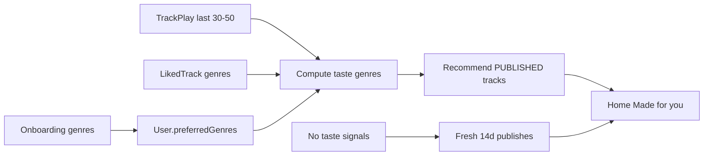

# Taste & Recommendations — Implementation Guide

**Audience:** teammates and AI agents implementing this feature end-to-end.  
**Repos:** backend (`audio-social-backend`) + mobile app (`audio-social-app`).  
**Status:** `Done` — lightweight heuristic personalization. Powers **Made for your vibe** on Home; genres from onboarding (`TRACK_GENRES` → `preferredGenres`) + `TrackPlay`.  
**Do not** invent a parallel mobile history sync engine for v1. This is a **small** taste module only.

**Related docs:** [`../project-context.md`](../project-context.md), [`./home.md`](./home.md), [`./publish.md`](./publish.md), [`./edit-profile.md`](./edit-profile.md), [`./library-saves.md`](./library-saves.md), [`./follow.md`](./follow.md)

**Naming:**

| Term | Meaning |
|------|---------|
| **preferredGenres** | Optional user-selected genre ids from onboarding / settings (`TRACK_GENRES`) |
| **Taste (computed)** | preferredGenres + genres from recent `TrackPlay` (+ like boost) — computed on read in v1 |
| **Made for you** | Recommended **tracks** rail on Home |
| **Cold start fallback** | Fresh publishes (14d by `publishedAt`) — **not** the same as Home trending |

---

## 1. Goal

1. Persist **onboarding genre picks** via user API (`preferredGenres`).
2. Make app onboarding genre picker use **`TRACK_GENRES` SSOT** (same ids/labels as publish).
3. Build a small backend heuristic using **`TrackPlay`** (+ preferred genres, likes boost).
4. Expose **recommended tracks** API for Home **Made for your vibe**.
5. Wire Home section to that API (Home doc owns layout; this doc owns architecture).



---

## 2. Scope

### In scope

| # | Item |
|---|------|
| 1 | Prisma: `User.preferredGenres String[]` (default `[]`) |
| 2 | `GET`/`PATCH /api/user` expose + accept `preferredGenres` (1–6 ids from `TRACK_GENRES` when provided) |
| 3 | Align mobile onboarding picker to `TRACK_GENRES` / `TRACK_GENRE_LABELS` |
| 4 | `GET` recommended tracks (Made for you) — **tracks only** |
| 5 | Heuristic: preferred + last 30–50 plays + likes boost; exclude own tracks |
| 6 | Cold start: fresh 14d by `publishedAt`; if empty → empty list (Home **hides** section) |
| 7 | Home wiring notes for Made for you |

### Out of scope

- Separate `UserTaste` / score table (v1 computes on read; cache later if needed)
- Mobile offline history queue / daily sync engine
- Recommend artists or playlists (later)
- Feed ranking
- Changing Home trending / featured artists (→ [`./home.md`](./home.md))

---

## 3. Locked product decisions

1. **Genre SSOT:** `src/server/constants/track-genres.ts` (`TRACK_GENRES`). App onboarding must use the same ids (replace legacy `features/onboarding/data/genres.ts` list).
2. **Onboarding selection:** optional step overall, but if the user submits genres → **min 1, max 6**. Empty array = skipped / cleared.
3. **Storage v1:** `User.preferredGenres String[]` only — **no** 1:1 taste table yet.
4. **API:** extend existing **`GET` / `PATCH /api/user`** (not a dedicated `/onboarding/genres` route).
5. **Play signal:** use existing **`TrackPlay`** rows (social play recording). No parallel client history for v1.
6. **Taste inputs:** `preferredGenres` ∪ genres from last **30–50** `TrackPlay` tracks (newest first) ∪ genre boost from **liked** tracks (lighter weight than plays if both present — implementer: plays primary, likes fill gaps).
7. **Output v1:** **tracks only**.
8. **Exclude** viewer’s own tracks from Made for you.
9. **Cold start** (no preferred genres and no usable play/like genre signal): return **fresh** `PUBLISHED` with `publishedAt >= now - 14d`, sort `publishedAt desc`, exclude own, same limit. **Not** identical to trending (`playCount` / 30d). If still empty → `[]` and Home hides the section.
10. Cross-link: Home calls this API; this doc defines service rules.

---

## 4. Data model (reference only)

Source of truth: `prisma/schema.prisma`.

| Model / field | Role |
|---------------|------|
| `User.preferredGenres` | `String[]` — ids ⊆ `TRACK_GENRES`, max 6 |
| `Track.genres` | Publish genres (1–3) — used when matching recommendations |
| `TrackPlay` | Recent listen history for taste |
| `LikedTrack` | Optional genre boost |

Migration: add `preferredGenres String[] @default([])` on `User` (Postgres text array, same pattern as `Track.genres`).

---

## 5. Backend APIs

### 5.1 User preferred genres

| Method | Path | Auth | Notes |
|--------|------|------|-------|
| `GET` | `/api/user` | Required | Include `preferredGenres: string[]` on `MeDto` |
| `PATCH` | `/api/user` | Required | Optional `preferredGenres`; validate each id ∈ `TRACK_GENRES`; length 0 or 1–6 |

When `preferredGenres` is sent as `[]`, clear preferences. Omit field → leave unchanged. Invalid id → `400`.

Onboarding screen: after picks, `PATCH` with selected ids (or skip without calling / call with `[]` per product — **skip = no PATCH or PATCH `[]`**; prefer **no PATCH on skip** so we don’t wipe later edits).

### 5.2 Made for you tracks

| Method | Path | Auth | Notes |
|--------|------|------|-------|
| `GET` | `/api/discover/tracks/made-for-you?limit=12` | **Required** | Default/max 12 |

**Item sketch:** align with Home trending track DTO (real UUID, title, coverUrl, mixUrl, artist, genres, playCount, …).

```ts
{
  id: string;
  title: string;
  coverUrl: string | null;
  mixUrl: string | null;
  playCount: number;
  genres: string[];
  artist: { id: string; username: string; name: string; avatarUrl: string | null };
  reason?: 'taste' | 'fresh'; // optional debug/UI hint
}
```

---

## 6. Business rules (service)

### 6.1 Build taste genre set

1. Start with `user.preferredGenres`.
2. Load last **50** `TrackPlay` for user (`createdAt` desc); collect `Track.genres` from those tracks (still PUBLISHED or any? — use genres even if later unpublished, but **recommend** only PUBLISHED). Cap contribution to first **30–50** plays as configured (use **50** fetch, weigh newest higher if needed).
3. Optionally load recent likes’ track genres to fill if play set is thin.
4. Produce a multiset / frequency map of genre ids; take top genres (e.g. top 5–8 distinct).

### 6.2 Personalized query

- `Track.status = PUBLISHED`, `userId != viewer`.
- `genres` array overlaps taste set (`hasSome` in Prisma).
- Prefer higher overlap, then `playCount` desc, then `publishedAt` desc.
- Exclude track ids already in viewer’s `LikedTrack` **optional** — locked: exclude **own** only for v1; may still show liked tracks.
- Limit 12.

### 6.3 Cold start (fresh)

If taste genre set is empty:

- `PUBLISHED`, `userId != viewer`, `publishedAt >= now - 14d`.
- Order `publishedAt desc`.
- Limit 12.
- If zero rows → return `[]`.

### 6.4 Publish genre vs preference counts

- Track publish remains **1–3** genres ([`./publish.md`](./publish.md)).
- User preference allows **1–6**. Different caps by design.

---

## 7. Architecture notes

```text
Onboarding genre picker (TRACK_GENRES)
  → PATCH /api/user { preferredGenres }

Social play → existing TrackPlay write (publish play API)

GET /api/discover/tracks/made-for-you
  → load preferredGenres + recent TrackPlay (+ likes)
  → overlap query OR fresh 14d fallback
  → track DTOs

Home Made for your vibe section
  → auth query → hide if data.length === 0
```

**v1 explicitly skips:** client-side history DB, interval sync queue, `UserTaste` denormalized table.

---

## 8. Backend code map

| Area | Path (suggested) |
|------|------------------|
| Genres constant | `src/server/constants/track-genres.ts` (existing) |
| User service / validator | `src/server/modules/user/*` — `preferredGenres` |
| Recommend / taste | `src/server/modules/discover/taste.service.ts` or `recommend.service.ts` |
| Route | `src/app/api/discover/tracks/made-for-you/route.ts` |
| OpenAPI | user paths + discover paths |

### Backend implement order

1. Migration `User.preferredGenres`
2. `GET`/`PATCH /api/user` + Zod (1–6 / empty / SSOT ids)
3. Made-for-you service (taste + fresh fallback)
4. Route + OpenAPI + tests (exclude self, cold start ≠ trending sort)

---

## 9. Mobile app

### Flows

1. **Onboarding:** replace local genre catalog with shared `TRACK_GENRES` labels (mirror backend ids). Selection 1–6; skip allowed. On continue with selection → `PATCH /api/user`.
2. **Edit later (optional in this slice):** settings/profile can PATCH genres; not required if only onboarding.
3. **Home Made for you:** `useQuery` → `GET /api/discover/tracks/made-for-you`; hide section if empty; play with real UUIDs.
4. Ensure social play path still records `TrackPlay` so taste improves over time (listen player records play on cold-open when `mixUrl` streams).

### Code map

| Area | Path |
|------|------|
| Onboarding picker | `src/features/onboarding/screens/genre-picker-screen.tsx` |
| Genre data | Replace `src/features/onboarding/data/genres.ts` with track-genres SSOT (shared with publish sheet constants) |
| User API | `src/features/profile/api/*` — MeDto + patch |
| Home section | `src/features/home/...` MadeForYourVibeSection |

### Home wiring (cross-doc)

| Concern | Home doc | This doc |
|---------|----------|----------|
| Section placement / hide rules | [`./home.md`](./home.md) §3 / §9 | Cold start empty → hide |
| API path + auth | Call site only | Full contract §5–6 |
| Fixture removal for Made for you | After API live | After API live |

---

## 10. Defaults

| Topic | v1 default |
|-------|------------|
| preferredGenres max | 6 |
| preferredGenres min when set | 1 |
| Play history window | last 50 `TrackPlay` rows |
| Made-for-you limit | 12 |
| Cold start window | 14 days `publishedAt` |
| Cold start sort | `publishedAt` desc |
| Exclude | Own tracks |
| UserTaste table | No |
| Mobile sync queue | No |

---

## 11. Task list (code vs doc — keep honest)

### Backend

- [x] Prisma `User.preferredGenres` + migrate (`20261114160000_user_preferred_genres`)
- [x] `MeDto` + `PATCH` validation for preferredGenres
- [x] `GET /api/discover/tracks/made-for-you` (taste + fresh fallback)
- [x] OpenAPI registered + unit tests (taste cold-start / ranking / fresh fallback)

### App

- [x] Onboarding genres = `TRACK_GENRES` SSOT (ids/labels)
- [x] Persist picks via `PATCH /api/user` (draft held until after signup/login; skip = no PATCH)
- [x] Home Made for you wired; hide if empty
- [x] Remove Made-for-you fixtures when live

### Docs / polish

- [x] This guide created
- [x] Update `../project-context.md` when taste + Home section ship

---

## 12. Non-goals reminder

- Not Explore filters product  
- Not artist/playlist recommendations in v1  
- Not mobile taste processing / daily upload queue  
- Not replacing Home trending logic  
- Not Feed  

---

## 13. Code review notes

Shipped **2026-11-14** (backend + Home); onboarding flush completed **2026-11-26:**

- `User.preferredGenres` + Me DTO / PATCH validation against `TRACK_GENRES`.
- Onboarding picker uses `TRACK_GENRES` SSOT (max 6); draft → `PATCH /api/user` after signup/login; skip clears draft (no PATCH).
- `GET /api/discover/tracks/made-for-you` heuristic + fresh 14d cold start; Home section hides when empty.
