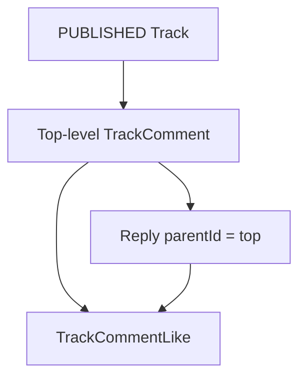

# Track Comments — Implementation Guide

**Audience:** humans and AI agents implementing this feature end-to-end.  
**Repos:** backend (`audio-social-backend`) + mobile app (`audio-social-app`).  
**Status:** `Partial` — APIs + Now Playing comments wired for API track ids; **Newest | Top** sort UI still missing (API supports `sort`, app always uses default `newest`). Do **not** invent alternate models.

**Related docs:** `./publish.md` (PUBLISHED gate), `./library-saves.md` (song **heart** = Liked Songs / `likeCount` — **not** comment likes).

**Naming:**

| Term | Meaning |
|------|---------|
| **Track like** | Heart on the song → `LikedTrack` (library-saves). Separate from comments. |
| **Comment** | Text on a PUBLISHED track (`TrackComment`) |
| **Reply** | One-level child of a top-level comment (`parentId` set) |
| **Comment like** | Heart on a comment (`TrackCommentLike` + `TrackComment.likeCount`) |

Now Playing comments UI is **reference only**. API + Prisma are SSOT.

---

## 1. Goal

1. Authenticated users comment on **PUBLISHED** tracks (including their own)
2. **One-level replies** only (reply to a top-level comment; no nested threads)
3. **Like / unlike** comments
4. Author can **hard-delete** own comment (parent delete **cascades** replies)
5. List with client sort: **newest** or **top** (by comment `likeCount`)
6. Expose denormalized **`Track.commentCount`** (all comments including replies)



---

## 2. Scope

### In scope

| # | Item |
|---|------|
| 1 | Prisma: `TrackComment`, `TrackCommentLike`, `Track.commentCount` |
| 2 | Create top-level comment + reply (1-level) |
| 3 | List comments (`sort=newest\|top`) with replies |
| 4 | Delete own comment (hard delete; cascade replies) |
| 5 | Like / unlike comment + `likeCount` |
| 6 | Bump `Track.commentCount` on create/delete (including cascaded replies) |
| 7 | Mobile: wire Now Playing comments block (composer, list, reply, like, delete, sort) |

### Out of scope

- Soft delete / “[deleted]” placeholders  
- Track owner deleting others’ comments  
- Edit comment  
- Report / moderation / block  
- @mentions  
- Nested replies beyond one level  
- Comments on DRAFT / unpublished tracks  
- Notifications (“X commented”) — later  
- Feed / share analytics  

---

## 3. Locked product decisions

1. Comments only when `track.status === PUBLISHED`.
2. Own track: **may** comment.
3. Body: trim required; **max 300** characters (Zod).
4. Replies: `parentId` must reference a **top-level** comment on the **same** track. Reject reply-to-reply (`400`).
5. **Hard delete.** Author only (`403` if not author). Deleting a top-level comment cascades replies + their likes (DB `ON DELETE CASCADE`).
6. Track owner has **no** extra delete rights in v1.
7. Sort query: `newest` (default) = `createdAt` desc for top-level; `top` = `likeCount` desc, then `createdAt` desc. Replies under each parent: `createdAt` asc.
8. Comment like: idempotent; bump `TrackComment.likeCount` only on real insert/delete.
9. `Track.commentCount` = count of **all** comment rows (top-level + replies). On delete parent with N replies, decrement by `1 + N` (or recount in transaction — prefer accurate decrement from known subtree size).
10. Unpublish: comments **remain** in DB; public comment APIs require PUBLISHED (return `404` for non-published). Owner tooling can ignore comments until re-publish (no auto-wipe).

---

## 4. Data model (reference only)

Source of truth: `prisma/schema.prisma`.

| Model / field | Role |
|---------------|------|
| `TrackComment` | `trackId`, `userId`, `parentId?`, `body`, `likeCount`, `createdAt` |
| `TrackCommentLike` | `(userId, commentId)` unique |
| `Track.commentCount` | Denormalized total comments including replies |

**Cascades:** delete Track → comments; delete parent comment → replies; delete comment → likes; delete User → their comments/likes.

---

## 5. Backend APIs

Auth required for mutate. List may require auth (same as other social reads) — **auth required** for v1 consistency.

### 5.1 List / create on track

| Method | Path | Notes |
|--------|------|-------|
| `GET` | `/api/tracks/:id/comments?sort=newest\|top` | Track must be PUBLISHED; return top-level + nested `replies[]` |
| `POST` | `/api/tracks/:id/comments` | Body: `{ body: string, parentId?: string }` |

Create response: comment DTO. Increment `commentCount` by 1.

### 5.2 Delete

| Method | Path | Notes |
|--------|------|-------|
| `DELETE` | `/api/comments/:id` | Author only; hard delete; adjust `commentCount` |

### 5.3 Comment like

| Method | Path | Notes |
|--------|------|-------|
| `POST` | `/api/comments/:id/like` | Idempotent; `likeCount += 1` if new |
| `DELETE` | `/api/comments/:id/like` | Idempotent; decrement if deleted |

Comment’s track must still be PUBLISHED for like (else `404`).

### 5.4 DTOs

```ts
type CommentAuthor = {
  id: string;
  username: string;
  name: string | null;
  avatarUrl: string | null;
};

type TrackCommentDto = {
  id: string;
  body: string;
  createdAt: string;
  likeCount: number;
  isLiked: boolean; // viewer
  isOwn: boolean;
  author: CommentAuthor;
  replies?: TrackCommentDto[]; // only on top-level list items; replies omit nested replies
};

// Track detail / player meta also expose:
// commentCount: number
```

---

## 6. Business rules (service)

**Create top-level**

- Track PUBLISHED  
- `body` length 1–300 after trim  
- `parentId` omitted/null  
- Insert; `commentCount += 1`

**Create reply**

- Track PUBLISHED  
- Parent exists, `parent.trackId === trackId`, `parent.parentId === null`  
- Else `400` (reply-to-reply or wrong track)  
- Insert; `commentCount += 1`

**Delete**

- Load comment; if `userId !== viewer` → `403`  
- If top-level: count replies `R`; delete comment (cascade); `commentCount -= (1 + R)` (floor 0)  
- If reply: delete; `commentCount -= 1`

**List**

- Only top-level rows (`parentId` null), ordered by sort  
- Include replies ordered by `createdAt` asc  
- Include `isLiked` / `isOwn` for viewer

---

## 7. Architecture notes

```text
Now Playing comments
       │
       ▼
GET/POST /api/tracks/:id/comments
DELETE /api/comments/:id
POST|DELETE /api/comments/:id/like
       │
       ▼
TrackComment (+ likes) → Postgres
Track.commentCount denormalized
```

Song heart on the player stays on **Liked Songs** (`./library-saves.md`), not this module.

---

## 8. Backend code map

| Area | Path |
|------|------|
| Prisma | `schema.prisma` + `20261106160000_track_comments` |
| Service | `src/server/modules/comment/` (or `track-comment/`) |
| Validators | Zod body max 300; `parentId` uuid optional; sort enum |
| Routes | `api/tracks/[id]/comments`, `api/comments/[id]`, `api/comments/[id]/like` |
| OpenAPI | `comments.paths.ts` |

### Backend implement order

1. Migrate + generate  
2. Create + list (newest/top) + reply validation  
3. Delete own + `commentCount` math  
4. Comment like/unlike  
5. OpenAPI + tests (1-level only, authz, counts, PUBLISHED gate)  

---

## 9. Mobile app

### 9.1 Now Playing

- Replace `PLAYER_COMMENTS` fixtures with API  
- Sort control: Newest | Top  
- Composer → `POST` (optional `parentId` when replying)  
- Heart on comment → like/unlike  
- Delete on own rows  
- Show `commentCount` in header  

### 9.2 Out of this slice

- Comment notifications  
- Opening comments from Feed (Feed deferred)  

---

## 10. Defaults

| Topic | v1 default |
|-------|------------|
| Body max | 300 |
| Replies | 1 level |
| Delete | Hard; author only; cascade replies |
| Sort | `newest` default; `top` optional |
| Own track comment | Allowed |
| Track owner mod delete | No |
| `commentCount` | Includes replies |

---

## 11. Relationship to other modules

| Module | Interaction |
|--------|-------------|
| Publish | Comments only on PUBLISHED; unpublish → comment routes 404 |
| Library saves | Song like ≠ comment like |
| Follow | Author chip may link to profile; no follow change here |
| Notifications | Out of scope |

---

## 12. Task list

1. [x] Prisma models + `commentCount` + migration  
2. [x] `prisma generate` / migrate applied  
3. [x] Create + list + reply rules  
4. [x] Delete own + count updates  
5. [x] Comment like/unlike  
6. [x] OpenAPI + tests  
7. [x] Mobile Now Playing comments wired _(list / post / reply / like / delete own for API track ids; fixtures remain for non-API tracks)_  

### Remaining app work

8. [ ] **Newest | Top sort UI** in `player-comments.tsx` (`LiveComments`):  
     - Add two chips/tabs: Newest / Top  
     - Hold sort in local state (`'newest' | 'top'`)  
     - Call `useTrackComments(trackId, sort)` (hook + `GET .../comments?sort=` already support both)  
     - Default remains `newest`  

---

## 13. Non-goals reminder

- Not soft delete  
- Not owner moderation delete  
- Not mentions / reports  
- Not song Liked Songs (separate)  
- Not Feed / notifications  
