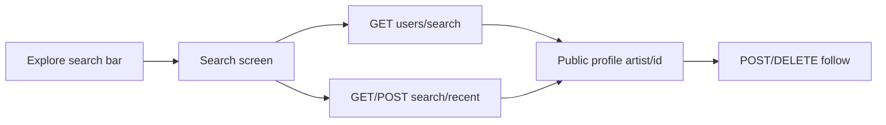

# Follow + Artist Search — Implementation Guide

**Audience:** humans and AI agents implementing this feature end-to-end.  
**Repos:** backend (`Singer-s-social-media-Backend`) + mobile app (`audio-social-media-app`).  
**Status:** planning doc — implement in the order in [Task list](#9-task-list-implement-in-this-order).

---

## 1. Goal

Let a logged-in user:

1. Open **Explore** → tap the search bar  
2. Land on a **dedicated Search screen**  
3. Search **artists (users)**  
4. Open their **public profile** (`/artist/[id]`)  
5. **Follow / unfollow** them  
6. See **live follower / following counts**

Recent searches are stored **on the backend** (per user), so they sync across devices for the same account.



---

## 2. Scope

### In scope

| # | Item |
|---|------|
| 1 | Dedicated Search screen (route from Explore) |
| 2 | Search UI tabs/sections: All, Artists, Songs, Playlists, Albums |
| 3 | **Live data for Artists only** |
| 4 | Backend **recent searches** (list, record on artist tap, clear) |
| 5 | Public profile loaded from API (not fixtures) for real user ids |
| 6 | Prisma `Follow` + follow / unfollow / relationship APIs |
| 7 | Live `followerCount` / `followingCount` + `isFollowing` on profile |
| 8 | Optimistic Follow button UI + query invalidation |
| 9 | Design aligned with existing Explore / Profile / Library patterns |

### Out of scope (do not build in this slice)

- Message / Chat behavior (Message button may stay visible as a **stub**)
- Publish tracks / feed ranking
- Real search for Songs, Playlists, Albums (UI chrome only → empty or “Coming soon”)
- Followers / following **list** screens or list APIs
- Private accounts, follow requests, close friends
- Block / mute
- Push notifications (“X followed you”)
- Voice / audio search icons behavior

---

## 3. Locked product decisions

1. **Search UX:** Option A — dedicated route (e.g. `/(tabs)/explore/search`), not in-place on Explore.  
2. **Recent searches:** Backend, authenticated user. Cap last **20** entries.  
3. **Follow only** for actions that must work; Message = later.  
4. **Counts only** — no paginated followers/following lists.  
5. **Public follows** — no approval flow.  
6. Identify users by **UUID** in routes (`/artist/[uuid]`), matching existing navigation.

---

## 4. Prisma schema

Add to `prisma/schema.prisma` (and update `User` relations).

### 4.1 Enums + Follow

```prisma
enum SearchRecentKind {
  ARTIST
  // Future: SONG, PLAYLIST, ALBUM
}

model Follow {
  id          String   @id @default(uuid(7)) @db.Uuid
  followerId  String   @db.Uuid
  followingId String   @db.Uuid
  createdAt   DateTime @default(now())

  follower  User @relation("UserFollowers", fields: [followerId], references: [id], onDelete: Cascade)
  following User @relation("UserFollowing", fields: [followingId], references: [id], onDelete: Cascade)

  @@unique([followerId, followingId])
  @@index([followingId, createdAt(sort: Desc)])
  @@index([followerId, createdAt(sort: Desc)])
}

model SearchRecent {
  id           String           @id @default(uuid(7)) @db.Uuid
  userId       String           @db.Uuid
  kind         SearchRecentKind @default(ARTIST)
  targetUserId String           @db.Uuid
  query        String?
  createdAt    DateTime         @default(now())
  updatedAt    DateTime         @updatedAt

  user       User @relation(fields: [userId], references: [id], onDelete: Cascade)
  targetUser User @relation("SearchRecentTarget", fields: [targetUserId], references: [id], onDelete: Cascade)

  @@unique([userId, kind, targetUserId])
  @@index([userId, updatedAt(sort: Desc)])
}
```

### 4.2 User model additions

```prisma
model User {
  id        String   @id @default(uuid(7)) @db.Uuid
  email     String   @unique
  username  String   @unique
  password  String
  name      String?
  createdAt DateTime @default(now())
  updatedAt DateTime @updatedAt
  tracks    Track[]

  followers     Follow[]       @relation("UserFollowers")
  following     Follow[]       @relation("UserFollowing")
  searchRecents SearchRecent[]
  searchRecentTargets SearchRecent[] @relation("SearchRecentTarget")
}
```

### 4.3 Migration commands

From backend repo root:

```bash
npx prisma migrate dev --name follow_and_search_recent
npx prisma generate
```

(Or `migrate deploy` in shared/staging environments.)

### 4.4 Business rules (enforce in service)

- Cannot follow yourself → `400 BAD_REQUEST`
- Follow when already following → **idempotent success** (no error)
- Unfollow when not following → **idempotent success**
- Search excludes the current user
- Recording a recent: upsert by `(userId, kind, targetUserId)`, bump `updatedAt`; then delete oldest beyond 20 for that user

---

## 5. Backend APIs

All routes require auth (`withAuth`), same envelope as tracks:

```json
{ "success": true, "message": "...", "data": { } }
```

Errors: existing `AppError` codes (`BAD_REQUEST`, `RESOURCE_NOT_FOUND`, `UNAUTHORIZED`, …).

### 5.1 Search artists

`GET /api/users/search?q={string}&limit={number}`

| Query | Rules |
|-------|--------|
| `q` | Required, trim, min 1 character (recommend min 2 in UI debounce) |
| `limit` | Optional, default `20`, max `20` |

**Match:** `username` ILIKE or `name` ILIKE (case-insensitive contains).  
**Exclude:** `viewer.id`.  
**Order:** exact username prefix first if easy; else `username` asc.

**Response `data`:** array of

```ts
{
  id: string;
  username: string;
  name: string | null;
  // optional later: avatarUrl
}
```

### 5.2 Public profile

`GET /api/users/:id`

**Response `data`:**

```ts
{
  id: string;
  username: string;
  name: string | null;
  followerCount: number;
  followingCount: number;
  isFollowing: boolean;   // viewer follows this user
  isFollowedBy: boolean;  // this user follows viewer
  isMutual: boolean;      // both true — needed later for Chat
  isSelf: boolean;
}
```

`404` if user not found.

### 5.3 Follow / unfollow

`POST /api/users/:id/follow`  
`DELETE /api/users/:id/follow`

- `:id` = target user UUID  
- Create / delete `Follow` row (`followerId = viewer`, `followingId = :id`)  
- Return updated relationship + counts for the **target** profile (so UI can refresh without a second round-trip), e.g.:

```ts
{
  id: string;
  followerCount: number;
  followingCount: number; // of target
  isFollowing: boolean;
  isFollowedBy: boolean;
  isMutual: boolean;
}
```

### 5.4 Relationship (Chat prep)

`GET /api/users/:id/relationship`

```ts
{
  isFollowing: boolean;
  isFollowedBy: boolean;
  isMutual: boolean;
}
```

### 5.5 Recent searches

`GET /api/search/recent`  
→ list for viewer, newest `updatedAt` first, max 20. Include target user snapshot:

```ts
{
  id: string;          // recent row id
  kind: "ARTIST";
  query: string | null;
  targetUser: {
    id: string;
    username: string;
    name: string | null;
  };
  updatedAt: string;
}
```

`POST /api/search/recent`

```ts
// body
{ kind: "ARTIST"; targetUserId: string; query?: string }
```

Upsert + trim to 20. Return the list or the created/updated item (prefer return updated list for simpler clients).

`DELETE /api/search/recent`  
Clear all recents for viewer. `{ ok: true }` or empty data.

### 5.6 Explicitly not in this slice

- `GET /api/users/:id/followers`  
- `GET /api/users/:id/following`  

---

## 6. Backend code map (follow existing Track patterns)

Mirror how tracks are built:

| Area | Suggested path |
|------|----------------|
| Prisma | `prisma/schema.prisma`, new migration under `prisma/migrations/` |
| Follow service | `src/server/modules/follow/follow.service.ts` |
| Follow validators | `src/server/modules/follow/follow.validator.ts` |
| User search / profile | `src/server/modules/user/user.service.ts` (extend) + validators |
| Recent search | `src/server/modules/search/search-recent.service.ts` + validator |
| Routes | `src/app/api/users/search/route.ts` |
| | `src/app/api/users/[id]/route.ts` |
| | `src/app/api/users/[id]/follow/route.ts` |
| | `src/app/api/users/[id]/relationship/route.ts` |
| | `src/app/api/search/recent/route.ts` |
| OpenAPI | `src/server/openapi/paths/users.paths.ts`, `search.paths.ts`, register in paths index + schemas |

**Patterns to copy:**

- `route().use(withAuth).use(validateQuery|validateBody).handle(...)`  
  (see `src/app/api/tracks/route.ts`)
- Zod validators in `*.validator.ts`
- Services throw `AppError`
- Register OpenAPI paths like `tracks.paths.ts`

### Backend implement order

1. Schema + migrate + generate  
2. Follow service (create / delete / counts / relationship helpers)  
3. User search + public profile endpoints  
4. Follow + relationship routes  
5. Search recent service + routes  
6. OpenAPI  
7. Smoke-test with HTTP client (auth token)

---

## 7. Mobile app — screens and design

### 7.1 Design system (do not invent a new look)

Follow the same language as **Explore, Profile, Library, Quick Record**:

- Screen root: `className="flex-1 bg-background"`
- Typography: shared `Text` variants (`title-md`, `body-md`, `label-md`, …)
- Controls: shared `Input`, `Button` (`ghost` / `soft` / `secondary` as appropriate)
- Chips: same pill style as Explore filter chips (`bg-primary-tonal` selected, `bg-surface-container-high` idle)
- Lists: rounded rows, `border-white/10`, `bg-surface-container`, continuous border curve where used elsewhere
- Headers: `ScreenHeader` on stacked routes; Explore tab keeps its top inset pattern

### 7.2 Explore → Search

**Files today:**

- `audio-social-media-app/src/features/explore/screens/explore-screen.tsx` — search bar not wired  
- `.../components/explore-search-bar.tsx` — presentational  

**Change:**

- On press / focus of search bar → `router.push('/explore/search')` (or `/(tabs)/explore/search` — match Expo Router file you add)
- Add route file under app router, e.g. `src/app/(tabs)/explore/search.tsx` exporting the Search screen

### 7.3 Search screen layout

**Empty query (default):**

1. Top: back + title “Search” (or autofocus field as hero)  
2. Full-width search `Input` (autofocus)  
3. Segment chips: **All | Artists | Songs | Playlists | Albums**  
4. Section **Recent** — rows from `GET /api/search/recent`  
   - Leading: initial circle or placeholder avatar  
   - Title: `name` or `@username`  
   - Subtitle: `@username`  
   - Tap → `POST /api/search/recent` (refresh) + `push(/artist/{id})`  
5. Optional “Clear recent” → `DELETE /api/search/recent`

**With query (debounced ~300ms):**

- If chip is Artists or All: show artist results from `GET /api/users/search?q=`  
- Songs / Playlists / Albums: empty state “Coming soon”  
- States: loading spinner, empty “No artists found”, error + retry  

**Row tap (result):**

1. `POST /api/search/recent` with `{ kind: "ARTIST", targetUserId, query }`  
2. Navigate to `/artist/[id]`

### 7.4 Public profile

**Files today:**

- `src/app/(tabs)/artist/[id].tsx` → `PublicProfileScreen`  
- `src/features/profile/screens/public-profile-screen.tsx` — local `useState` for follow  
- `src/features/profile/hooks/use-public-profile.ts` — **fixtures only** (comment already says swap for API)

**Change:**

1. `usePublicProfile(id)` → React Query `GET /api/users/:id`  
2. Map API → existing `Profile` type / stats (`followersLabel` can be formatted count string, or extend type with numbers)  
3. Follow button → `useFollow` / `useUnfollow` mutations; optimistic `isFollowing` + counts  
4. If `isSelf`, hide Follow (or show Edit entry if you already have my-profile elsewhere)  
5. Message: leave stub; do not block this slice on Chat

---

## 8. Mobile app — API wiring

### 8.1 Suggested feature module

Create something like:

```
src/features/users/   (or features/social/)
  api/types.ts
  api/service.ts
  api/hooks.ts
  index.ts
```

### 8.2 Hooks (React Query)

| Hook | Calls | Used on |
|------|--------|---------|
| `useSearchUsers(q)` | `GET /api/users/search` | Search screen (enabled when `q` length ≥ 1 or 2) |
| `useSearchRecent()` | `GET /api/search/recent` | Search screen empty state |
| `useRecordSearchRecent()` | `POST /api/search/recent` | Artist row / recent row press |
| `useClearSearchRecent()` | `DELETE /api/search/recent` | Clear control |
| `usePublicProfile(id)` | `GET /api/users/:id` | Public profile screen |
| `useFollowUser()` | `POST .../follow` | Follow button |
| `useUnfollowUser()` | `DELETE .../follow` | Following button |

**Query keys (example):**

- `['users', 'search', q]`  
- `['search', 'recent']`  
- `['users', 'profile', id]`  

**After follow/unfollow:** invalidate `['users', 'profile', id]` (and optionally recent if you show follow state there later).

Use existing `apiRequest` from `@/core/api` like tracks.

### 8.3 Call-site checklist

| UI | API |
|----|-----|
| Explore search bar press | Navigate only |
| Search input change | Debounce → `useSearchUsers` |
| Search mounted, empty q | `useSearchRecent` |
| Tap artist result / recent | `useRecordSearchRecent` → navigate |
| Clear recent | `useClearSearchRecent` |
| Public profile mount | `usePublicProfile` |
| Follow / Following press | `useFollowUser` / `useUnfollowUser` |
| Stats Followers / Following | From profile payload counts |

---

## 9. Task list (implement in this order)

### Backend

- [x] Add `Follow`, `SearchRecent`, `SearchRecentKind` + User relations to Prisma  
- [x] Migrate + `prisma generate` *(migration committed; run `migrate deploy` with local `.env`)*  
- [x] Follow service: follow, unfollow, counts, relationship helpers  
- [x] `GET /api/users/search`  
- [x] `GET /api/users/:id` public profile  
- [x] `POST` + `DELETE /api/users/:id/follow`  
- [x] `GET /api/users/:id/relationship`  
- [x] Search recent GET / POST / DELETE  
- [x] OpenAPI paths + schemas  
- [ ] Manual API smoke test with auth token *(needs `.env` + running server; automated in `tests/e2e`)*  

### Mobile app

- [x] `features/users` (or `social`) types + `apiRequest` service  
- [x] React Query hooks listed above  
- [x] Add Explore search route + Search screen UI (tabs, recent, results)  
- [x] Wire Explore search bar → push search route  
- [x] Replace `usePublicProfile` fixtures with API  
- [x] Wire Follow button + live counts; hide follow when `isSelf`  
- [x] Debounce, empty/loading/error polish  
- [ ] Manual device test checklist below *(Maestro flow: `e2e/maestro/search-follow.yaml`)*  

---

## 10. Manual test checklist

1. Two users A and B exist (sign up / seed).  
2. As A, Explore → Search → type B’s username → see B.  
3. Tap B → profile loads real name/username/counts.  
4. Follow → button shows Following; B’s follower count +1.  
5. Unfollow → count -1.  
6. Recent: after visiting B, Search with empty query shows B; works after app restart (same account).  
7. Clear recent → list empty.  
8. A cannot follow A (no Follow on own public profile / API 400).  
9. Songs/Playlists/Albums tabs show coming-soon, not fake data.  
10. Logged out cannot hit APIs (401).

---

## 11. Future (not this PR)

- Chat gated by `isMutual` / relationship API  
- Publish + search songs  
- Followers/following list screens  
- Follow notifications  
- Avatars on search/profile  

---

## 12. Quick reference — endpoints

| Method | Path | Purpose |
|--------|------|---------|
| GET | `/api/users/search?q=` | Artist search |
| GET | `/api/users/:id` | Public profile + counts + flags |
| POST | `/api/users/:id/follow` | Follow |
| DELETE | `/api/users/:id/follow` | Unfollow |
| GET | `/api/users/:id/relationship` | isFollowing / isFollowedBy / isMutual |
| GET | `/api/search/recent` | List recent |
| POST | `/api/search/recent` | Record artist recent |
| DELETE | `/api/search/recent` | Clear recent |
