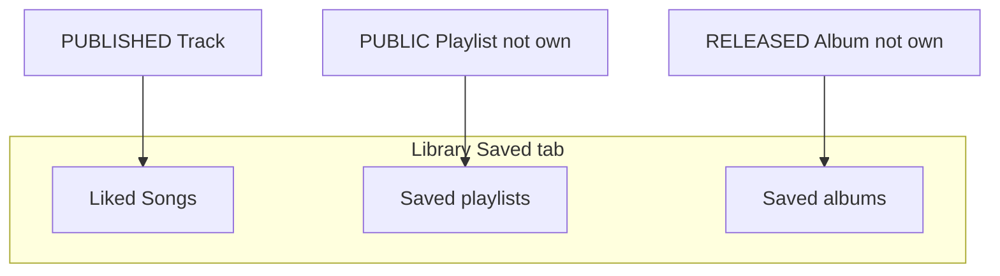

# Library Saves — Implementation Guide

**Audience:** humans and AI agents implementing this feature end-to-end.  
**Repos:** backend (`audio-social-backend`) + mobile app (`audio-social-app`).  
**Status:** planning doc — Prisma models + migration `20261106140000_library_saves` are in repo (applied). Do **not** invent alternate models.

**Related docs:** `docs/publish.md` (PUBLISHED gate), `docs/playlists-and-albums.md` (PUBLIC / RELEASED + Unavailable), `docs/follow-and-artist-search.md` (Follow is **artists only** — not this module).

**Naming:**


| Term                         | Meaning                                                                                     |
| ---------------------------- | ------------------------------------------------------------------------------------------- |
| **Save**                     | Bookmark a published song, public playlist, or released album into the viewer’s Library     |
| **Liked Songs**              | The viewer’s saved tracks list (`SavedTrack`) — Spotify-style favorites, not a Playlist row |
| **Follow**                   | Artist relationship only — separate module                                                  |
| **Own playlist / own album** | Never appear as “saved”; hide Save control                                                  |


Mobile Library fixtures are **UI reference only**. API + Prisma are SSOT.

---


## 1. Goal

1. Let a user **save / unsave** published tracks → personal **Liked Songs**
2. Let a user **save / unsave** another user’s **PUBLIC** playlist
3. Let a user **save / unsave** another user’s **RELEASED** album
4. Surface all three under Library → **Saved** tab (songs / playlists / albums segments)
5. Expose `saveCount` on playlists only (social proof); no counts on tracks or albums in v1
6. If a target later becomes unpublished / private / unreleased: **keep** the save row and show **Unavailable**




---


## 2. Scope


### In scope


| #   | Item                                                                                           |
| --- | ---------------------------------------------------------------------------------------------- |
| 1   | Prisma: `SavedTrack`, `SavedPlaylist`, `SavedAlbum` + `Playlist.saveCount`                     |
| 2   | Save / unsave APIs (idempotent) with eligibility rules                                         |
| 3   | List APIs for Liked Songs, saved playlists, saved albums                                       |
| 4   | `isSaved` on relevant detail DTOs (track / playlist / album for viewer)                        |
| 5   | Playlist `saveCount` bump on save/unsave; expose on playlist list/detail                       |
| 6   | Unavailable mapping when target no longer eligible to open/play                                |
| 7   | Mobile: Library **Saved** tab + heart/save controls on song / public playlist / released album |


### Out of scope

- Creating a real `Playlist` row named “Liked Songs” (Liked Songs is **only** `SavedTrack`)
- Saving own playlists or own albums
- `saveCount` on tracks or albums
- Public “who saved this” lists
- Collaborative likes / activity feed
- Changing Publish, Playlist, Album, or Follow product rules

---


## 3. Locked product decisions

1. **Three tables** — `SavedTrack`, `SavedPlaylist`, `SavedAlbum` (not one polymorphic table). Real FKs + cascades; different eligibility rules per type.
2. **Liked Songs** — `SavedTrack` ordered by `savedAt` desc. Acts like Spotify Liked Songs. Users **may** save their **own** published tracks.
3. **Own playlists** — never saved. Hide Save on owner UI; API rejects if `playlist.userId === viewerId` (`400` or `409`).
4. **Own albums** — never saved. Same as playlists.
5. **Eligibility at save time**
  - Track: `status === PUBLISHED`
  - Playlist: `visibility === PUBLIC` and not owner
  - Album: `status === RELEASED` and not owner
6. **After eligibility lost** (unpublish / make private / unrelease): **keep** save row; list/detail shows **Unavailable** (same contract as playlist/album members). Do **not** auto-delete saves. Do **not** decrement `saveCount` when a playlist goes private (count stays; optional later cleanup job out of scope).
7. **Library UI** — new **Saved** tab alongside Audio / Playlists / Albums / Projects. Inside Saved: segments or sections for Songs (Liked Songs), Playlists, Albums.
8. **Counts** — `Playlist.saveCount` only. No `saveCount` on Track or Album in v1.
9. **Idempotent** save and unsave (already saved / not saved → success, no error).
10. **Delete target** (track / playlist / album deleted) → cascade deletes save rows. For playlist, implementers should adjust `saveCount` only via save/unsave paths; hard-delete of playlist removes rows so count is irrelevant.
11. Save is **viewer-private** — other users do not see your Liked Songs or saved lists (unless a future sharing feature).

---


## 4. Data model (reference only)

Source of truth: `prisma/schema.prisma`.


| Model / field        | Role                                                         |
| -------------------- | ------------------------------------------------------------ |
| `SavedTrack`         | `(userId, trackId)` unique; `savedAt`                        |
| `SavedPlaylist`      | `(userId, playlistId)` unique; `savedAt`                     |
| `SavedAlbum`         | `(userId, albumId)` unique; `savedAt`                        |
| `Playlist.saveCount` | Denormalized count of `SavedPlaylist` rows for that playlist |


**Cascades:** delete User → their saves; delete Track/Playlist/Album → saves pointing at them.

---


## 5. Backend APIs

Auth + envelope same as tracks. All save routes require the authenticated viewer.

### 5.1 Tracks (Liked Songs)


| Method   | Path                   | Notes                                             |
| -------- | ---------------------- | ------------------------------------------------- |
| `POST`   | `/api/tracks/:id/save` | Require PUBLISHED; idempotent create `SavedTrack` |
| `DELETE` | `/api/tracks/:id/save` | Idempotent delete                                 |
| `GET`    | `/api/saves/tracks`    | Viewer’s Liked Songs; `savedAt` desc              |


List item:

```ts
{
  savedAt: string;
  available: boolean; // false if track not PUBLISHED (or missing)
  track: {
    id: string;
    title: string;
    // when available: durationMs, coverUrl, mixUrl, artist { id, username, name, avatarUrl }, ...
  } | null;
}
```


### 5.2 Playlists


| Method   | Path                      | Notes                                                                         |
| -------- | ------------------------- | ----------------------------------------------------------------------------- |
| `POST`   | `/api/playlists/:id/save` | PUBLIC + not owner; create `SavedPlaylist`; `saveCount += 1` if newly created |
| `DELETE` | `/api/playlists/:id/save` | Idempotent; `saveCount -= 1` if a row was deleted (floor at 0)                |
| `GET`    | `/api/saves/playlists`    | Viewer’s saved playlists; `savedAt` desc                                      |


Bump `saveCount` **only** when the join row is actually inserted/deleted (idempotent no-ops do not change count). Prefer a transaction: insert + increment, or delete + decrement.

List / detail playlist payloads (from playlist module) should include:

```ts
{
  saveCount: number;
  isSaved: boolean; // viewer; false for owner / unauthenticated edges
}
```


### 5.3 Albums


| Method   | Path                   | Notes                                 |
| -------- | ---------------------- | ------------------------------------- |
| `POST`   | `/api/albums/:id/save` | RELEASED + not owner; idempotent      |
| `DELETE` | `/api/albums/:id/save` | Idempotent                            |
| `GET`    | `/api/saves/albums`    | Viewer’s saved albums; `savedAt` desc |


No `saveCount` on album DTO.

### 5.4 `isSaved` on detail

When returning track / playlist / album detail to an authenticated viewer, include `isSaved: boolean` (false for ineligible own playlist/album even if somehow a row existed — should not exist).

---


## 6. Business rules (service)

**Save track**

- Track exists and `PUBLISHED` → upsert/create `SavedTrack`
- Else `404` or `400` (prefer 404 if hidden draft of another user; 400 if own draft)

**Save playlist**

- Exists, `PUBLIC`, `userId !== viewerId` → create + increment `saveCount` if new
- Own → `400 BAD_REQUEST`
- Private (non-owner) → `404` (do not leak existence) or `403` — prefer **404** for private of others

**Save album**

- Exists, `RELEASED`, `userId !== viewerId` → create
- Own → `400`
- DRAFT (non-owner) → `404`

**Unavailable in lists**

- Track: not `PUBLISHED`
- Playlist: not `PUBLIC` (or deleted → row gone)
- Album: not `RELEASED`

Still return the save row with `available: false` and minimal metadata when possible.

---


## 7. Architecture notes

```text
Library → Saved tab
  Songs     → GET /api/saves/tracks
  Playlists → GET /api/saves/playlists
  Albums    → GET /api/saves/albums

Heart / Save on detail → POST|DELETE .../save
Playlist saveCount ← only SavedPlaylist mutations
```

- Liked Songs is **not** a `Playlist` — do not create a system playlist row.
- Owner Library → Playlists / Albums tabs still show **created** items; Saved tab shows **bookmarked** others’ (plus Liked Songs including own tracks if saved).

---


## 8. Backend code map


| Area          | Path                                                                                                                         |
| ------------- | ---------------------------------------------------------------------------------------------------------------------------- |
| Prisma        | `schema.prisma` + migration                                                                                                  |
| Service       | `src/server/modules/save/` (or `library-save/`)                                                                              |
| Validators    | Zod for empty body / ids from params                                                                                         |
| Routes        | `src/app/api/tracks/[id]/save`, `playlists/[id]/save`, `albums/[id]/save`, `saves/tracks`, `saves/playlists`, `saves/albums` |
| OpenAPI       | `saves.paths.ts`                                                                                                             |
| Playlist DTOs | Add `saveCount` + `isSaved` when implementing playlist module                                                                |


### Backend implement order

1. Migrate + generate
2. SavedTrack save/unsave + list
3. SavedPlaylist + `saveCount` transaction
4. SavedAlbum save/unsave + list
5. Wire `isSaved` / `saveCount` into playlist (and track/album detail) serializers
6. OpenAPI + unit tests (idempotent, ownership rejects, eligibility, count bump)

---


## 9. Mobile app


### 9.1 Library

Add **Saved** to library segment tabs (same chrome as existing panels).

**Saved → Songs (Liked Songs)**  

- List from `GET /api/saves/tracks`  
- Tap available → player; unavailable → Unavailable state  
- Unsave from row or detail

**Saved → Playlists / Albums**  

- Lists from respective save endpoints  
- Open detail when available; Unavailable when not


### 9.2 Controls


| Surface                            | Control                                              |
| ---------------------------------- | ---------------------------------------------------- |
| Published track detail / player    | Save / Saved (heart) — includes own published tracks |
| Public playlist detail (not owner) | Save / Saved                                         |
| Own playlist                       | **No** Save control                                  |
| Released album detail (not owner)  | Save / Saved                                         |
| Own album                          | **No** Save control                                  |


Optimistic toggle + invalidate `['saves', ...]` and detail queries.

### 9.3 Playlist UI

Show `saveCount` on public playlist detail (and list rows if space). Do not show save counts on songs/albums.

---


## 10. Defaults


| Topic                     | v1 default                          |
| ------------------------- | ----------------------------------- |
| Schema                    | Three join tables                   |
| Liked Songs               | `SavedTrack` only (no Playlist row) |
| Own track save            | Allowed if PUBLISHED                |
| Own playlist / album save | Forbidden                           |
| Lost eligibility          | Keep row → Unavailable              |
| Counts                    | `Playlist.saveCount` only           |
| List order                | `savedAt` desc                      |
| Save/unsave               | Idempotent                          |


---


## 11. Relationship to other modules


| Module    | Interaction                                                            |
| --------- | ---------------------------------------------------------------------- |
| Publish   | Only PUBLISHED tracks saveable; unpublish → Unavailable in Liked Songs |
| Playlists | PUBLIC + not owner; `saveCount` on Playlist                            |
| Albums    | RELEASED + not owner                                                   |
| Follow    | Unrelated — artists only                                               |
| Projects  | Unrelated                                                              |


Update `docs/playlists-and-albums.md` follow-up section to point here when this doc ships.

---


## 12. Task list

1. [x] Prisma models + `Playlist.saveCount` in repo
2. [x] Migration applied + `prisma generate`
3. [ ] Save/unsave + list for tracks
4. [ ] Save/unsave + list for playlists + `saveCount`
5. [ ] Save/unsave + list for albums
6. [ ] `isSaved` / `saveCount` on detail DTOs
7. [ ] OpenAPI + tests
8. [ ] Mobile Library Saved tab + save controls

---


## 13. Non-goals reminder

- Not a system “Liked Songs” Playlist entity  
- Not save counts on tracks/albums  
- Not saving own playlists/albums  
- Not Follow  
- Not public saver lists / social graph of saves

