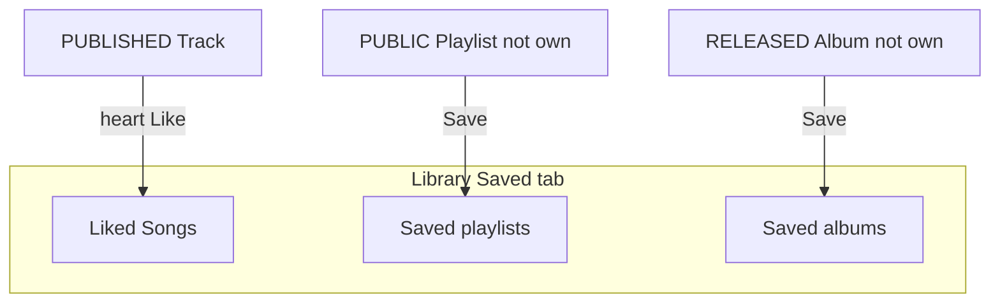

# Library Saves & Liked Songs — Implementation Guide

**Audience:** humans and AI agents implementing this feature end-to-end.  
**Repos:** backend (`audio-social-backend`) + mobile app (`audio-social-app`).  
**Status:** planning doc — Prisma models + migrations `20261106140000_library_saves` and `20261106150000_liked_track_rename` are in repo. Do **not** invent alternate models.

**Related docs:** `docs/publish.md` (PUBLISHED gate), `docs/playlists-and-albums.md` (PUBLIC / RELEASED + Unavailable), `docs/follow-and-artist-search.md` (Follow is **artists only** — not this module).

**Naming:**

| Term | Meaning |
|------|---------|
| **Like** (songs) | Heart on a published track → `LikedTrack` row + **Liked Songs** library list. Same as Spotify Liked Songs. **Not** a separate social “like” system. |
| **Save** (playlists / albums) | Bookmark someone else’s public playlist or released album |
| **Liked Songs** | Viewer’s liked tracks (`LikedTrack`) — not a `Playlist` row |
| **Follow** | Artist relationship only — separate module |
| **Own playlist / own album** | Never saved; hide Save control |

Mobile Library fixtures are **UI reference only**. API + Prisma are SSOT.

---

## 1. Goal

1. Let a user **like / unlike** published tracks → personal **Liked Songs** (heart = library favorite)
2. Let a user **save / unsave** another user’s **PUBLIC** playlist
3. Let a user **save / unsave** another user’s **RELEASED** album
4. Surface all three under Library → **Saved** tab (Liked Songs / playlists / albums)
5. Expose **`Track.likeCount`** and **`Playlist.saveCount`** (no count on albums)
6. If a target later becomes unpublished / private / unreleased: **keep** the row and show **Unavailable**



**Product rule:** On songs, the Now Playing / mini-player **heart is Like → Liked Songs**. There is no second “save song” action.

---

## 2. Scope

### In scope

| # | Item |
|---|------|
| 1 | Prisma: `LikedTrack`, `SavedPlaylist`, `SavedAlbum` + `Track.likeCount` + `Playlist.saveCount` |
| 2 | Like / unlike track APIs (idempotent) + eligibility |
| 3 | Save / unsave playlist & album APIs (idempotent) + eligibility |
| 4 | List APIs: Liked Songs, saved playlists, saved albums |
| 5 | `isLiked` on track DTOs; `isSaved` on playlist / album DTOs |
| 6 | Bump `likeCount` / `saveCount` only on real insert/delete |
| 7 | Unavailable mapping when target no longer eligible |
| 8 | Mobile: Library **Saved** tab + heart on songs + Save on public playlist / released album |

### Out of scope

- Creating a real `Playlist` row named “Liked Songs”
- A separate TrackLike / social-like table (Like **is** `LikedTrack`)
- Saving own playlists or own albums
- `saveCount` / like counts on albums
- Public “who liked / saved this” lists
- Comments on tracks — see `docs/track-comments.md` (comment likes ≠ song likes)
- Feed / notifications
- Changing Publish, Playlist, Album, or Follow product rules

---

## 3. Locked product decisions

1. **Three tables** — `LikedTrack`, `SavedPlaylist`, `SavedAlbum` (not one polymorphic table).
2. **Song heart = Like = Liked Songs** — one action, one row type, one count (`Track.likeCount`).
3. **Liked Songs** — `LikedTrack` ordered by `likedAt` desc. Users **may** like their **own** published tracks.
4. **Own playlists / own albums** — never saved. Hide Save; API rejects if owner (`400`).
5. **Eligibility at mutate time**
   - Track like: `status === PUBLISHED`
   - Playlist save: `visibility === PUBLIC` and not owner
   - Album save: `status === RELEASED` and not owner
6. **After eligibility lost** — **keep** join row; lists show **Unavailable**. Do **not** auto-delete. Do **not** decrement counts when a playlist goes private / track unpublishes (count stays until unlike/unsave or target hard-delete).
7. **Library UI** — **Saved** tab with segments: Songs (Liked Songs), Playlists, Albums.
8. **Counts** — `Track.likeCount` + `Playlist.saveCount`. No count on Album.
9. **Idempotent** like/unlike and save/unsave.
10. **Delete target** → cascade deletes join rows.
11. Lists are **viewer-private** (others don’t see your Liked Songs / saves).

---

## 4. Data model (reference only)

Source of truth: `prisma/schema.prisma`.

| Model / field | Role |
|---------------|------|
| `LikedTrack` | `(userId, trackId)` unique; `likedAt` |
| `Track.likeCount` | Denormalized count of `LikedTrack` for that track |
| `SavedPlaylist` | `(userId, playlistId)` unique; `savedAt` |
| `Playlist.saveCount` | Denormalized count of `SavedPlaylist` |
| `SavedAlbum` | `(userId, albumId)` unique; `savedAt` |

**Cascades:** delete User → their likes/saves; delete Track/Playlist/Album → joins pointing at them.

---

## 5. Backend APIs

Auth + envelope same as tracks.

### 5.1 Tracks (Liked Songs)

| Method | Path | Notes |
|--------|------|-------|
| `POST` | `/api/tracks/:id/like` | Require PUBLISHED; idempotent create `LikedTrack`; `likeCount += 1` if newly created |
| `DELETE` | `/api/tracks/:id/like` | Idempotent; `likeCount -= 1` if a row was deleted (floor at 0) |
| `GET` | `/api/likes/tracks` | Viewer’s Liked Songs; `likedAt` desc |

Bump `likeCount` **only** when the join row is actually inserted/deleted.

List item:

```ts
{
  likedAt: string;
  available: boolean; // false if track not PUBLISHED (or missing)
  track: {
    id: string;
    title: string;
    // when available: durationMs, coverUrl, mixUrl, likeCount, artist { ... }, ...
  } | null;
}
```

Track detail / player payloads should include:

```ts
{
  likeCount: number;
  isLiked: boolean; // viewer
}
```

### 5.2 Playlists

| Method | Path | Notes |
|--------|------|-------|
| `POST` | `/api/playlists/:id/save` | PUBLIC + not owner; create `SavedPlaylist`; `saveCount += 1` if new |
| `DELETE` | `/api/playlists/:id/save` | Idempotent; `saveCount -= 1` if deleted (floor at 0) |
| `GET` | `/api/saves/playlists` | Viewer’s saved playlists; `savedAt` desc |

```ts
{
  saveCount: number;
  isSaved: boolean; // viewer; false for owner
}
```

### 5.3 Albums

| Method | Path | Notes |
|--------|------|-------|
| `POST` | `/api/albums/:id/save` | RELEASED + not owner; idempotent |
| `DELETE` | `/api/albums/:id/save` | Idempotent |
| `GET` | `/api/saves/albums` | Viewer’s saved albums; `savedAt` desc |

No `saveCount` on album DTO; include `isSaved: boolean` for viewer.

---

## 6. Business rules (service)

**Like track**

- Track exists and `PUBLISHED` → create `LikedTrack` + increment `likeCount` if new
- Else `404` or `400` (prefer 404 if hidden draft of another user; 400 if own draft)

**Unlike track**

- Delete join if present; decrement `likeCount` only if a row was deleted

**Save playlist**

- Exists, `PUBLIC`, `userId !== viewerId` → create + increment `saveCount` if new
- Own → `400 BAD_REQUEST`
- Private (non-owner) → prefer **404**

**Save album**

- Exists, `RELEASED`, `userId !== viewerId` → create
- Own → `400`
- DRAFT (non-owner) → `404`

**Unavailable in lists**

- Track: not `PUBLISHED`
- Playlist: not `PUBLIC`
- Album: not `RELEASED`

Still return the join row with `available: false` and minimal metadata when possible.

---

## 7. Architecture notes

```text
Library → Saved tab
  Songs     → GET /api/likes/tracks     (LikedTrack)
  Playlists → GET /api/saves/playlists
  Albums    → GET /api/saves/albums

Player / lists heart → POST|DELETE /api/tracks/:id/like  → likeCount
Playlist Save        → POST|DELETE /api/playlists/:id/save → saveCount
Album Save           → POST|DELETE /api/albums/:id/save
```

- Liked Songs is **not** a `Playlist` — do not create a system playlist row.
- Owner Library → Playlists / Albums tabs show **created** items; Saved tab shows **Liked Songs** + bookmarked others’ playlists/albums.

---

## 8. Backend code map

| Area | Path |
|------|------|
| Prisma | `schema.prisma` + migrations |
| Service | `src/server/modules/save/` (or split `like/` + `save/`) |
| Routes | `tracks/[id]/like`, `likes/tracks`, `playlists/[id]/save`, `albums/[id]/save`, `saves/playlists`, `saves/albums` |
| OpenAPI | `likes.paths.ts` / `saves.paths.ts` |
| DTOs | Track: `likeCount` + `isLiked`; Playlist: `saveCount` + `isSaved`; Album: `isSaved` |

### Backend implement order

1. Migrate + generate  
2. LikedTrack like/unlike + list + `likeCount`  
3. SavedPlaylist + `saveCount`  
4. SavedAlbum + list  
5. Wire `isLiked` / `isSaved` / counts into serializers  
6. OpenAPI + unit tests  

---

## 9. Mobile app

### 9.1 Library

Add **Saved** to library segment tabs.

**Saved → Songs (Liked Songs)** — `GET /api/likes/tracks`; unlike from row/detail.  
**Saved → Playlists / Albums** — respective save list endpoints.

### 9.2 Controls

| Surface | Control |
|---------|---------|
| Published track (player, mini player, lists) | **Heart** Like / Unlike — includes own published tracks |
| Public playlist detail (not owner) | Save / Saved |
| Own playlist | **No** Save |
| Released album detail (not owner) | Save / Saved |
| Own album | **No** Save |

Optimistic toggle; invalidate `['likes', ...]`, `['saves', ...]`, and detail queries.

### 9.3 Counts in UI

- Show **`likeCount`** on track / Now Playing where the heart is.  
- Show **`saveCount`** on public playlist detail (and list rows if space).  
- Do not show save/like counts on albums.

---

## 10. Defaults

| Topic | v1 default |
|-------|------------|
| Song action | Like → `LikedTrack` |
| Playlist / album action | Save |
| Own track like | Allowed if PUBLISHED |
| Own playlist / album save | Forbidden |
| Lost eligibility | Keep row → Unavailable |
| Counts | `Track.likeCount` + `Playlist.saveCount` |
| List order | `likedAt` / `savedAt` desc |
| Mutations | Idempotent |

---

## 11. Relationship to other modules

| Module | Interaction |
|--------|-------------|
| Publish | Only PUBLISHED tracks likeable; unpublish → Unavailable in Liked Songs |
| Playlists | PUBLIC + not owner; `saveCount` |
| Albums | RELEASED + not owner |
| Follow | Unrelated |
| Comments | `docs/track-comments.md` — comment like ≠ song like |
| Player audio engine | Client concern; uses `isLiked` / `likeCount` from track DTO |

---

## 12. Task list

1. [x] Prisma: `LikedTrack` + `Track.likeCount` + `SavedPlaylist` / `SavedAlbum` + `Playlist.saveCount`  
2. [x] Migrations applied + `prisma generate`  
3. [ ] Like/unlike + list for tracks + `likeCount`  
4. [ ] Save/unsave + list for playlists + `saveCount`  
5. [ ] Save/unsave + list for albums  
6. [ ] `isLiked` / `isSaved` / counts on detail DTOs  
7. [ ] OpenAPI + tests  
8. [ ] Mobile Library Saved tab + heart / save controls  

---

## 13. Non-goals reminder

- Not a system “Liked Songs” Playlist entity  
- Not a second social-like table for songs  
- Not album save counts  
- Not saving own playlists/albums  
- Not Follow / Feed / Comments  
- Not public liker/saver lists  
