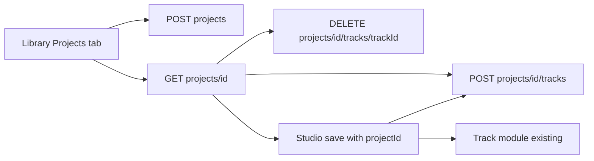

# Projects — Implementation Guide

**Audience:** humans and AI agents implementing this feature end-to-end.  
**Repos:** backend (`audio-social-backend`) + mobile app (`audio-social-app`).  
**Status:** implemented — APIs + mobile wiring landed; run migrate/generate if needed after pull.

**Schema:** `Project` + `ProjectTrack` live in `prisma/schema.prisma`. Do **not** invent alternate models or paste a full Prisma dump into PRs — read the file. Run migrate + generate after pulling.

**Naming (critical):**

| Term | Meaning |
|------|---------|
| **Project** (this module) | Private workplace / folder that **groups** the owner's Tracks |
| **Track** | Existing audio entity (SINGLE / MULTI) — source of truth for audio + backup |
| **`AudioProject` / `project.json`** | Local editor file for **one** Track — **not** this module |

Mobile `features/projects` fixtures and types are **UI reference only**. API + Prisma are the single source of truth; replace fixture types with API DTOs.

---

## 1. Goal

Let an artist:

1. Create a **Project** (name required, description optional)
2. Group related takes in one place (vocal, instrumental, rap, mixes, etc.)
3. **Add** existing Library tracks into a project
4. **Record / multitrack / import** from inside a project so the new Track is **linked** to that project
5. **Unlink** a track from a project without deleting the audio
6. **Delete** a project (default: keep tracks; optional dialog also deletes tracks)



---

## 2. Scope

### In scope

| # | Item |
|---|------|
| 1 | Prisma `Project` + `ProjectTrack` (already in schema — migrate) |
| 2 | REST: create, list, get, patch, delete project |
| 3 | REST: attach track(s), unlink track; bump `Project.updatedAt` on membership changes |
| 4 | Studio / save-track-draft: optional `projectId` → attach after create |
| 5 | Mobile: replace fixtures; Library Projects list + detail + create / add / unlink / delete |
| 6 | Design aligned with existing Projects screens under `features/projects` (layout reference) |

### Out of scope (do not build in this slice)

- Sharing / public projects
- Cover art for projects
- Roles, collaborators, multi-user access
- Project “status” / progress labels (remove from UI)
- Manual drag-reorder (`sortIndex`) — list by `addedAt` desc
- Storing any project-level audio blobs (metadata only)
- Changing Track backup / restore / storage paths

---

## 3. Locked product decisions

1. **Owner only** — `Project.userId` is the sole owner; no members.
2. **Many-to-many** — a Track may belong to **0..N** projects; a Project has **0..N** tracks via `ProjectTrack`.
3. **Folder, not owner of audio** — Project only groups references. Tracks remain first-class in Library → Audio.
4. **Create project** — requires `title`; `description` optional.
5. **Studio entry:**
   - Opened **from a project** → after Track create, **attach** that track to the project.
   - Opened from **global Create / Library Audio** → no project link.
6. **Attach existing** — yes; track must belong to the same user.
7. **Unlink** — removes `ProjectTrack` only; Track stays.
8. **Delete project:**
   - Default: delete `Project` (+ cascade join rows). Tracks remain.
   - Optional UI: “Also delete tracks” → delete those Track rows (existing track delete: DB + storage + local files) then delete project.
9. **No status field** — drop fixture “In Progress” chrome.
10. **`Project.updatedAt`** — bump on title/description patch **and** on attach / unlink.
11. **Track list order in a project** — `ProjectTrack.addedAt` descending (newest membership first).
12. **Idempotent attach** — attaching an already-linked pair is a no-op success (or return existing link); do not duplicate join rows (`@@unique([projectId, trackId])`).

---

## 4. Data model (reference only)

Source of truth: `prisma/schema.prisma`.

| Model | Role |
|-------|------|
| `Project` | `userId`, `title`, `description?`, timestamps |
| `ProjectTrack` | Join: `projectId`, `trackId`, `addedAt`; unique pair |

**Cascade:**

- Delete `User` → projects + joins go with them  
- Delete `Project` → joins only (tracks stay)  
- Delete `Track` → its join rows go  

**Business rules (enforce in service):**

- All project mutations: caller must own the project (`userId`)
- Attach: caller must own the track; track + project same user
- Unlink / delete: same ownership checks
- Cannot attach another user’s track → `404` or `403`

---

## 5. Architecture

```text
Mobile
  │
  ├─ REST (JWT) ──► Next.js API ──► Postgres (Project + ProjectTrack)
  │
  └─ Track audio ──► existing Track module (local + Supabase)
         optional projectId on save → attach join row
```

- **Project APIs** never upload audio.
- **Track create/update/backup/restore** stay in the Track module; Projects only manage membership.

---

## 6. Backend APIs

Auth + envelope same as tracks:

```json
{ "success": true, "message": "...", "data": { } }
```

Validation sketch (Zod):

- `title`: trim, min 1, max 100  
- `description`: optional, trim, max 500; empty → `null`

### 6.1 Create project

`POST /api/projects`

```ts
{ title: string; description?: string | null }
```

**Response `data`:** project summary (see §6.2 item shape).

### 6.2 List projects

`GET /api/projects`

Owner’s projects, `updatedAt` desc.

```ts
{
  id: string;
  title: string;
  description: string | null;
  trackCount: number;
  updatedAt: string;
  createdAt: string;
}
```

### 6.3 Get project detail

`GET /api/projects/:id`

Owner only. Include tracks ordered by membership `addedAt` desc.

```ts
{
  id: string;
  title: string;
  description: string | null;
  trackCount: number;
  updatedAt: string;
  createdAt: string;
  tracks: Array<{
    id: string;
    kind: "SINGLE" | "MULTI";
    status: string;
    storageState: string;
    title: string;
    durationMs: number;
    mixUrl: string | null;
    addedAt: string; // ProjectTrack.addedAt
    createdAt: string;
  }>;
}
```

Reuse Track list/detail field conventions (`mixUrl` signed when present).

### 6.4 Update project

`PATCH /api/projects/:id`

```ts
{ title?: string; description?: string | null }
```

At least one field required. Bumps `updatedAt`.

### 6.5 Delete project

`DELETE /api/projects/:id?deleteTracks=true|false`

- Default / omitted / `false`: delete project + join rows only  
- `true`: for each linked track owned by user, run **existing** track delete (DB + storage), then delete project  
- Response: `{ id: string; deletedTrackIds?: string[] }`

### 6.6 Attach track(s)

`POST /api/projects/:id/tracks`

```ts
{ trackIds: string[] } // min 1
```

- Validate ownership for each track  
- Skip / no-op duplicates  
- Insert missing `ProjectTrack` rows  
- Touch `Project.updatedAt` if any row added  
- Return updated detail or `{ attached: string[] }`

### 6.7 Unlink track

`DELETE /api/projects/:id/tracks/:trackId`

- Delete join row if present  
- Touch `Project.updatedAt`  
- Idempotent if already unlinked (`200` / `204`)

### 6.8 Track create with project (Track module touch)

Extend **existing** create-track / `saveTrackDraft` path:

- Optional body field or follow-up client call: `projectId`
- After successful Track create (same user owns project): create `ProjectTrack` and bump project `updatedAt`
- Prefer: client calls `POST /api/projects/:id/tracks` after `POST /api/tracks` **or** accept optional `projectId` on `POST /api/tracks` — **pick one** in implementation; recommend **optional `projectId` on create track** to avoid a race if the user backgrounds the app mid-save.

If `projectId` invalid / not owned → fail attach with clear error; Track may already exist — document: either transactional create+attach or create track then attach with compensating unlink guidance. Prefer **same request transaction**: create track + join in one service method when `projectId` present.

---

## 7. Backend code map

| Area | Suggested path |
|------|----------------|
| Prisma | `prisma/schema.prisma` + migration |
| Service | `src/server/modules/project/project.service.ts` |
| Validators | `project.validator.ts` |
| Routes | `src/app/api/projects/...` |
| OpenAPI | `src/server/openapi/paths/projects.paths.ts` + schemas |
| Track create | small change in `track.service.ts` / create route for optional `projectId` |

**Patterns to copy:** tracks module (`withAuth`, Zod, `AppError`, OpenAPI).

### Backend implement order

1. Migrate + generate (models already in schema)
2. Project CRUD + list/detail with `trackCount`
3. Attach / unlink + `updatedAt` bumps
4. Delete with `deleteTracks` query flag
5. Optional `projectId` on track create (transaction)
6. OpenAPI
7. Unit tests for ownership + idempotent attach

---

## 8. Mobile app

### 8.1 Design

Reuse layout from `features/projects` screens/components; **do not** keep fixture status labels or fixture IDs as API contracts.

### 8.2 Data wiring

| Today | Change |
|-------|--------|
| `projects.fixtures.ts` | React Query + API (`useProjects`, `useProject`, mutations) |
| Fixture `ProjectSummary` / `ProjectDetail` | Align types to API DTOs (or map in one place) |
| Detail add actions → studio routes with no id | Pass `projectId` (search param / store) into save |

### 8.3 Flows

1. **Library → Projects** — list from `GET /api/projects`
2. **Create project** — sheet/screen: title + optional description → `POST`
3. **Detail** — `GET /api/projects/:id`; rows open existing track restore/open paths
4. **Add existing** — picker of user’s Library tracks → `POST .../tracks`
5. **Quick Record / Multitrack / Import from project** — carry `projectId` through studio save
6. **Unlink** — confirm → `DELETE .../tracks/:trackId`
7. **Delete project** — dialog: “Delete project only” vs “Delete project and tracks”

### 8.4 Cleanup

Remove fixture catalog once wired; drop status UI.

---

## 9. Defaults (locked unless product changes)

| Topic | v1 default |
|-------|------------|
| Membership | Many-to-many join |
| List order in project | `addedAt` desc |
| Project list order | `updatedAt` desc |
| Attach duplicate | Idempotent |
| Delete project default | Keep tracks |
| Collab / share / cover | Out of scope |
| Audio storage | Track module only |

---

## 10. Explicit non-goals reminder

- Projects do **not** store WAV/mix objects  
- Do **not** confuse with local `AudioProject` / `project.json`  
- Do **not** add status enums  
- Do **not** redesign Library Audio list beyond linking/unlinking behavior  

---

## 11. Task list (implement in this order)

1. [x] Prisma models `Project` + `ProjectTrack` in `schema.prisma`
2. [x] `prisma migrate` `20261104180000_add_project_models` + generate
3. [x] Backend: project CRUD + list/detail
4. [x] Backend: attach / unlink + delete (`deleteTracks`)
5. [x] Backend: optional `projectId` on track create (transactional attach)
6. [x] OpenAPI paths + schemas
7. [x] Mobile: API client + hooks; replace fixtures on list/detail/create
8. [x] Mobile: add existing tracks + unlink + delete dialog
9. [x] Mobile: pass `projectId` from project studio entry into save
10. [x] Remove status chrome + fixture-only types from app
