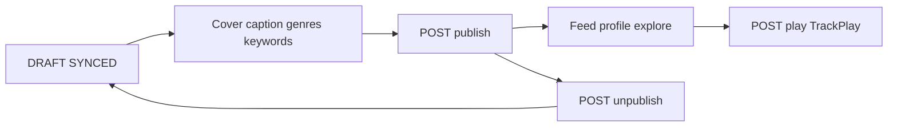

# Publish — Implementation Guide

**Audience:** humans and AI agents implementing this feature end-to-end.  
**Repos:** backend (`audio-social-backend`) + mobile app (`audio-social-app`).  
**Status:** planning doc — schema fields + `TrackPlay` are in `prisma/schema.prisma`; genres live in `src/server/constants/track-genres.ts`. Run migrate + generate after pulling.

**Schema:** Do **not** invent alternate models. Read `prisma/schema.prisma` and `track-genres.ts`. Do not paste full Prisma dumps into PRs.

**Social gate:** Only `PUBLISHED` tracks appear on feed, explore songs, public profile, search songs, and similar surfaces. Playlists/albums may keep rows for unpublished tracks and show **Unavailable**.

---

## 1. Goal

Let the owner:

1. Publish a **SYNCED** draft with cover, caption, description, genres (1–3), keywords (≤5)
2. Expose the **mix only** as the public audio
3. Unpublish (back to `DRAFT`) so social surfaces hide it; playlist/album show Unavailable
4. Record plays via **`TrackPlay`** (with denormalized `playCount`)
5. Keep the track in **Projects** and owner Library whether draft or published



---

## 2. Scope

### In scope

| # | Item |
|---|------|
| 1 | Track publish fields + `TrackPlay` (schema — migrate) |
| 2 | Curated 30 genres (`TRACK_GENRES`), 1–3 per track |
| 3 | Cover upload via **object storage adapter** (Supabase impl now) |
| 4 | `POST publish` / `POST unpublish` |
| 5 | `POST play` → insert `TrackPlay` + bump `playCount` |
| 6 | Public/list queries filter `status = PUBLISHED` |
| 7 | Mobile: publish sheet + unpublish; Library draft/published filters |
| 8 | Keep PATCH track **DRAFT-only** (published frozen) |

### Out of scope

- Editing published tracks in place (must unpublish first)
- Track likes → `docs/library-saves.md` (Liked Songs); comments → `docs/track-comments.md`; OS share only for now
- Feed ranking algorithm (only need “list published” primitives)
- Playlist / album modules (see `docs/playlists-and-albums.md`; Unavailable contract only here)
- Switching cover storage to R2 (adapter ready; creds later)
- Anonymous plays

---

## 3. Locked product decisions

1. Publish requires `storageState === SYNCED` and mix object present.
2. **Unpublish** allowed → `DRAFT`. Keep `publishedAt` as first-published timestamp. Keep cover/caption/genres/keywords for easy re-publish.
3. While `PUBLISHED`: **no** audio or metadata PATCH (frozen). Unpublish → edit → re-backup if audio changed → publish again.
4. Publish payload includes **cover** (required), **caption**, **description**, **genres** (1–3 from curated list), **keywords** (0–5).
5. Plays: **`TrackPlay`** rows + denormalized **`playCount`**.
6. Unpublished: **omit** from feed / explore / public profile / song search. Playlist/album refs → **Unavailable**.
7. Projects may still link the track after publish.
8. Social playback = **mix only** (one finished audio).
9. Cover storage: Supabase path today behind a swappable **object storage** service (R2 later = one impl swap).
10. Genres: Zod/const list of **30** ids — not a Postgres ENUM. Keywords: free text, max 5, normalized lowercase.

---

## 4. Data model (reference only)

Source: `prisma/schema.prisma`.

| Field / model | Role |
|---------------|------|
| `Track.coverPath` | Cover object key |
| `Track.caption` | Short social line |
| `Track.description` | Longer blurb |
| `Track.genres` | `String[]` curated ids (1–3) |
| `Track.keywords` | `String[]` max 5 |
| `Track.publishedAt` | First publish time (keep on unpublish) |
| `Track.playCount` | Cached play total |
| `TrackPlay` | `trackId`, `userId`, `createdAt` |

**Genres:** `src/server/constants/track-genres.ts` (`TRACK_GENRES`, labels, `MAX_TRACK_GENRES = 3`, `MAX_TRACK_KEYWORDS = 5`).

---

## 5. Object storage (cover)

### 5.1 Adapter

Introduce a small interface used by cover upload (and reusable later):

```ts
// conceptual
interface ObjectStorage {
  createSignedUploadUrl(path: string, contentType: string): Promise<{ signedUrl: string; path: string; token?: string }>;
  objectExists(path: string): Promise<boolean>;
  remove(paths: string[]): Promise<void>;
  // display URL or signed GET as needed
}
```

- **v1 impl:** Supabase Storage (existing bucket / same client pattern as track audio)
- **Later:** R2 impl; wire via config — call sites unchanged

### 5.2 Path

`buildCoverPath(userId, trackId, extension)` → `{userId}/tracks/{trackId}/cover.{ext}`  
(`storage-path.ts` + `STORAGE_CONFIG.files.cover`)

### 5.3 Limits

Max **5 MB**; `image/jpeg`, `image/png`, `image/webp`. Aspect: square or near-square for cards (product/UI).

---

## 6. Backend APIs

Auth envelope unchanged.

### 6.1 Cover upload

| Method | Path | Purpose |
|--------|------|---------|
| `POST` | `/api/tracks/:id/cover/upload-url` | Signed PUT + path (owner, any status but typically before publish) |
| `POST` | `/api/tracks/:id/cover/complete` | Verify object, set `coverPath`, delete previous cover if any |
| `DELETE` | `/api/tracks/:id/cover` | Clear `coverPath`, delete object |

While `PUBLISHED`, reject cover changes (frozen) — or only allow via unpublish first.

### 6.2 Publish

`POST /api/tracks/:id/publish`

```ts
{
  caption?: string | null;      // max ~200
  description?: string | null;  // max ~1000
  genres: string[];             // 1–3 from TRACK_GENRES
  keywords?: string[];          // 0–5
}
```

**Guards:**

- Owner
- `status === DRAFT`
- `storageState === SYNCED` + mix exists
- `coverPath` set (complete cover first)
- Validate genres/keywords

**Effect:** set publish fields, `status = PUBLISHED`, `publishedAt = publishedAt ?? now()`.

**Response:** public-ready track DTO (include `coverUrl`, `mixUrl`, `playCount`, genres, etc.).

### 6.3 Unpublish

`POST /api/tracks/:id/unpublish`

- Owner + currently `PUBLISHED`
- `status = DRAFT`
- Do **not** clear cover/caption/description/genres/keywords/`publishedAt`

### 6.4 Record play

`POST /api/tracks/:id/play`

- Auth required
- Track must be `PUBLISHED` (else 404/400)
- Insert `TrackPlay` + `playCount += 1` (transaction)
- Optional anti-spam: ignore if same user played this track within last N minutes (still 200 idempotent)

### 6.5 Public / social reads (primitives)

These power later feed/profile (implement as needed in this slice or immediately after):

- List published by user: `GET /api/users/:id/tracks?status=PUBLISHED` (or extend public profile)
- Owner library already can `GET /api/tracks?status=`

Unpublished tracks must **not** appear in public list endpoints.

### 6.6 Owner update

Existing `PATCH /api/tracks/:id` remains **DRAFT only**.

---

## 7. Visibility matrix

| Surface | PUBLISHED | Unpublished / DRAFT |
|---------|-----------|---------------------|
| Owner Library | Yes | Yes |
| Projects | Yes | Yes |
| Feed / Explore / public profile / song search | Yes | **Hidden** |
| Playlist / album item | Playable | **Unavailable** UI |

---

## 8. Backend code map

| Area | Path |
|------|------|
| Genres | `src/server/constants/track-genres.ts` |
| Cover path | `storage-path.ts` / `storage.config.ts` |
| Object storage adapter | e.g. `src/server/lib/object-storage/` (`supabase` impl) |
| Publish / play | extend `track.service.ts` or `publish.service.ts` |
| Routes | `src/app/api/tracks/[id]/publish`, `unpublish`, `play`, `cover/...` |
| OpenAPI | `tracks.paths.ts` + schemas |

### Backend implement order

1. Migrate + generate (publish migration)
2. Object storage adapter + cover upload/complete/delete
3. Publish / unpublish
4. Play + `TrackPlay` / `playCount`
5. Public published list hook for profile (minimal)
6. OpenAPI + unit tests (guards: not synced, missing cover, frozen patch)

---

## 9. Mobile app

1. Library: Publish action on SYNCED drafts → sheet (cover, caption, description, genres chips, keywords)
2. Unpublish confirm on published items
3. After play in feed/profile (when those exist): call play once per session
4. Playlist/album (later): Unavailable for non-published ids
5. Do not allow editor save/PATCH while published — prompt to unpublish

---

## 10. Genre list (30)

Ids in `TRACK_GENRES` (labels in `TRACK_GENRE_LABELS`):

pop, hip_hop_rap, rnb_soul, electronic_edm, rock, indie, folk, jazz, western_classical, ambient_lofi, metal, soundtrack, experimental, bollywood_filmi, indie_indian, hindustani_classical, carnatic_classical, devotional, ghazal, sufi, punjabi_bhangra, desi_hip_hop, indian_fusion, tamil, telugu, malayalam, kannada, bengali, marathi, gujarati

Select **1–3** per publish.

---

## 11. Task list (implement in this order)

1. [x] Prisma publish fields + `TrackPlay` in schema
2. [x] `track-genres.ts` + cover path helpers
3. [x] Migration `20261104183000_track_publish_fields` applied + `prisma generate`
4. [ ] Object storage adapter (Supabase) + cover APIs
5. [ ] Publish / unpublish endpoints
6. [ ] Play endpoint (`TrackPlay` + `playCount`)
7. [ ] OpenAPI + tests for guards
8. [ ] Mobile publish / unpublish UI
9. [ ] Wire public published lists when building feed/profile

---

## 12. Non-goals reminder

- No in-place edit of published audio  
- No feed algorithm in this slice  
- No R2 until credentials — keep adapter boundary clean  
- Playlist/album full modules come after this contract exists  
